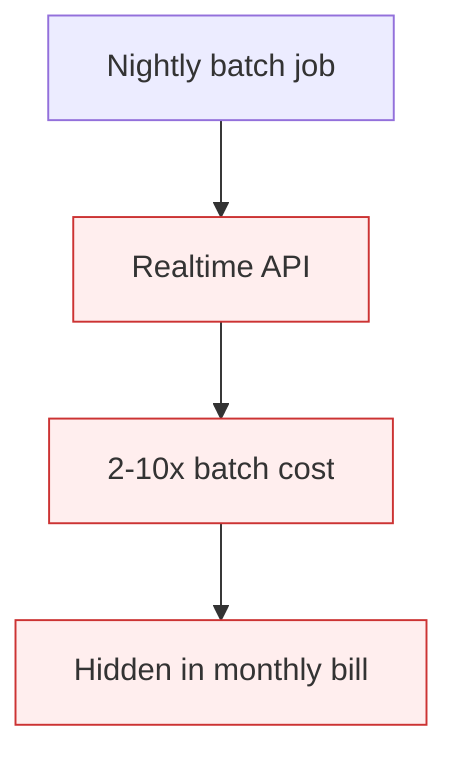

# Realtime API When Batchable

**Also known as:** Synchronous API for Batch Workload, Premium API for Async Work

**Category:** Anti-Patterns  
**Status in practice:** deprecated

## Intent

Anti-pattern: use the realtime/synchronous model API for workloads whose latency budget would permit batching, paying 2–10× the unit cost for no user-visible benefit.

## Context

A backend job processes documents, generates embeddings, summarizes records, or runs nightly analyses. The user sees the result hours later — no human is waiting on each call. The team uses the realtime synchronous API because it was the first one their SDK exposed.

## Problem

Realtime API pricing is 2–10× the batch tier on every major provider. For workloads where latency could be 1h or 24h, this is pure overspend. The team often is not aware the batch API exists, or rejected it early as 'complex'. Cost shows up as a flat line in the bill: '$N per million tokens' instead of 'half of $N per million tokens'.

## Forces

- Realtime is the default API in most SDKs.
- Batch APIs require restructuring the job to submit-and-poll.
- Engineers default to the API they know rather than the one that matches the latency budget.

## Therefore

Therefore: classify every model-using workload by latency budget; if the budget exceeds the batch SLA (typically <24h), use the batch endpoint, not the realtime one.

## Solution

Identify model calls whose results are consumed asynchronously. Submit them via the provider's batch API (50% cheaper at OpenAI, similar at Anthropic). Poll or webhook for completion. Reserve realtime for genuinely user-facing or sub-minute-latency workloads. Track 'realtime calls without realtime latency requirement' as a metric in cost-observability.

## Structure

```
Anti-pattern: Async-consumed workload -> realtime API -> full unit price for no user benefit. Corrected: Classify latency budget -> async calls via batch API (poll or webhook) ; user-facing calls via realtime -> track realtime-without-need metric.
```

## Diagram



## Example scenario

A nightly job re-embeds 2M product descriptions. Runs through the realtime embeddings endpoint. Costs $4k/month. The same work via the batch endpoint with a 24h SLA costs $2k/month. The team only discovers when a cost-review asks why embedding cost grew with the catalog.

## Consequences

**Benefits**

- Short-term: the realtime API is already wired up, and results arrive at once with no polling code.
- Naming it lets a team audit each call site for its real latency budget.

**Liabilities**

- 2–10× overspend on workloads whose latency would permit batching.
- Bill is opaque to the failure mode — looks like normal usage, not waste.
- Pressure to fix only comes from budget reviews, not from any technical signal.

## Failure modes

- Paying for speed nobody uses — overnight report jobs run on the realtime API at full price.
- Unknown batch tier — the team does not know a batch API exists, or wrote it off early as too complex.
- Normal-looking waste — the bill shows ordinary usage, so nothing flags the overspend.
- Budget-only trigger — the problem is found only in a budget review, never by a technical signal.

## What this pattern constrains

No useful constraint; the missing constraint is latency-budget-aware API selection.

## Applicability

**Use when**

- Never. Cite when reviewing async jobs that use realtime APIs.
- Classify workloads by latency budget and route to batch where the budget allows.
- Track 'realtime calls without realtime SLA need' as a cost-waste metric.

**Do not use when**

- Any model-using batch job using the realtime endpoint.
- Any nightly or hourly pipeline that does not need sub-minute latency.
- Any team without per-job latency-budget classification.

## Components

- Async workload — does not need sub-minute latency
- Realtime API endpoint — 2-10x batch pricing
- Missing latency-budget classifier — would route to batch
- Missing batch submission plumbing — submit/poll/webhook

## Tools

- Detection signal — monitors or audits that surface this anti-pattern in the wild
- Mitigation pattern infrastructure — the positive pattern that resolves this anti-pattern
- Incident-response playbook — what to do when the anti-pattern fires

## Evaluation metrics

- Incident rate — occurrences per period
- Mean time to detection — how long the anti-pattern runs unobserved
- Cost / damage per incident — measurable impact of each occurrence

## Known uses

- **[Zenn: 7つのLLM APIコスト削減アンチパターン](https://zenn.dev/kei_concierge/articles/llm-api-cost-antipatterns-2026)** _available_

## Related patterns

- _complements_ **Cost Observability**
- _complements_ **Cost Gating**
- _complements_ **Top-Tier Model For Everything (Cost)**
- _complements_ **Prompt Caching**
- _complements_ **Tool Result Caching**

## References

- [LLM APIコスト削減の落とし穴](https://zenn.dev/kei_concierge/articles/llm-api-cost-antipatterns-2026) — 2026
