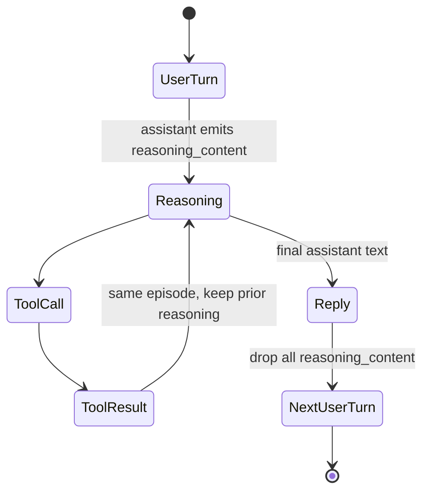

# Reasoning Trace Carry-Forward

**Also known as:** Reasoning Content Episode, CoT Carry Across Tool Calls, Episode-Bound Reasoning

**Category:** Memory  
**Status in practice:** emerging

## Intent

For reasoning models that emit a separate reasoning trace, preserve that trace in context across the same logical task episode (across tool-call/result turns) but drop it at user-turn boundaries.

## Context

A team is using a reasoning-capable model (for example one of the OpenAI o-series, Claude with extended thinking, or DeepSeek-R1) that returns the model's chain-of-thought in a separate reasoning_content field, distinct from the user-visible content. The agent runs in a tool-use loop with multi-turn history: the model reasons, calls a tool, sees the result, reasons again, possibly answers, and then a new user message starts the next turn.

## Problem

Two failure modes pull in opposite directions. If the reasoning trace is dropped between a tool call and its result, the model loses the thread of why it called the tool in the first place, and the next reasoning step starts from a degraded context. If the reasoning trace is instead preserved across user-turn boundaries, conversation history bloats with stale reasoning from earlier tasks and the next user message inherits irrelevant prior thinking that pollutes its own reasoning. Neither 'always carry forward' nor 'always drop' is correct; the team needs a rule keyed to where in the loop the trace appears.

## Forces

- Reasoning trace is the bridge between tool-call intent and post-tool-result interpretation.
- Reasoning trace is private intermediate state, not conversational record.
- Tokens are expensive; preserving traces forever costs money.
- Stale reasoning leaks bias into the next task.

## Therefore

Therefore: preserve assistant reasoning_content across tool turns within a single user-to-user episode and drop it at the next user boundary, so that tool calls and their interpretations stay coherent without leaking stale reasoning into the next task.

## Solution

Define an episode as: from one user turn to the next user turn (inclusive of all intervening tool calls and tool results). Within an episode, preserve assistant reasoning_content as part of the context concatenation across all turns. At the next user turn boundary, drop reasoning_content from prior episodes (the API silently ignores it when passed across boundaries). The user-visible content remains in history; only the reasoning trace is episode-scoped.

## Structure

```
User -> [reasoning + tool_call] -> tool_result -> [reasoning + tool_call] -> tool_result -> [reasoning + final_content] -> User. Within episode: preserve reasoning. Across episodes: drop reasoning, keep content.
```

## Diagram



## Example scenario

An agent built on a reasoning model debugs flaky CI by calling a log-fetch tool. Without trace carry-forward, the model emits its hidden reasoning, calls the tool, then on the result turn the reasoning is dropped and it forgets why it asked for those logs and re-derives from scratch, sometimes incorrectly. The team scopes an episode from one user turn to the next and preserves reasoning_content across all intervening tool calls, dropping it only at the next user turn. Tool-result interpretations stop drifting and token usage stays bounded.

## Consequences

**Benefits**

- Tool-using episodes get the benefit of CoT continuity.
- Multi-turn dialogues do not accumulate stale reasoning.
- Cheaper than naive reasoning-trace preservation forever.

**Liabilities**

- Episode boundary detection has to be encoded in the agent loop, not the model.
- If the model expects its own past reasoning at a later turn, dropping it breaks that.
- Provider-specific (DeepSeek-style reasoning_content); needs adaptation per API.

## Failure modes

- Misplaced boundary — the loop treats a tool result as a new user turn, drops the reasoning, and the next step forgets why the tool was called.
- Boundary leak — prior-episode reasoning is passed along at a user turn, and the new task inherits stale thinking.
- Expected reasoning gone — a later turn refers back to a past decision whose reasoning was dropped, and the model reconstructs it wrongly.
- Provider mismatch — the carry-forward rule is ported to another API that handles the reasoning field differently, and traces are lost or rejected.

## What this pattern constrains

Internal reasoning content may not cross user-task boundaries; only user-visible content persists in conversation history.

## Applicability

**Use when**

- The model is a reasoning model that emits a separate reasoning trace.
- Within an episode (one user turn through tool calls and results), reasoning context must persist.
- Reasoning traces should be dropped at user-turn boundaries to avoid stale carryover.

**Do not use when**

- The model does not produce a separable reasoning trace.
- The provider already manages reasoning persistence across turns automatically.
- Stateless single-turn use cases that do not span tool-call cycles.

## Components

- Reasoning-capable model — emits user-visible content and a separable reasoning_content field per assistant turn
- Episode boundary detector — agent-loop rule that marks each user turn as the start of a new episode
- Context concatenator — assembles the next call's history, including or excluding reasoning_content per the episode rule
- Reasoning store (in-memory) — holds episode-local reasoning_content until the next user-turn boundary drops it
- Provider adapter — translates the rule to the specific API (DeepSeek reasoning_content, Anthropic thinking blocks, o-series)

## Tools

- Reasoning-model API — DeepSeek thinking mode, Anthropic extended thinking, or OpenAI o-series with reasoning surfaces
- Tokeniser — used to budget the additional cost of carrying reasoning across tool turns

## Evaluation metrics

- Tool-result interpretation accuracy — correctness of the post-tool reasoning step with vs without carry-forward
- Cross-episode contamination rate — sampled cases where prior-episode reasoning leaked into a new user task
- Reasoning-token cost per episode — additional tokens consumed by carrying reasoning across tool turns
- Boundary-detection precision — fraction of user-turn boundaries the loop correctly identifies for the drop step
- Provider portability — pass rate of the same agent loop across reasoning APIs from different vendors

## Known uses

- **[DeepSeek API (thinking mode)](https://api-docs.deepseek.com/guides/thinking_mode)** _available_ — Documented behaviour: pass reasoning_content back across tool-call turns; drop it across user turns.

## Related patterns

- _complements_ **Extended Thinking**
- _uses_ **Context Window Packing**
- _specialises_ **Short-Term Thread Memory**
- _complements_ **Prompt Caching**
- _complements_ **Trajectory-Summary Test-Time Scaling** — Carry-forward keeps a single trace within an episode; this carries a summary of a whole rollout across attempts for sequential scaling.

## References

- [DeepSeek API: Thinking Mode](https://api-docs.deepseek.com/guides/thinking_mode)
- [DeepSeek-V3 Technical Report](https://arxiv.org/abs/2412.19437) — DeepSeek-AI, 2024
