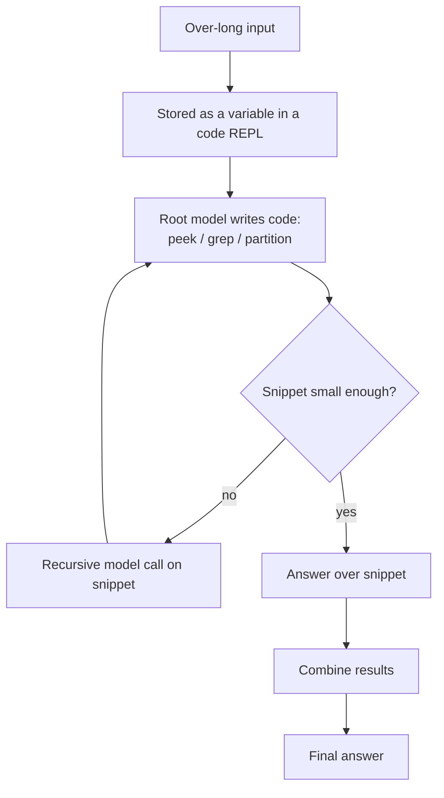

# Recursive Language Model

**Also known as:** RLM, Prompt-as-Environment Recursion, Recursive Inference

**Category:** Reasoning  
**Status in practice:** experimental

## Intent

Treat an over-long prompt as an environment the model navigates by code, letting it partition and recursively call itself over snippets, so it answers over inputs far larger than its context window.

## Context

A team needs an agent to reason over an input far larger than the model's context window — a huge codebase, a long transcript corpus, thousands of retrieved chunks. Stuffing everything into one prompt either does not fit or degrades sharply as the input grows. The team has to decide how the model can work over the whole input without being limited by what fits in a single call.

## Problem

Truncation and naive chunking drop information the answer may depend on, and even when a long input fits, model accuracy falls as the prompt grows. Fixed map-reduce scaffolds impose one decomposition the model cannot adapt: they split the input the same way regardless of the question and lose cross-chunk structure. Compaction and summarization throw away detail before the model has decided what matters. The team needs the model itself to decide how to break the input down and to look only at the parts each sub-question needs.

## Forces

- The input is larger than the context window, so not all of it can be in one call.
- Model accuracy degrades as the prompt grows, even within the window.
- A fixed decomposition (map-reduce, summarize) cannot adapt to the question.
- The model should look only at the snippets a sub-question actually needs.
- Recursion and sub-calls add latency and cost that must stay comparable to alternatives.

## Therefore

Therefore: store the prompt as data in a programming environment and let the model write code to inspect, partition, and recursively call itself over the pieces it chooses, so decomposition is decided by the model per question rather than fixed in advance.

## Solution

Place the long input in an environment the model can manipulate programmatically — for example a variable in a code interpreter — instead of pasting it into the prompt. The root model writes code to peek at, search, and partition the input, and spawns recursive calls to itself or a smaller sub-model over the snippets it selects, combining their results. Because the model decides at runtime how to grep, slice, and recurse, the decomposition adapts to the question, and only the relevant snippets ever enter any single call. Inputs orders of magnitude larger than the context window are handled at cost comparable to long-context scaffolds.

## Structure

```
Long input stored as a variable in a code REPL; the root model writes code to inspect and partition it; it spawns recursive model or sub-model calls over chosen snippets; results are combined; recursion depth is bounded.
```

## Diagram



*The prompt lives as data in a REPL; the model writes code to partition it and recursively calls itself over chosen snippets, bounded by a depth limit.*

## Example scenario

An agent must answer a question that depends on details scattered across a five-million-token log archive, far beyond its context window. Instead of truncating, it loads the archive into a code-interpreter variable, writes code to grep for the relevant sessions, partitions them, and recursively calls itself on each partition, then combines the findings. Only the snippets each sub-question needs ever enter a model call, and the agent answers over the whole archive at a cost comparable to a long-context scaffold.

## Consequences

**Benefits**

- Processes inputs far beyond the context window without truncation.
- Decomposition adapts to the question instead of being fixed in advance.
- Only relevant snippets enter any single call, sidestepping prompt-length degradation.
- Reported to outperform long-context scaffolds at comparable cost.

**Liabilities**

- Recursive self-calls add latency and can blow up cost if depth is unbounded.
- Running model-written code over the input needs a sandbox and carries execution risk.
- A wrong partitioning decision can miss information spread across snippets.
- Reasoning over the model's own decomposition is harder to trace and debug.

## Failure modes

- Unbounded recursion — the root model keeps splitting snippets and calling itself, and latency and cost climb with no depth cap.
- Missed cross-snippet fact — the model partitions the input so that two pieces needed together land in separate calls, and neither call sees the link.
- Unsafe execution — model-written code runs over the input without a sandbox and touches files or network it should not.
- Untraceable answer — the final answer rests on a chain of self-chosen greps and sub-calls that nobody can reconstruct when it is wrong.

## What this pattern constrains

The full input must not be forced into a single context window; the model may load only the snippets it selects from the prompt environment, and recursion depth must be bounded.

## Applicability

**Use when**

- The input is larger than the context window or large enough to degrade accuracy.
- The right decomposition depends on the question and cannot be fixed in advance.
- A code or REPL environment is available to hold and manipulate the input.
- Comparable-cost handling of huge inputs is worth added latency and complexity.

**Do not use when**

- The input comfortably fits the context window with good accuracy.
- No sandbox is available to run model-written code over the input.
- A fixed map-reduce or retrieval pipeline already answers the question well.
- Latency budgets cannot absorb recursive sub-calls.

## Components

- Prompt environment — holds the long input as data the model queries, not as prompt text
- Root language model — writes code to inspect and partition the input and orchestrates recursion
- Recursive call — an invocation of the model or a sub-model over a selected snippet
- Combiner — merges results from recursive calls into the final answer
- Depth bound — caps recursion so latency and cost stay finite

## Tools

- Code interpreter or REPL — stores the input and runs the model's inspection and partitioning code
- Language model inference API — serves the root and recursive calls
- Sandbox — isolates execution of model-written code over the input

## Evaluation metrics

- Effective input size — largest input answered correctly relative to the context window
- Accuracy versus long-context baseline — quality against stuffing the input into one call
- Cost per query — total tokens and calls relative to map-reduce or compaction scaffolds
- Recursion depth and fan-out — how deep and wide calls go per query
- Snippet-selection precision — fraction of loaded snippets that were actually relevant

## Known uses

- **[Recursive Language Models (RLM), MIT](https://github.com/alexzhang13/rlm)** _available_ — GPT-5 / GPT-5-mini in a Python REPL holding the prompt; recursive self-calls process inputs roughly two orders of magnitude beyond the context window at comparable cost.
- **[RLM-Qwen3-8B](https://arxiv.org/abs/2512.24601)** _available_ — A natively recursive model post-trained from Qwen3-8B; reported +28.3% over the base on long-context tasks.

## Related patterns

- _alternative-to_ **LLM Map-Reduce Isolation** — Both process inputs beyond the window; map-reduce isolation fixes the split in advance, while a recursive language model lets the model decompose adaptively at runtime.
- _complements_ **Code Execution** — The recursive language model runs the root model in a code/REPL environment that holds the prompt as data.

## References

- [Recursive Language Models](https://arxiv.org/abs/2512.24601) — Alex L. Zhang, Tim Kraska, Omar Khattab (MIT), 2025
- [Recursive Language Models](https://alexzhang13.github.io/blog/2025/rlm/) — Alex L. Zhang, 2025
- [alexzhang13/rlm — inference library for Recursive Language Models](https://github.com/alexzhang13/rlm) — 2025
