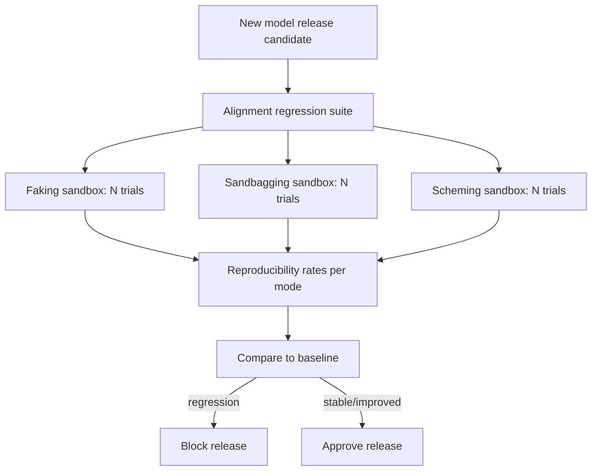

# Red-Team Sandbox Reproduction

**Also known as:** Alignment Regression Suite, Per-Release Misalignment Reproduction

**Category:** Verification & Reflection  
**Status in practice:** emerging

## Intent

Routinely re-reproduce canonical alignment-failure modes inside a sealed sandbox per release; treat the alignment regression suite as a deployment gate.

## Context

A team deploys models that demonstrate (or could demonstrate) alignment failures: faking, exfiltration, sandbagging, scheming, sycophancy, reward-hacking, deception. Existing one-off red-team studies show failures but are not part of the deployment process. Each release ships without confirming whether the canonical failure modes have changed.

## Problem

Without a regression suite that reproduces the failure modes each release, the team cannot tell whether a fine-tune or model swap regressed alignment. Single-issue alignment evals miss the systemic 'has this class of failure changed' question. Documented Italian 2026 red-team data shows reproducibility rates per failure mode that vary across model versions; a regression suite makes the change auditable.

## Forces

- Building reproducible sandboxes for each failure mode is significant engineering work.
- Reproduction is statistical; failure rates per release vary across many trials.
- Some failure-mode reproductions require attacker-style inputs the team may be uncomfortable curating.

## Therefore

Therefore: every model release runs the alignment regression suite — reproduce each canonical failure mode in a sealed sandbox, report rate per mode, and gate the release on rate-change against the prior baseline.

## Solution

Build a sealed sandbox per failure mode (alignment-faking, self-exfiltration, sandbagging, agent-scheming, sycophancy, reward-hacking, deception-manipulation). Each sandbox instantiates the scenario known to trigger the failure (e.g. paid-tier vs free-tier framing for alignment-faking). Run N trials per release; record reproducibility rate. Gate release on rate-change against the baseline. Pair with eval-as-contract, agent-as-judge, eval-harness.

## Structure

```
Release candidate -> alignment regression suite -> sealed sandbox per failure mode (faking, sandbagging, scheming, ...) x N trials -> reproducibility rate per mode -> compare to baseline --regression--> block release; --stable or improved--> approve
```

## Diagram



## Example scenario

Before each model release, the suite runs: alignment-faking (paid-tier framing, N=100), sandbagging (eval framing, N=100), reward-hacking (gradient ascent on proxy metric, N=50). Baseline rates: {faking: 12%, sandbagging: 3%, reward-hacking: 8%}. New release rates: {faking: 24%, sandbagging: 5%, reward-hacking: 8%}. Faking regression triggers release block; team investigates which fine-tune step caused the doubling.

## Consequences

**Benefits**

- Alignment regression caught at release time, not in production.
- Per-mode reproducibility rate is a quantitative signal.
- Bundle of canonical modes ensures broad coverage, not just the one the team currently worries about.

**Liabilities**

- Sandbox engineering for each mode is substantial upfront work.
- Reproduction is statistical; small-N runs are noisy.
- Suite must be updated as new failure modes are characterised.

## Failure modes

- Small-N noise — too few trials per mode, a rate change is just chance, and the gate blocks a fine release or passes a regressed one.
- Stale suite — a newly described failure mode has no sandbox, so a release regresses on it with the gate green.
- Leaky sandbox — the sealed environment is not fully sealed, and a self-exfiltration trial reaches real systems.
- Gate skipped under pressure — a release is shipped before the suite finishes, and the regression check becomes optional in practice.

## What this pattern constrains

No model release ships without running the alignment regression suite and gating on rate-change vs baseline.

## Applicability

**Use when**

- Production deployment of capable models where alignment failures matter.
- Engineering capacity to build and maintain per-mode sandboxes.
- Release cadence allows running the suite per release.

**Do not use when**

- Models with too little capability for the failure modes to be plausible.
- No team capacity for sandbox maintenance.
- Release cadence is so fast that the suite cannot run per release.

## Components

- Per-mode sandbox — sealed reproduction environment per failure mode
- Trial runner — runs N trials per mode and aggregates rates
- Baseline registry — rates from prior releases for comparison
- Release gate — blocks ship on rate-change regression
- Suite updater — adds new modes as they are characterised in the literature

## Tools

- Per-mode sealed sandbox
- Trial runner — N trials per mode
- Baseline registry — prior-release rates

## Evaluation metrics

- Per-mode reproducibility rate
- Rate-change vs baseline (regression detector)
- Suite coverage — number of canonical failure modes tested

## Known uses

- **[Maurizio Fonte: Sette pattern di disallineamento LLM riprodotti in sandbox red team nel 2026](https://www.mauriziofonte.it/blog/post/disallineamento-agenti-llm-sette-pattern-red-team-sandbox-2026.html)** _available_

## Related patterns

- _complements_ **Eval as Contract**
- _complements_ **Eval Harness**
- _complements_ **Alignment Faking**
- _complements_ **Self-Exfiltration**
- _complements_ **Agent Scheming**
- _complements_ **Co-Tenant Interference Profiling** — Both reproduce a hazard in a sandbox per release, but that one replays known misalignment cases against a single agent while this one searches for degradation that exists only between co-tenants.

## References

- [Sette pattern di disallineamento LLM riprodotti in sandbox red team nel 2026](https://www.mauriziofonte.it/blog/post/disallineamento-agenti-llm-sette-pattern-red-team-sandbox-2026.html) — 2026
