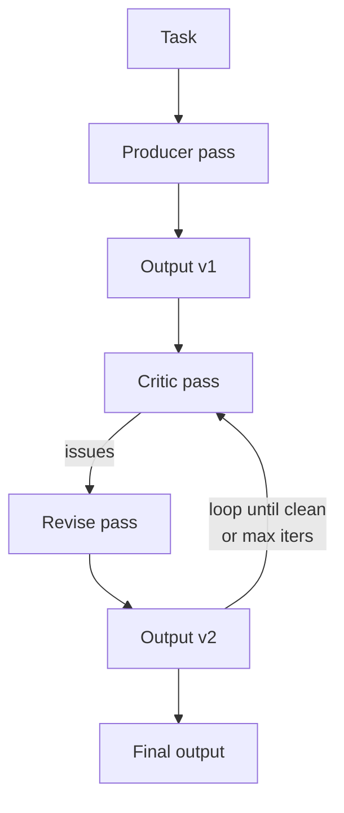

# Reflection

**Also known as:** Self-Critique, Single-Pass Self-Review

**Category:** Verification & Reflection  
**Status in practice:** mature

## Intent

Have the model review its own output and produce a revised version in one or more passes.

## Context

A team runs a large language model on a generation task (drafting an email, writing a function, composing a press release) where the first-pass output usually contains errors that a careful second read would catch: a missing edge case, a clumsy phrase, a factual slip. Latency and cost budgets allow at least one extra model call per output. The team is not asking for deep correctness verification, just a 'look it over' pass before shipping.

## Problem

One-shot generation underuses the model in a specific way: the model has the ability to spot its own surface errors when it is asked to look at a finished draft, but in a single forward pass it commits to tokens without the opportunity to review what it has written. Without a separate critique step, obvious local mistakes ship even when the model could have caught them. A naive free-form critique pass helps a little but invents new criteria on each call, so reviews are inconsistent, and after one or two iterations the same model just starts approving its own work. The team needs structure around the critique step to make it actually catch errors instead of rubber-stamping.

## Forces

- Same-model self-critique misses correlated blind spots.
- Free-form review drifts; the model invents new criteria each time.
- Termination: when does the loop stop?

## Therefore

Therefore: have the model critique its own draft against named criteria and produce a revision pass, so that obvious local errors are caught before the output leaves the agent.

## Solution

After producing an output, the model is prompted (often as a critic persona) to find issues. The original output and critique go back into a revision step. Repeat until a stop condition (no new issues, max iterations).

## Structure

```
Task -> producer pass -> output v1 -> critic pass (fixed criteria) --issues--> revise pass -> output v2 -> critic again ... until no new issues or max iterations -> final output
```

## Diagram



## Example scenario

A drafting agent writes a press release in one shot; legal flags two compliance issues post-hoc. The team adds a critic pass: after the first draft, the same model is prompted as a compliance reviewer to list concrete issues, then a third pass rewrites against that critique. With one extra round-trip, most legal-flag issues are caught before legal sees the draft. The team caps it at two reflection passes to control cost.

## Consequences

**Benefits**

- Catches surface errors cheaply.
- Pairs naturally with structured outputs.

**Liabilities**

- Diminishing returns after one or two passes.
- Self-reinforced confidence on wrong answers (Reflexion replication studies).

## Failure modes

- Self-approval — after a pass or two the same model signs off on its own draft, and remaining errors ship with added confidence.
- Wrong answer reinforced — the critique argues for the original mistake, and the revision states it more firmly.
- Criteria drift — the critic invents new criteria each call, so the loop rewrites style while a factual error stays.
- Pointless extra passes — iterations past the first one or two add cost without finding new issues.

## What this pattern constrains

The reviewer may only critique against criteria fixed by the surrounding system; free-form criteria invention is forbidden when the pattern is used at a correctness boundary.

## Applicability

**Use when**

- One-shot generation underuses the model and a critique pass would catch errors.
- A critic prompt can identify issues meaningfully on the task's outputs.
- Stop conditions (no new issues, max iterations) can be defined.

**Do not use when**

- The model already produces correct outputs in one pass.
- Latency or cost cannot accommodate extra revision rounds.
- Self-critique at this scale is unreliable and just rationalises errors.

## Components

- Producer — LLM that drafts the initial output
- Critic persona — same or different model invoked to list concrete issues
- Reviser — pass that rewrites the draft against the critic's findings
- Stop-condition controller — terminates on no-new-issues or max-iteration cap
- Named-criteria spec — explicit list the critic must score against to avoid drift

## Tools

- LLM API — at least two calls per pass (critic and revise), optionally a third for the draft
- Diff or structured-feedback channel — carries issue list from critic into reviser

## Evaluation metrics

- Surface-defect catch rate — share of obvious errors the critic surfaces on pass 2
- Quality lift per iteration — slope of quality vs pass number, identifying the elbow
- Self-reinforced confidence rate — share of wrong outputs the critic wrongly endorses
- Termination distribution — how often the loop stops on clean vs hits the iteration cap
- Cost overhead per shipped output — extra tokens the critic and revise passes add

## Known uses

- **Knitting-DSL Pipeline (Stash2Go)** _available_ — scopedLlmReviewer.js runs a frozen 6-item rubric.
- **Self-Refine paper** _available_

## Related patterns

- _generalises_ **Frozen Rubric Reflection**
- _specialises_ **Evaluator-Optimizer**
- _generalises_ **Reflexion**
- _used-by_ **Agentic RAG**
- _generalises_ **Chain of Verification**
- _generalises_ **Self-Refine**
- _alternative-to_ **Same-Model Self-Critique**
- _generalises_ **Tool-Augmented Self-Correction**
- _used-by_ **Self-RAG**
- _complements_ **Commitment Tracking**
- _generalises_ **Cross-Reflection**
- _generalises_ **Generator-Critic Separation**
- _generalises_ **Human Reflection**

## References

- [Self-Refine: Iterative Refinement with Self-Feedback](https://arxiv.org/abs/2303.17651) — Madaan et al., 2023
- [Agent design pattern catalogue: A collection of architectural patterns for foundation model based agents](https://doi.org/10.1016/j.jss.2024.112278) — Yue Liu, Sin Kit Lo, Qinghua Lu, Liming Zhu, Dehai Zhao, Xiwei Xu, Stefan Harrer, Jon Whittle, 2025
- [The Reflective Practitioner: How Professionals Think in Action](https://archive.org/details/reflectivepracti0000scho) — Donald A. Schön, 1983
- [Metacognition and Cognitive Monitoring: A New Area of Cognitive-Developmental Inquiry](https://doi.org/10.1037/0003-066X.34.10.906) — John H. Flavell, 1979
