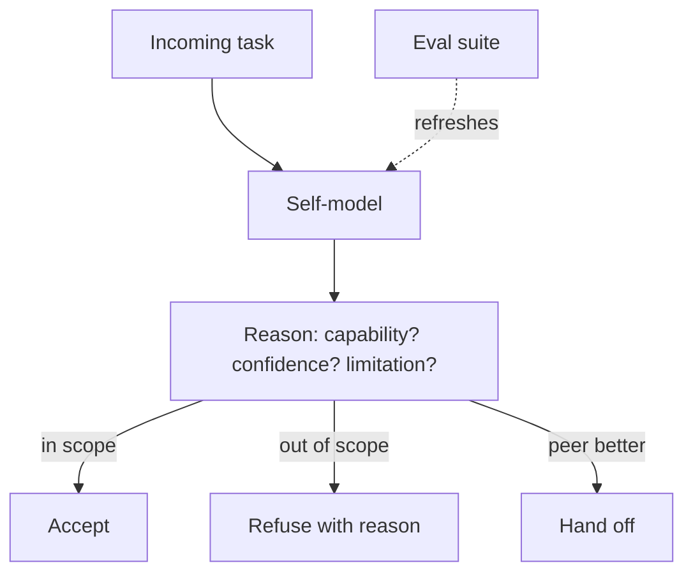

# Reflexive Metacognitive Agent

**Also known as:** Self-Model Agent, Capability-Aware Agent

**Category:** Cognition & Introspection  
**Status in practice:** experimental

## Intent

Agent maintains an explicit self-model of its own capabilities, confidence and limitations, and reasons over that model when accepting / refusing / handing off tasks.

## Context

A team has an agent. The default agent accepts whatever task it is given and proceeds. There is no explicit self-model — the agent does not represent 'what I am good at' or 'what I should refuse'.

## Problem

Without an explicit self-model, the agent has no principled way to refuse tasks outside its competence or hand off to a more suitable peer. Refusals are ad-hoc, based on prompt-level instructions that are inconsistent across calls. Differs from confidence-reporting (which is per-output) by making the self-model an *input* to decision-making, not just an output.

## Forces

- Maintaining an explicit self-model requires upfront capability characterization.
- Self-model drift — the agent's actual capabilities change with model updates.
- Reasoning over a self-model adds a step to every decision.

## Therefore

Therefore: the agent carries an explicit, structured self-model (capabilities, confidence calibrations, declared limitations); decision logic reasons over the self-model before accepting a task — accept, refuse, or hand off.

## Solution

Self-model is a structured artifact: {capabilities: [...], confidence-by-task-class: {...}, declared-limitations: [...]}. At task acceptance, agent reasons over self-model: does this task fall in my capabilities? what's my confidence for this class? are any declared limitations triggered? Output: accept / refuse-with-reason / handoff-to-peer-with-capability-X. Self-model refreshed periodically against eval-suite results. Pair with confidence-reporting, decentralized-swarm-handoff, refusal, typed-refusal-codes.

## Structure

```
Incoming task --> Self-model {capabilities, confidence by task class, declared limitations} --> reason: in capability? confidence? limitation triggered? --> {accept | refuse with reason | hand off to peer with capability X}; Eval suite -.periodic refresh.-> Self-model
```

## Diagram



## Example scenario

A research agent's self-model: {capabilities: [literature-search, summarization], confidence: {medical-research: 0.6, legal-research: 0.3}, limitations: [no-citation-verification]}. Asked a legal-research question, the agent consults self-model, sees 0.3 confidence, refuses-with-reason and hands off to a legal-specialist peer. Without self-model, the agent would have attempted and produced low-quality output.

## Consequences

**Benefits**

- Principled refusals and handoffs based on declared self-model.
- Self-model as a versionable artifact, not implicit prompt behavior.
- Eval-driven self-model updates — agent's known capabilities track measured reality.

**Liabilities**

- Upfront capability characterization is work.
- Self-model drift if not refreshed against evals.
- Reasoning over self-model adds a step to every task-acceptance.

## Failure modes

- Stale self-model — the model behind the agent is upgraded, but the self-model is not refreshed against evals, so the agent refuses tasks it can now handle.
- Overconfident class — confidence for a task class is set from a narrow eval, and the agent accepts work it will fail.
- Bypassed check — a fast path accepts tasks without consulting the self-model, and refusals become ad-hoc again.
- Handoff to nowhere — the agent hands off to a peer with capability X that does not exist or is not reachable.

## What this pattern constrains

The agent does not accept tasks without consulting its self-model; the self-model is an explicit artifact, not implicit prompt behavior.

## Applicability

**Use when**

- Agent operates in a domain where competence boundaries are clear.
- Handoff to peer agents is feasible.
- Eval suite can refresh self-model periodically.

**Do not use when**

- Single general-purpose agent with no peers to hand off to.
- Capability boundaries are not characterizable.
- No eval suite to refresh self-model.

## Components

- Self-model artifact — structured capability/confidence/limitation record
- Self-model reasoner — decides accept/refuse/handoff
- Refusal-with-reason emitter — structured refusal output
- Handoff mechanism — to peer with matching capability
- Self-model refresher — eval-driven updates

## Tools

- Self-model artifact (capability/confidence/limitation registry)
- Self-model reasoner
- Refusal/handoff emitter

## Evaluation metrics

- Refusal rate — out-of-scope task detection
- Handoff success rate to capable peer
- Self-model accuracy — eval-measured vs declared capability

## Known uses

- **[Joakim Vivas: 17 Patrones de Arquitecturas Agénticas de IA (Reflexive Metacognitive)](https://www.joakimvivas.com/tech/17-patrones-arquitecturas-agenticas-ia/)** _available_

## Related patterns

- _complements_ **Confidence Reporting**
- _complements_ **Decentralized Swarm Handoff**
- _complements_ **Refusal**
- _complements_ **Typed Refusal Codes**
- _specialises_ **Awareness**
- _complements_ **Subject-First Agent Architecture (ENA Stateful Core)**
- _alternative-to_ **False Confidence Syndrome**
- _complements_ **Confidence-Checking Workflow**
- _alternative-to_ **Over-Helpfulness** — An explicit self-model lets the agent consult its own capabilities before accepting a task, removing the answer-anyway default.
- _complements_ **Advisor Consult** — The advisor's value depends on the executor knowing when it is out of its depth; an explicit self-model of competence gives it a better trigger than a nudge.

## References

- [17 Patrones de Arquitecturas Agénticas de IA](https://www.joakimvivas.com/tech/17-patrones-arquitecturas-agenticas-ia/) — 2026
