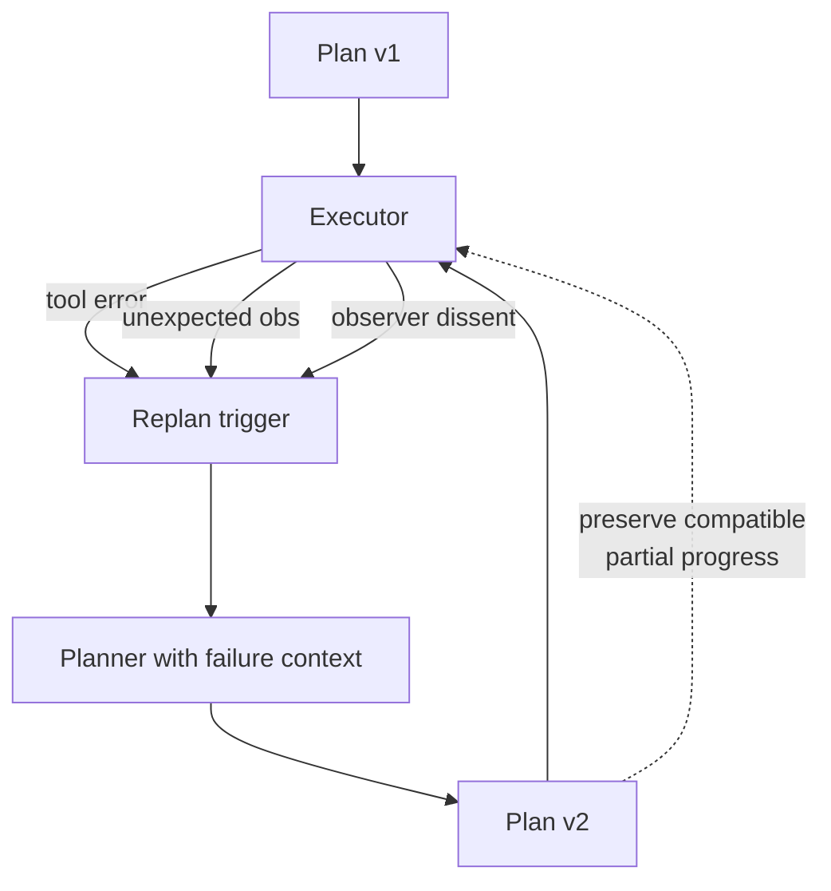

# Replan on Failure

**Also known as:** Adaptive Replanning, Plan Revision

**Category:** Planning & Control Flow  
**Status in practice:** mature

## Intent

Trigger a fresh planning step when execution evidence contradicts the current plan.

## Context

A team runs a Plan-and-Execute agent where the planner commits to a plan up front and the executor walks it step by step. The world is not perfectly predictable: a tool returns an error, an observation contradicts an assumption in the plan, or an observer disagrees with where the run is heading. The team wants the agent to repair the plan from that evidence instead of grinding through to failure.

## Problem

Plans are made under incomplete information, so some plans are wrong from the start and others become wrong partway through. Without a replanning step the executor will either keep trying the same broken sequence until the step budget runs out, or it will silently fail and return partial results that look complete. A naive replan-on-every-error policy thrashes — the agent re-plans, fails, re-plans again on the new plan, and never makes progress. The team needs explicit triggers that decide when failure is bad enough to send control back to the planner with the failure context attached.

## Forces

- Replanning resets cost; thrashing is real.
- When to trigger replanning is itself a judgment.
- Stale context: the new plan must include lessons from the failed run.

## Therefore

Therefore: define explicit replan triggers and on any of them hand the failure context back to the planner instead of grinding the executor, so that broken plans get repaired with the new evidence rather than driven to budget exhaustion.

## Solution

Define replan triggers (tool error, unexpected observation, observer dissent). When triggered, the executor pauses and the planner runs again with the failure context. The new plan replaces the old one; partial progress is preserved if compatible.

## Structure

```
Plan v1 --> Executor --tool error / unexpected observation / observer dissent--> Replan trigger --> Failure-context capture --> Planner --> Plan v2 (compatible partial progress kept) --> Executor
```

## Diagram



## Example scenario

A travel-booking agent has a plan that assumes a particular hotel API is up; the API returns 500 on every retry. Without replan-on-failure the agent grinds the same dead branch until budget exhausts. Instead, the tool error trips a replan trigger: the planner is invoked again with the failure context, drops the dead branch, picks an alternate provider, and proceeds. The user sees one extra second of latency and a successful booking instead of a timeout.

## Consequences

**Benefits**

- Recovers from plan failures gracefully.
- The planner gets feedback; future plans improve.

**Liabilities**

- Replanning thrash if triggers are too sensitive.
- Compatibility logic between old and new plans is non-trivial.

## Failure modes

- Replan thrash — triggers fire on every minor error, and the agent keeps replacing plans without finishing any step.
- Lost progress — the new plan is not checked against finished work, and completed steps are redone or undone.
- Missing failure context — the planner reruns without the error details, and produces a plan with the same flaw.
- Silent partial result — a failure never reaches a trigger, and the executor returns partial output that looks complete.

## What this pattern constrains

The executor cannot deviate from the current plan without raising a replan request.

## Applicability

**Use when**

- Plans are made under incomplete information and execution evidence may contradict them.
- Clear replan triggers exist (tool error, unexpected observation, observer dissent).
- Partial progress can be preserved when compatible with the new plan.

**Do not use when**

- Tasks are short and a fresh plan offers no advantage over retry-or-abort.
- Replanning cost dominates and the executor would do better grinding through.
- No reliable triggers exist and replans would fire arbitrarily.

## Components

- Replan triggers — tool error, unexpected observation, or observer dissent
- Failure-context capture — partial state and error packaged for the planner
- Planner — invoked again with the failure context to produce a revised plan
- Progress preserver — keeps compatible partial work across the replan boundary
- Plan replacer — swaps the new plan in for the failed one

## Tools

- LLM API — invokes the planner for the revision step
- Plan store — holds current and prior plans so replacements are auditable
- Failure ledger — records trigger events and their downstream effect

## Evaluation metrics

- Recovery rate after first replan — runs that succeed without thrashing
- Replan thrash incidents — multiple replans on the same root cause
- Trigger-precision — fraction of replans that were warranted
- Partial-progress preservation — fraction of pre-failure work carried into the new plan
- End-to-end success vs no-replan baseline — quality lift from the recovery path

## Known uses

- **LangGraph plan-and-execute templates** _available_
- **[Sparrot](https://marco-nissen.com/sparrot/)** _available_ — When execution evidence contradicts the current plan (tool error, refusal, surprise observation), the active-plan layer replans rather than retrying the same step blindly.

## Related patterns

- _complements_ **Plan-and-Execute**
- _uses_ **Planner-Executor-Observer**
- _complements_ **Exception Handling and Recovery**
- _used-by_ **Outer-Inner Agent Loop**
- _alternative-to_ **Errors Swept Under the Rug**
- _complements_ **Single-Path Plan Generator**
- _complements_ **Incremental Model Querying**
- _complements_ **Planner-Executor-Verifier (PEV)**
- _uses_ **Physical-Evidence Progress Gate** — Replanning fires when evidence contradicts the plan; this gate is the sensing discipline that produces that evidence, and its own default verdict on absent evidence is to hold the pointer rather than to replan.

## References

- [LangGraph: Plan-and-Execute](https://langchain-ai.github.io/langgraph/tutorials/plan-and-execute/plan-and-execute/)
