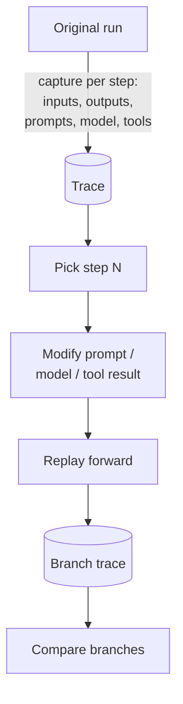

# Replay / Time-Travel

**Also known as:** Trace Replay, Run Branching, Fork from Step N

**Category:** Governance & Observability  
**Status in practice:** mature

## Intent

Re-run a past agent trace from any step with modified inputs/prompts/tools to debug or branch.

## Context

A team supports an agent in production where users occasionally hit weird, hard-to-reproduce behaviour: a strange reply, an unexpected tool call, a wrong answer on an input that worked yesterday. Engineers want to load the exact past run, jump to a specific step, swap in a different prompt or model, and see whether the alternative would have done better. The system already captures per-step inputs, outputs, prompts, model identifiers, and tool calls in a trace store.

## Problem

Agent runs depend on non-deterministic model outputs, accumulated conversation state, and external tool results that may not be the same on the next call. Trying to reproduce a three-day-old bug locally usually fails because too much has changed, and engineers end up debugging by re-running the user's prompt and hoping the model behaves the same way. The team is forced to choose between spending hours on guess-and-check reproduction or shrugging off intermittent bugs that they cannot deterministically trigger.

## Forces

- Captured state must be complete enough to re-run.
- Storage of full traces is expensive.
- Modified replays diverge from original; comparison logic is non-trivial.

## Therefore

Therefore: capture per-step inputs, outputs, prompts, model ids, and tool calls in a trace, and expose a replay tool that resumes from any step with optional substitutions, so that past runs become debuggable artefacts rather than write-once logs.

## Solution

Capture per-step inputs, outputs, prompts, model id, tool calls. Provide a replay tool that loads a trace at step N and re-runs forward with optional modifications (different model, different prompt, different tool result). Store branches for comparison.

## Structure

```
Original run --capture per step (inputs, outputs, prompts, model id, tool calls)--> Trace store --> Step selector (pick step N) --> Substitution layer (modify prompt / model / tool result) --> Replay forward (captured state before N, live calls after) --> Branch trace --> Compare branches
```

## Diagram



## Example scenario

A support agent gives a strange reply to a user three days ago and the team cannot reproduce it locally because too much state has changed. They open the trace store, jump to step 7, swap in the new system prompt, and re-run forward; the new prompt fixes the issue, the old one reproduces it exactly. They commit the fix with the trace ID in the changelog. Replay turns 'this happened once' bugs into deterministic tests.

## Consequences

**Benefits**

- Debugging cycle drops from hours to minutes.
- A/B comparison of fixes becomes trivial.

**Liabilities**

- Trace storage overhead.
- Non-deterministic external dependencies (network) limit fidelity.

## Failure modes

- Live call leak — the replay re-calls a real tool for a step before N instead of reading the captured result, and the branch diverges for reasons unrelated to the change.
- Incomplete capture — the trace misses the exact prompt or model id for some steps, so the replay starts from a state the original run never had.
- Network-dependent drift — the modified branch calls an external service whose answers have changed, and the comparison mixes the fix with outside drift.
- Trace store bloat — full per-step capture is kept for every run, and storage cost leads to short retention that drops the traces needed for old bugs.

## What this pattern constrains

Replay reads from captured state; live model and tool calls happen only for the modified branch from step N forward.

## Applicability

**Use when**

- Agent runs are non-deterministic and incidents need reproducible debugging.
- Engineers want to branch from a past step to test fixes or alternative prompts.
- Per-step inputs, outputs, and tool calls can be captured durably.

**Do not use when**

- Trace storage cost outweighs the value of replay (low-stakes ephemeral runs).
- Privacy or retention rules forbid keeping per-step traces.
- The agent has no externally observable failures worth reproducing.

## Components

- Per-Step Trace Capture — records inputs, outputs, prompts, model id, and tool calls for each step of every run
- Trace Store — durable storage of full historical traces
- Step Selector — UI or API for picking step N of a past run as the branch point
- Substitution Layer — applies prompt, model, or tool-result overrides for the replay
- Branch Trace — separate stored run that holds the replay output for comparison

## Tools

- LangSmith replay — UI for branching past runs at any step
- Langfuse playground replay — trace-driven re-execution against modified prompts or models
- Inspect AI — agent eval framework with run replay
- Braintrust playground — branch-and-compare interface tied to trace storage

## Evaluation metrics

- Trace-completeness rate — share of past runs that can actually be replayed end-to-end
- Replay fidelity gap — divergence between an unmodified replay and the original output (signals non-determinism leakage)
- Mean time to reproduce a reported bug — debug latency from report to deterministic repro
- Branch-vs-original lift — number of replays that demonstrably improve on the original after a fix
- Trace storage cost per run — bytes per run retained for replay

## Known uses

- **LangSmith replay** _available_
- **Langfuse playground replay** _available_
- **Inspect AI** _available_
- **Claude Code conversation rewind** _available_ — Transcript-level rewind, not full trace replay.
- **Braintrust playground** _available_

## Related patterns

- _uses_ **Decision Log**
- _complements_ **Lineage Tracking**
- _complements_ **Durable Workflow Snapshot**
- _alternative-to_ **Journaled LLM Call**
- _complements_ **Determinism-Tiered Replay Gate** — Replay/time-travel re-runs a captured trace for debugging; this pattern re-runs paired cases to classify a reproducibility tier and turns that tier into a release gate.
- _complements_ **Replay Divergence** — Replay / time-travel re-runs a past trace to debug or branch; this is the failure where that re-run silently diverges from the trace it was meant to reproduce.
- _alternative-to_ **Forkable Agent Sandbox** — That re-runs a recorded trace of model and tool calls with modifications for retrospective debugging; this forks the live environment forward for exploration, and restores process and session state a trace cannot reconstruct.
- _complements_ **As-Of Information-Set Pinning** — Replay re-runs a stored trace from a chosen step but still resolves live tools against today's data; pinning is what makes those reads return the original information set.
- _complements_ **Harness-Native Rollout Capture** — Replay consumes captured traces to debug or branch a run; this consumes them for a policy update, which is why the record has to carry token ids rather than rendered steps.

## References

- [LangSmith: Replay](https://docs.smith.langchain.com/observability/how_to_guides/replay)
