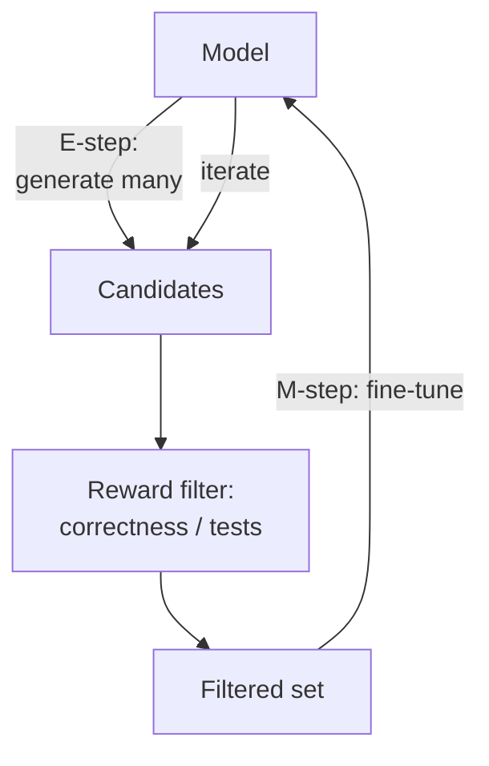

# ReST-EM

**Also known as:** Reinforced Self-Training, Self-Training Loop

**Category:** Reasoning  
**Status in practice:** emerging

## Intent

Iterate generate → reward-filter → fine-tune to bootstrap reasoning capabilities without human-labelled data.

## Context

A team wants to improve a model's performance on a reasoning task where the model is already partially competent — it gets some answers right with chain-of-thought — and where there is an automatic way to tell a right answer from a wrong one. This automatic check might be a ground-truth label, an executable test suite, or a formal verifier that says yes or no. The team has compute to spend on generating and filtering many samples, but they do not have human-written rationales or step-by-step solutions to fine-tune on.

## Problem

Pure prompting on the base model has plateaued and is not improving any further. Full reinforcement learning with algorithms like PPO is unstable and expensive to set up and run. Buying or labelling supervised rationale data at scale is not affordable for this task. The team needs a training loop that can bootstrap better reasoning out of the model itself using only the reward signal they already have, without depending on human labels and without the volatility of full reinforcement learning.

## Forces

- Reward filter quality bounds learning quality.
- Iteration count vs cost.
- Distribution drift across iterations.

## Therefore

Therefore: iterate generate → reward-filter → fine-tune, so that the model bootstraps reasoning from its own correct outputs without human-labelled rationales.

## Solution

EM-style loop. (E-step) Generate many responses per problem. Filter by reward (correctness against ground truth or executable test). (M-step) Fine-tune on the filtered set. Iterate. Variants: ReST (DeepMind, RL-shaped), ReST-EM (Singh et al., expectation-maximisation framing).

## Structure

```
Model --E-step: generate many responses per problem--> Candidates --reward filter (ground truth or executable test)--> Filtered set --M-step: fine-tune--> Model --> iterate
```

## Diagram



## Example scenario

A team wants a small in-house model to solve grade-school math without paying to label rationales. They run ReST-EM: sample many CoT solutions per problem, keep only those whose final answer matches ground truth, fine-tune on the kept set, then sample again. Each round yields a stronger sampler whose kept fraction grows. After three iterations the small model lands within a few points of a much larger zero-shot baseline at a fraction of inference cost.

## Consequences

**Benefits**

- Strong gains without human-labelled rationales.
- Stable; converges in a few iterations.

**Liabilities**

- Compute-heavy.
- Reward gaming possible.

## Failure modes

- Reward gaming — candidates pass the filter by exploiting the test or answer check, and fine-tuning reinforces the trick.
- Narrowing — each round trains only on problems the model already solves, so it gets better at easy cases and stalls on hard ones.
- Compute overrun — generating many responses per problem each iteration costs more than the gain justifies.
- Leaky filter — the reward check accepts a right answer reached by wrong reasoning, and those samples enter training.

## What this pattern constrains

Training data is restricted to filter-passing samples; ungrounded samples are not reinforced.

## Applicability

**Use when**

- The model is partially competent on the task and a programmatic reward signal exists.
- Pure prompting has plateaued and full RL with PPO is too unstable or expensive.
- Generation, filtering, and fine-tuning infrastructure is available.

**Do not use when**

- No reliable reward signal (correctness, executable test, formal verifier) is available.
- The base model is too weak to produce any correct samples to filter.
- Quick iteration matters more than the multi-day generate-filter-train loop.

## Components

- Base policy model — current generation of the model being self-trained
- Sampler (E-step) — draws many candidate responses per problem at temperature
- Reward filter — programmatic check (ground-truth match, executable test, formal verifier) that keeps or discards a sample
- Fine-tuner (M-step) — supervised trainer that updates the policy on the filtered set
- Iteration controller — orchestrates rounds and stops when kept-fraction plateaus

## Tools

- LLM training stack — supervised fine-tuning runner with checkpoint management
- Reward grader — ground-truth comparator, code-execution sandbox, or formal verifier
- Sampling cluster — inference infrastructure sized for many candidates per problem

## Evaluation metrics

- Reward pass rate per iteration — fraction of samples that survive the filter each round
- Held-out accuracy across iterations — does each round actually lift quality on unseen data
- Distribution drift indicator — divergence between successive rounds' kept sets
- Reward-gaming incidence — share of filter-passing samples that exploit the reward rather than solve the task, sample-audited
- Compute cost per accuracy point — total sampling plus training spend per benchmark gain

## Known uses

- **DeepMind ReST** _available_
- **Singh et al. ReST-EM** _available_

## Related patterns

- _generalises_ **STaR Bootstrapping**
- _uses_ **Best-of-N Sampling**
- _complements_ **Learnability-Frontier Task Sampling** — ReST-EM filters generated samples by correctness and fine-tunes on the ones that passed; this pattern filters tasks by outcome variance before the rollouts are spent, and a task every attempt solves is exactly what ReST-EM keeps and what this drops.

## References

- [Reinforced Self-Training (ReST) for Language Modeling](https://arxiv.org/abs/2308.08998) — Gulcehre et al., 2023
- [Beyond Human Data: Scaling Self-Training for Problem-Solving with Language Models](https://arxiv.org/abs/2312.06585) — Singh, Co-Reyes, Agarwal, Anand, Patil, Garcia, Liu, Harrison, Lee, Xu, Parisi, Kumar, Alemi, Rizkowsky, Nova, Adlam, Bohnet, Elsayed, Sedghi, Mordatch, Simpson, Gur, Snoek, Pfaff, Brown, Roy, Mustafa, Hoffman, Botvinick, Faust, Larochelle, Hadsell, Schuurmans, Faruqui, 2023
