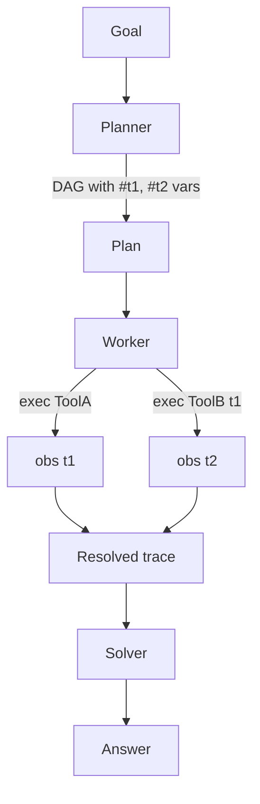

# ReWOO

**Also known as:** Reasoning Without Observation, Plan-as-DAG, Placeholder-Variable Plan

**Category:** Planning & Control Flow  
**Status in practice:** experimental

## Intent

Plan a complete dependency DAG with placeholder variables before any tool runs, then execute and substitute observations into the plan.

## Context

A team runs a multi-tool agent on tasks where most of the planning could be done in one shot — search for X, then summarise the result, then extract a field — because each step's structure is determined by the task, not by what the previous step returned. A strong, expensive model is doing the planning and a cheap worker can do the tool calls. Token cost matters: the agent is called at volume.

## Problem

In a ReAct loop (reason-act-observe), every tool observation is fed back into the planner's prompt for the next reasoning turn. Token cost therefore grows roughly with the square of the step count, because each turn carries the trace of all the previous turns. On an eight-step task the planner re-reads its own scratch reasoning and all prior observations seven times. Most of those re-reads do not change the plan — the structure was knowable up front — so the team is paying for re-prompting that produces no new decisions.

## Forces

- Pre-planning fails when dependencies are truly observation-dependent.
- Placeholder substitution requires a typed variable convention.
- Plan correctness must be high; mid-run replans defeat the saving.

## Therefore

Therefore: have the planner emit a complete DAG of tool calls referenced by placeholder variables before any tool runs, then let a separate worker and solver substitute observations in, so that tool outputs never re-enter the planner's prompt and token cost stops scaling with step count.

## Solution

Three roles. Planner emits a DAG with steps `t1 = ToolA(x); t2 = ToolB(#t1)` using variable references. Worker executes each tool in dependency order. Solver reads the resolved trace and produces the final answer. The planner never sees observations.

## Structure

```
Planner(query) -> DAG(steps with #refs) -> Worker(steps) -> resolved_trace -> Solver(query, trace) -> answer.
```

## Diagram



## Example scenario

A research agent built with ReAct burns tokens because each tool observation re-enters the prompt for the next reasoning turn; an eight-step task quadratic-blows. The team rewrites it as ReWOO: planner emits a DAG with placeholder variables (`t1 = Search(x); t2 = Summarise(#t1)`), a worker resolves the DAG, and a solver reads the final trace once. Total tokens drop sharply on multi-tool tasks while quality holds.

## Consequences

**Benefits**

- Up to 5x fewer tokens than ReAct on the original benchmarks.
- Plan is fully inspectable before any tool fires.

**Liabilities**

- Bad plans are paid for in full.
- Not a fit for tasks where observation truly redirects planning.

## Failure modes

- Fully paid bad plan — the planner emits a wrong DAG, and every tool call in it runs before the solver sees the mistake.
- Blind to surprises — an early observation shows the task is different from what was planned, but the planner never sees it and later steps run anyway.
- Broken variable reference — a step points to #t2 when it needed #t1, and the worker substitutes the wrong output.
- Solver over-trust — the solver treats a failed or empty tool result as evidence and writes a confident answer from it.

## What this pattern constrains

The Planner cannot see tool outputs; substitution happens only at the Worker stage.

## Applicability

**Use when**

- Most planning steps do not depend on early observations and can be planned upfront.
- ReAct-style observation re-injection is the dominant token cost.
- Tools have stable signatures so the planner can reference outputs by variable.

**Do not use when**

- Plans must adapt at every step based on observations (true exploratory tasks).
- Tool outputs are large or complex enough that the solver still needs reasoning per step.
- A simple ReAct loop already meets latency and cost targets.

## Components

- Planner — emits the full DAG with placeholder variables, no observations seen
- Worker — executes each step in dependency order, substituting upstream outputs
- Solver — reads the resolved trace once and produces the final answer
- Variable convention — typed placeholder references (e.g. #t1) across the DAG
- Resolved-trace artefact — handoff between worker and solver

## Tools

- Strong LLM API — drives planner and solver, where judgement matters
- Cheaper LLM or function caller — runs worker steps that just dispatch tool calls
- Tool catalogue — registered functions with stable signatures the planner references
- DAG state store — persists steps, references, and resolved values

## Evaluation metrics

- Token cost ratio versus ReAct — savings from not re-injecting observations
- Plan correctness — fraction of DAGs whose worker resolves them without rework
- Observation-dependent failure — runs where the static plan needed mid-run reshaping
- Solver context size — total tokens at the final synthesis call
- End-to-end accuracy versus ReAct — quality at lower cost

## Known uses

- **agent-patterns library** _available_

## Related patterns

- _specialises_ **Plan-and-Execute**
- _generalises_ **LLMCompiler**

## References

- [ReWOO: Decoupling Reasoning from Observations for Efficient Augmented Language Models](https://arxiv.org/abs/2305.18323) — Xu, Peng, Liang, Lei, Mukherjee, Liu, Xu, 2023
