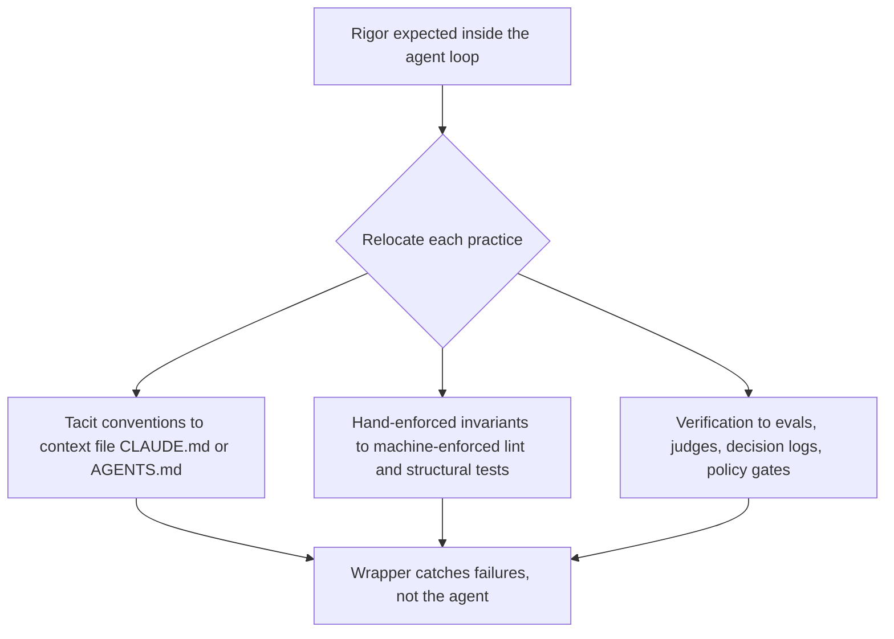

# Rigor Relocation

**Also known as:** Relocating Rigor, Rigor Migration, Discipline at a Higher Abstraction

**Category:** Governance & Observability  
**Status in practice:** emerging

## Intent

Relocate verification rigor from the model loop to surrounding scaffolding (evals, judges, decision logs, policy gates) so failures are caught by the wrapper rather than the agent.

## Context

A team has handed real code-writing work to coding agents. The keystrokes that used to carry the engineer's discipline — careful naming, defensive checks, hand-written tests — are now produced at a different speed and by a different author. Senior engineers worry that quality is collapsing; the productivity numbers say the opposite. Both can be true if nobody asks where the rigor went.

## Problem

Treating agentic coding as if rigor itself were optional produces drift: undocumented conventions the agent re-invents each session, invariants that exist only in code review folklore, and verification that runs by hand when somebody remembers. The opposite mistake — preserving every prior practice unchanged — applies rigor at the wrong layer, so reviewers grade tokens the agent wrote on autopilot while the load-bearing decisions go unexamined. The team is forced to choose between performative discipline at the old layer and accepting that discipline has quietly left the building.

## Forces

- Engineering rigor does not vanish when a constraint is removed; it relocates to whichever surface still binds behaviour.
- Agents read context files, configs, and tests far more reliably than they read human folklore.
- Verification cost falls as compute gets cheap, so 'check it every time' becomes affordable where 'check it once at review' used to be the cap.

## Therefore

Therefore: name the new surfaces — agent context files, machine-enforced invariants, continuous evaluation — and move each prior rigor practice deliberately to whichever of those surfaces now binds the agent's behaviour, so discipline migrates up the stack instead of being abandoned.

## Solution

Identify, for each existing rigor practice, which agent-readable surface now carries it, and relocate it there. Three concrete relocations: (a) tacit conventions and architecture decisions move into the agent's context file (CLAUDE.md, AGENTS.md, system prompt) so they are read every session, not learned once by a human; (b) hand-enforced invariants move into machine-enforced rules — types, assertions, schema validators, policy-as-code gates — so they bind every generated change, not only the reviewed ones; (c) periodic verification moves into continuous evaluation — eval-as-contract on every PR, agent-as-judge on trajectories, scorer-live-monitoring in production — so the bar is enforced on every change instead of every release. Pair with decision-log and provenance-ledger so the relocations are auditable.

## Structure

```
Rigor practice once inside the agent loop --> Relocation map --> (tacit conventions --> context file | hand-enforced invariants --> types, validators, policy gates | periodic checks --> continuous evaluation) --> Wrapper catches failures on every change; decision log + provenance ledger record each relocation; stale-rule detector --> context file
```

## Diagram



*Rigor Relocation flow.*

## Example scenario

A team's senior engineer is alarmed that nobody is hand-writing argument validation anymore — the agent just generates the function and merges. Instead of forbidding agent-authored code, the team relocates the rigor: a CLAUDE.md rule says 'public functions take validated inputs and the agent must add the type or assertion that enforces it', a policy-as-code gate rejects PRs that introduce unchecked public entry points, and an eval-as-contract case fails closed if the validation is silently dropped. The senior's discipline is still in the codebase; it just lives on three new surfaces instead of in one human's habit.

## Consequences

**Benefits**

- Discipline survives the shift to agentic generation instead of degrading into review folklore.
- Context files turn one-time onboarding into per-session enforcement.
- Machine-enforced invariants catch deviations the human reviewer would miss in a 2000-line diff.
- Continuous evaluation surfaces regressions on the change that caused them, not on the release that shipped them.

**Liabilities**

- Authoring and maintaining context files is real engineering work, and stale context files actively mislead the agent.
- Machine-enforced invariants are only as good as the rules; missing rules produce a false sense of safety.
- Continuous evaluation has cost and calibration overhead; bad evals fail loud and block legitimate work.
- Relocating the wrong practice (e.g. relocating taste to a linter) produces ritual without rigor.

## Failure modes

- Stale context file — the context file still describes last quarter's architecture, and the agent follows the outdated convention in every session.
- Missing rule mistaken for safety — an invariant was never written as a validator or gate, yet the team assumes the machine checks cover it.
- Taste moved to a linter — a judgement call is reduced to a lint rule, and changes pass the rule while the design still gets worse.
- Unmapped retirement — an old review practice is dropped without being placed on any surface, and nothing in the relocation map shows it is gone.

## What this pattern constrains

Any rigor practice the team claims to hold must be expressible on a surface the agent reads or is checked against — context file, machine-enforced rule, or continuous evaluation. Practices that live only in human habit are not counted as rigor in agentic mode.

## Applicability

**Use when**

- Code-writing work is materially handed to agents and prior rigor practices were tied to human keystrokes.
- Senior engineers can point to specific disciplines (invariant checks, naming, architecture decisions) that used to bind behaviour and now do not.
- Agent-readable surfaces (context files, machine-enforced rules, continuous evals) exist or can be introduced.

**Do not use when**

- The agent's role is narrow enough that prior review-time rigor still binds every change.
- The team will not invest in maintaining context files and evaluations, in which case the relocation produces stale rigor instead of relocated rigor.
- Practices being relocated are taste, not invariants; taste does not survive translation to a machine-checked rule.

## Components

- Agent Context File — CLAUDE.md / AGENTS.md / system prompt that carries conventions and architecture decisions the agent reads every session.
- Machine-Enforced Invariants — types, assertions, schema validators, and policy-as-code gates that bind every generated change, not only reviewed ones.
- Continuous Evaluation — eval-as-contract, agent-as-judge on trajectories, scorer-live-monitoring in production, run on every change.
- Relocation Map — explicit register of which prior rigor practice now lives on which surface; what got relocated, what got retired.
- Stale-Rule Detector — flags context-file rules contradicted by current code so the relocation does not silently rot.

## Tools

- Observability — logs, traces, and metrics that surface the pattern in production
- Eval harness — runs that quantify the pattern's frequency or severity over time

## Evaluation metrics

- Context-file coverage — share of recurring agent-behaviour mistakes prevented by a rule in the context file rather than caught at review.
- Machine-enforced-invariant share — fraction of historical bug classes that now fail closed via types, assertions, or policy-as-code instead of human review.
- Continuous-evaluation cadence — share of PRs (not releases) gated by eval-as-contract or agent-as-judge.
- Relocation completeness — count of prior rigor practices explicitly assigned to a new surface versus left implicit.
- Stale-context-file rate — share of context-file rules contradicted by the codebase or by current architectural intent.

## Known uses

- **[Honeycomb (Chad Fowler)](https://www.honeycomb.io/blog/production-is-where-the-rigor-goes)** _available_ — Original 'Relocating Rigor' framing — control does not disappear, it moves closer to reality; if generation gets easier, judgment must get stricter.
- **[martinfowler.com fragments](https://martinfowler.com/fragments/2026-01-22.html)** _available_ — Martin Fowler endorses Chad Fowler's framing: AI-enabled development demands rigor in evaluating software rather than abandoning discipline for speed.
- **[bjorn.now (Björn Andersson)](https://bjorn.now/link/2026-01-28-relocating-rigor-by-chad-fowler/)** _available_ — Applies the concept to working with Claude on legacy code: tests before changes, intent specified as failing tests first, ruthless trace-the-call-sites verification before refactors.
- **[Bits, Bytes and Neural Networks (Jonas Kim)](https://bits-bytes-nn.github.io/insights/agentic-ai/2026/04/05/evolution-of-ai-agentic-patterns-en.html)** _available_ — Frames the relocation across three eras — prompt engineering, context engineering, harness engineering — with rigor migrating up at each step.
- **[kode24.no](https://www.kode24.no/)** _available_ — Norwegian-language application of Fowler's term to agentic coding with three concrete relocations: CLAUDE.md context files, deterministic constraints, continuous verification.

## Related patterns

- _complements_ **Spec-Driven Loop**
- _complements_ **Spec-First Agent**
- _uses_ **Eval as Contract**
- _uses_ **Policy-as-Code Gate**
- _uses_ **Agentic Context Engineering Playbook**
- _complements_ **Decision Log**
- _complements_ **Provenance Ledger**
- _uses_ **Agent-as-a-Judge**
- _complements_ **Scorer Live Monitoring**
- _alternative-to_ **Errors Swept Under the Rug**
- _alternative-to_ **Perma-Beta**
- _alternative-to_ **Automating a Broken Process**
- _alternative-to_ **Agentic Skill Atrophy**

## References

- [Production Is Where the Rigor Goes (Relocating Rigor)](https://www.honeycomb.io/blog/production-is-where-the-rigor-goes) — Chad Fowler
- [Fragments: January 22](https://martinfowler.com/fragments/2026-01-22.html) — Martin Fowler, 2026
- [Relocating Rigor by Chad Fowler](https://bjorn.now/link/2026-01-28-relocating-rigor-by-chad-fowler/) — Björn Andersson, 2026
- [From Prompts to Harnesses — Four Years of AI Agentic Patterns](https://bits-bytes-nn.github.io/insights/agentic-ai/2026/04/05/evolution-of-ai-agentic-patterns-en.html) — Jonas Kim, 2026
