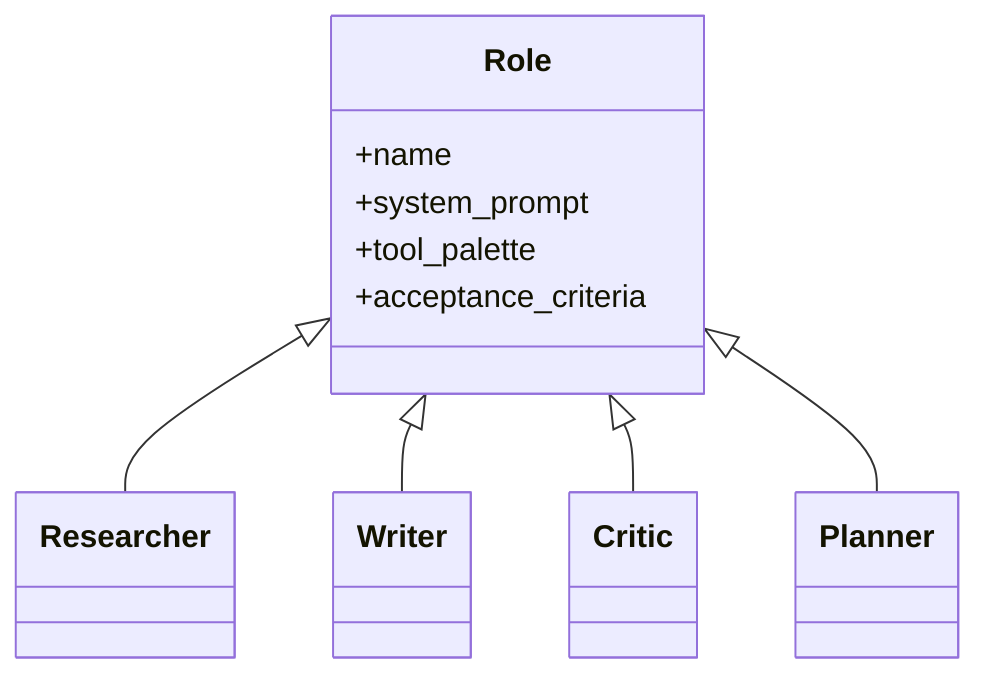

# Role Assignment

**Also known as:** Persona Roles, Agent Crew, Specialist Roles

**Category:** Multi-Agent  
**Status in practice:** mature

## Intent

Assign each agent a named role (researcher, writer, critic, planner) with a role-specific prompt, tool palette, and acceptance criteria.

## Context

A team is running several agents that contribute to a shared workflow — a content pipeline with a researcher, a writer, and a critic; a coding crew with a planner, a coder, and a reviewer — and the user, the reviewer, and the team itself need to know who produced what. Each role has its own work to do and its own definition of done.

## Problem

When the agents share a generic prompt and an open tool palette, they drift toward sameness: the researcher starts writing prose, the writer starts critiquing, the critic starts proposing rewrites, and the outputs all sound alike. Contributions blur together in the transcript, review cannot focus on the right thing, and disagreement between roles — which is the signal the team wanted — never surfaces because every agent agrees with every other agent. Without explicit roles backed by scoped prompts, tools, and acceptance criteria, the multi-agent setup gives no benefit over a single agent.

## Forces

- Role definitions can ossify into bureaucracy.
- Cross-role handoffs need typed contracts.
- Role count multiplies prompt-engineering effort.

## Therefore

Therefore: give each agent a named role with a scoped prompt, a scoped tool palette, and explicit acceptance criteria for its outputs, so that contributions are attributable and review focuses on the role boundary.

## Solution

Define each role with a system prompt naming its responsibility and constraints, a tool palette scoped to its role, and acceptance criteria for outputs it produces. Workflow assigns tasks to roles. Outputs are evaluated against the role's acceptance criteria.

## Structure

```
Task --> Workflow --assign--> Role (system prompt + scoped tool palette + acceptance criteria): Planner | Researcher | Writer | Critic --output--> check against role's acceptance criteria --> [accept | return to role]
```

## Diagram



## Example scenario

A multi-agent content pipeline with three identical generic agents keeps producing similar bland outputs and reviewers cannot tell whose work to trust. The team gives each agent a named role with role-specific prompt and a scoped tool palette: researcher (search-only), writer (draft tools), critic (lint and policy tools). Outputs become identifiable, review focuses on the role boundary, and disagreement between writer and critic surfaces as a productive signal rather than confusion.

## Consequences

**Benefits**

- Outputs are attributable and reviewable per role.
- Specialisation improves quality on each role's task.

**Liabilities**

- Bureaucratic overhead.
- Role drift over long sessions.

## Failure modes

- Role drift — over a long session the researcher starts writing prose and the critic starts rewriting, and the outputs blur together again.
- Bureaucracy — a small task is passed through planner, researcher, writer and critic, and the hand-offs cost more than the work.
- Loose acceptance criteria — a role's criteria are vague, so weak outputs pass and review cannot tell which role fell short.
- Leaky tool palette — a role is given tools outside its scope and starts doing another role's job with them.

## What this pattern constrains

An agent operates only within its role's constraints and tool palette; cross-role action is forbidden.

## Applicability

**Use when**

- Multiple agents collaborate and the user needs to reason about who did what.
- Different parts of the workflow have distinct responsibilities, tools, and acceptance criteria.
- Generic agents have been observed drifting toward similarity or duplicating effort.

**Do not use when**

- A single agent with one prompt already handles the workflow well.
- Roles would be artificial and add prompt overhead without separating concerns.
- The team cannot articulate distinct responsibilities and acceptance criteria per role.

## Components

- Named role — specialist agent (researcher, writer, critic, planner) with scoped responsibility
- Role-scoped system prompt — declares responsibility and constraints for one role
- Role-scoped tool palette — subset of tools each role is permitted to call
- Acceptance criteria — explicit predicate each role's output must satisfy
- Workflow assigner — routes incoming tasks to the right role given task type

## Tools

- CrewAI — defines role classes, tool palettes, and acceptance criteria as first-class entities
- AutoGen named agents — alternative scaffolding for declaring per-role specialists
- LLM API — invoked once per role-bound turn
- Output validator — checks role outputs against acceptance criteria before passing downstream

## Evaluation metrics

- Per-role pass rate — share of outputs that meet that role's acceptance criteria
- Role-drift incidents — outputs where an agent acted outside its declared tool palette or scope
- Cross-role disagreement signal — productive critic-writer disagreements surfaced versus suppressed
- Attribution accuracy — share of artefacts correctly traced to the producing role on review
- Workflow throughput — tasks completed per hour against a generic-agent baseline

## Known uses

- **[CrewAI](https://www.crewai.com/)** _available_
- **AutoGen named agents** _available_

## Related patterns

- _complements_ **Supervisor**
- _alternative-to_ **Inner Committee**
- _complements_ **Handoff**
- _complements_ **Mixture of Experts Routing**
- _complements_ **Conversational Multi-Agent**
- _generalises_ **CAMEL Role-Playing**
- _used-by_ **SOP-Encoded Multi-Agent Workflow**
- _specialises_ **Dynamic Expert Recruitment**
- _used-by_ **Cross-Domain Enterprise Agent Network**
- _composes-with_ **Voting-Based Cooperation**
- _complements_ **Group-Chat Manager**
- _alternative-to_ **Role-Typed Subagents**
- _alternative-to_ **Personality Variant Overlay**
- _alternative-to_ **Control-Loop-Mapped Agent Chain** — There the roles are invented for the task and given persona prompts; here the roles are read off a commissioned control chain and each carries a controlled variable rather than a persona.

## References

- [CrewAI docs](https://docs.crewai.com)
- [Agent design pattern catalogue: A collection of architectural patterns for foundation model based agents](https://doi.org/10.1016/j.jss.2024.112278) — Yue Liu, Sin Kit Lo, Qinghua Lu, Liming Zhu, Dehai Zhao, Xiwei Xu, Stefan Harrer, Jon Whittle, 2025
