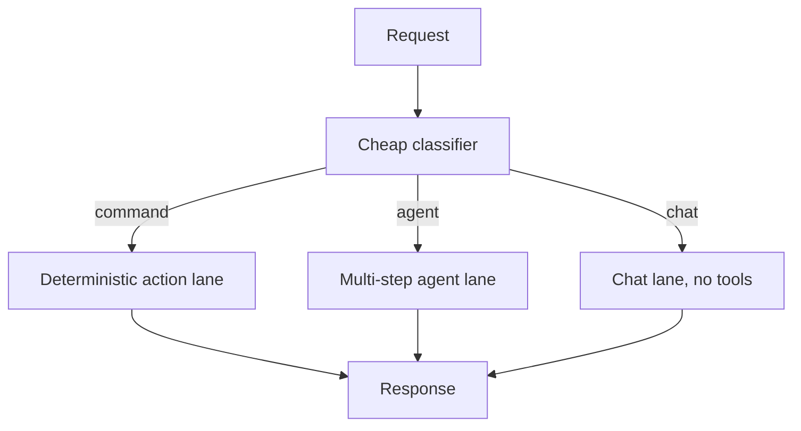

# Routing

**Also known as:** Mode Selector, Intent Classifier, Task Router

**Category:** Routing & Composition  
**Status in practice:** mature

## Intent

Classify an incoming request and dispatch it to the specialist (lane / agent / model) best suited to handle it.

## Context

An agent product receives a heterogeneous mix of incoming requests: short deterministic commands ("open settings"), open-ended chats with no tool use, and longer multi-step tasks that need a planner, retrieval, and several tool calls. Each kind of request benefits from a different prompt, a different tool palette, and sometimes a different model. The team has the option of building several specialist lanes behind a single front door.

## Problem

If every request goes through one all-purpose prompt that can handle the hardest case, the cheap and simple requests over-pay on tokens and latency for capabilities they never use. If every request goes through a prompt tuned for cheap cases, the complex requests are stuck without the planning and tools they need and the product feels incompetent on anything non-trivial. A single shared prompt forces the team to pay for the worst case on every request or under-serve the hard cases.

## Forces

- Routing itself costs a model call.
- Misrouting can be worse than not routing at all.
- The router needs visibility into capabilities of each downstream specialist.

## Therefore

Therefore: put a cheap classifier in front that labels each request and dispatches it to the specialist lane built for that label, so that traffic pays the price and gets the depth that matches its kind.

## Solution

A lightweight classifier model (often the cheapest available) returns a label. The host dispatches the request to the specialist for that label. Common lanes: command (deterministic action), agent (multi-step), chat (no tools).

## Structure

```
Request --> Cheap intent classifier --label--> Dispatcher --command--> Deterministic action lane | --agent--> Multi-step agent lane | --chat--> Chat lane (no tools) | --unsure--> Disambiguation fallback --> Response
```

## Diagram



## Example scenario

A help-desk product handles cheap FAQ lookups and rare deep-research queries through one expensive prompt; per-query cost is irrational. The team puts a small classifier in front: it returns one of `command`, `agent`, `research`, `human` and the host dispatches to the right lane. Eighty percent of traffic lands in the cheap deterministic command lane, the heavy agent only runs when needed, and average per-query cost falls by an order of magnitude.

## Consequences

**Benefits**

- Cheap requests pay cheap prices.
- Each lane can be tuned in isolation.

**Liabilities**

- Two-call latency on every request.
- Lane definitions ossify; reclassification is hard once users learn the lanes.

## Failure modes

- Misroute to the light lane — a multi-step request is labelled chat, lands in the lane with no tools, and the user gets an answer that cannot do the job.
- Unlabelled request forced into a lane — the classifier is unsure but still picks a lane instead of using the disambiguation fallback.
- Ossified lanes — users learn the lanes, new kinds of request appear, and the old labels no longer match the traffic.
- Router blind to capability — a specialist changes its tools or prompt, the router still sends it the old mix, and requests fail inside the lane.

## What this pattern constrains

A request gets exactly one lane; downstream specialists cannot accept work outside their declared lane.

## Applicability

**Use when**

- Traffic is heterogeneous and different requests benefit from different prompts or models.
- A single all-purpose prompt is over-paying for cheap requests or under-serving complex ones.
- A lightweight classifier can produce a stable label cheaply.

**Do not use when**

- All requests look alike and a single specialist already serves them well.
- Misrouting cost is high and the classifier cannot meet the required accuracy.
- Latency budget cannot accommodate an extra classifier hop.

## Components

- Intent classifier — cheap model that returns a lane label for each request
- Lane catalogue — declared set of specialists (command, agent, chat, research, human) with capability descriptors
- Dispatcher — invokes the matching specialist and refuses cross-lane work
- Lane specialists — per-lane prompt, tool palette, and possibly model tuned to the lane's traffic
- Disambiguation fallback — explicit handler for requests the classifier cannot label confidently

## Tools

- Lightweight classifier model — the cheapest LLM tier or a fine-tuned small model
- Routing telemetry — per-lane counters and a confusion matrix from sampled audits
- Lane-specific runtimes — separate prompts, agent frameworks, or deterministic action handlers

## Evaluation metrics

- Classifier accuracy on a labelled audit set — share of requests sent to the correct lane
- Per-lane traffic share — distribution that confirms the routing assumption matches reality
- Per-lane cost and latency — confirms cheap lanes are actually cheap end-to-end
- Misroute recovery rate — share of misrouted requests salvaged by disambiguation or re-classification
- Lane-saturation drift — how often a specialist hits capabilities outside its declared lane

## Known uses

- **Bobbin (Stash2Go)** _available_ — mode_selector classifies intent into command / agent / chat.
- **Anthropic Building Effective Agents (Workflow #2)** _available_

## Related patterns

- _generalises_ **Multi-Model Routing**
- _used-by_ **Supervisor**
- _generalises_ **Mixture of Experts Routing**
- _complements_ **Fallback Chain**
- _used-by_ **Dynamic Scaffolding**
- _alternative-to_ **Hero Agent**
- _used-by_ **Disambiguation**
- _complements_ **Prompt Chaining**
- _used-by_ **Tool Loadout**
- _uses_ **Augmented LLM**
- _generalises_ **Hybrid Symbolic-Neural Routing**
- _generalises_ **Complexity-Based Routing**
- _used-by_ **Hierarchical Retrieval**
- _complements_ **Trust and Reputation Routing**
- _used-by_ **Production Failure Triage Loop** — Reuses classify-then-dispatch, but applied to failures feeding remediation rather than to incoming user requests.
- _specialises_ **Semantic Decision Node** — Routing classifies an incoming request once and dispatches it to a lane; a semantic decision node is the same mechanism placed at any branch point inside the harness, with the probability exposed and the threshold held in code.

## References

- [Anthropic: Building Effective Agents](https://www.anthropic.com/research/building-effective-agents) — 2024
