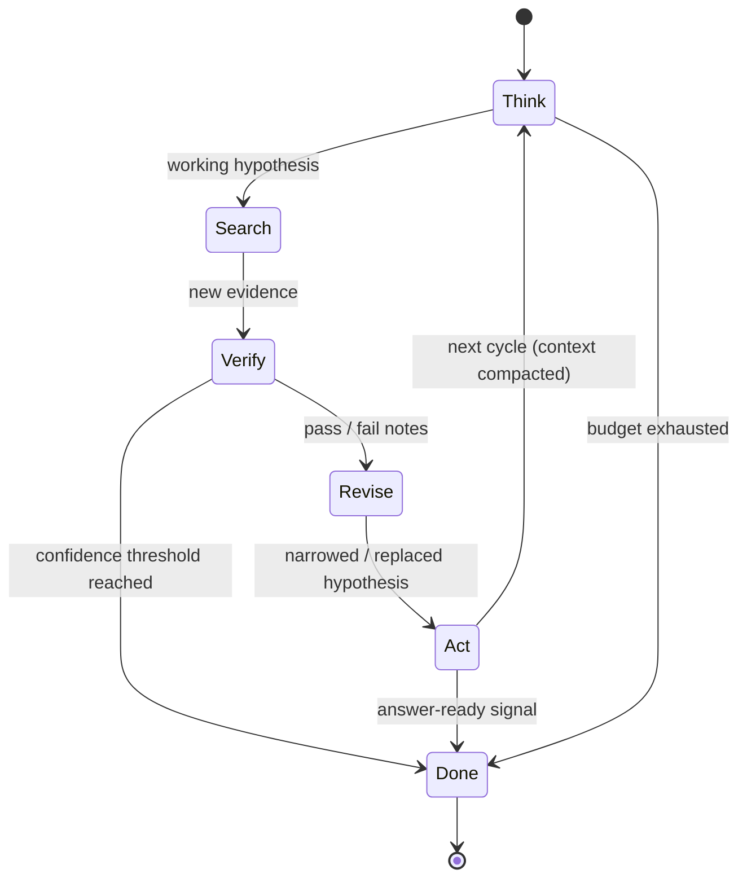

# Rumination Agent

**Also known as:** 沉思, Rumination Loop, Long-Horizon Research Loop, Hypothesis-Revising Agent

**Category:** Planning & Control Flow  
**Status in practice:** emerging

## Intent

Run a single agent through a protracted think-search-verify-revise-act loop spanning hundreds of tool calls, autonomously re-formulating hypotheses across the run.

## Context

A team runs an agent on open-ended research and deep-investigation work — assessing whether a paper's claims replicate, tracing the root cause of a system anomaly, scoping a novel question — where the answer cannot be reached by a short reason-act-observe loop or by a one-shot plan. The agent has retrieval, browsing, and code-execution tools and is expected to spend minutes to hours on a single question, accumulating evidence across hundreds of tool calls.

## Problem

Short reasoning budgets and one-shot plans collapse these investigations into surface-level answers because the agent never gets to revisit its working hypothesis. Splitting the work across multiple agents (a lead researcher delegating to subagents) introduces coordination overhead, message-passing artefacts, and inconsistent reasoning across the team. A single agent that runs for hours without any explicit cycle structure either declares victory too early or wanders into unbounded looping, with no checkpoint where drift becomes visible. The team needs one agent with an explicit, repeatable cycle that can sustain a long investigation without losing coherence or runaway cost.

## Forces

- Depth of investigation requires many sequential tool calls, but long traces bloat context and degrade attention.
- Re-formulating hypotheses mid-run is essential for hard questions, yet uncontrolled re-formulation is indistinguishable from drift.
- A single agent avoids inter-agent message-passing overhead, but loses the natural checkpoints a multi-agent split provides.
- The loop must be long-running but not unbounded; termination criteria are domain-dependent.

## Therefore

Therefore: structure the agent's run as an explicit think-search-verify-revise-act cycle with named hypothesis state and a per-cycle revision step, so that one model can sustain a protracted investigation while keeping each cycle short enough to stay coherent.

## Solution

Each outer iteration runs five named phases: (1) think — emit an updated working hypothesis given the trace so far; (2) search — issue retrieval, browsing, or tool calls scoped to that hypothesis; (3) verify — check the new evidence against the hypothesis with explicit pass/fail notes; (4) revise — either narrow, broaden, or replace the hypothesis based on verification; (5) act — write findings, update an externalised plan, or commit an artefact. The loop terminates on confidence threshold, budget exhaustion, or explicit answer-ready signal. Context is compacted between cycles by replacing prior search dumps with verified-evidence summaries, so the trace stays linear in cycles, not in tool calls.

## Structure

```
Single agent runtime with named cycle phases. State: working hypothesis, evidence ledger, cycle counter, budget. Tools: retrieval, browser, code execution. Termination: confidence threshold OR budget OR answer-ready.
```

## Diagram



*Each outer iteration cycles five named phases; the loop exits on confidence, budget, or an answer-ready signal.*

## Example scenario

A user asks an agent to assess whether a recent paper's empirical claims hold up. The agent forms an initial hypothesis (claim is supported), then over forty cycles searches for replications, reads supplementary materials, runs small reproductions in a sandbox, narrows the hypothesis to one specific table, eventually flips to claim is partially supported with one figure non-reproducible, and writes the verified findings into a structured report. No subagents are spawned; the same model carries the thread end-to-end.

## Consequences

**Benefits**

- Single-agent simplicity avoids multi-agent coordination overhead.
- Explicit hypothesis revision gives a checkable place where drift becomes visible.
- Per-cycle compaction keeps context bounded even across hundreds of tool calls.

**Liabilities**

- Long runs are expensive in tokens and wall-clock time.
- Compaction loses raw evidence; replay fidelity degrades.
- Without strong termination criteria the loop devolves into Unbounded Loop.
- Single-agent self-revision still shares all the failure modes of Same-Model Self-Critique.

## Failure modes

- Endless rumination — termination criteria are loose, and the loop keeps revising hypotheses until the budget is gone.
- Skipped verify — the agent revises its hypothesis straight from search results, and unchecked evidence steers the run.
- Compaction loss — summaries replace raw search dumps, and a detail needed later for a revision is no longer available.
- Self-agreement — the same model checks its own hypothesis, and it keeps confirming an early wrong frame.

## What this pattern constrains

The agent must not branch into parallel sub-investigations, must not skip the verify phase before revising the hypothesis, and must not extend the run past the declared cycle or token budget without explicit budget-extension authorisation.

## Applicability

**Use when**

- The task is open-ended research where a short ReAct loop returns surface answers.
- A single model can hold the investigation's working state and you want to avoid multi-agent coordination.
- Hundreds of tool calls are acceptable and budgeted.

**Do not use when**

- The task is short or well-specified; ReAct or plan-and-execute is enough.
- Verification needs an independent model; pair with cross-model review instead.
- Hard latency budgets forbid minutes-to-hours runs.

## Components

- Single long-running agent — carries the investigation across all cycles
- Working hypothesis state — named, persistent across cycles
- Five-phase cycle — think, search, verify, revise, act
- Evidence ledger — per-cycle verified evidence summary
- Termination guard — confidence threshold, budget, or explicit answer-ready signal

## Tools

- LLM API — invoked many times for the same agent across cycles
- Retrieval and browsing tools — external evidence gathering during search
- Code-execution sandbox — small reproductions during verify
- Context compactor — replaces raw search dumps with verified summaries between cycles

## Evaluation metrics

- Cycle count to answer-ready — depth of investigation needed
- Hypothesis-revision frequency — how often the agent narrows, broadens, or replaces
- Context-bloat resistance — token growth per cycle versus per tool call
- Verify-phase skip rate — incidents where revision happened without verification
- Budget-bound respect — fraction of runs terminating cleanly versus unbounded-loop drift

## Known uses

- **[Kimi K2 Thinking (Moonshot AI)](https://huggingface.co/moonshotai/Kimi-K2-Thinking)** _available_ — Long-horizon thinking model with explicit protracted reasoning loop spanning 200–300 sequential tool calls; weights on Hugging Face.
- **[GLM-Z1-Rumination (Zhipu AI)](https://ai-bot.cn/glm-z1-rumination/)** _available_ — Z1 variant tuned for rumination-style research loops.
- **[AutoGLM沉思 (Zhipu AI)](https://finance.sina.com.cn/tech/csj/2025-03-31/doc-inerpqhq7160075.shtml)** _available_ — Consumer-facing agent built around the rumination loop.

## Related patterns

- _generalises_ **ReAct** — ReAct is the short-loop ancestor; rumination is its protracted single-agent descendant.
- _complements_ **Extended Thinking** — Extended thinking is single-turn; rumination spans many turns of tool use.
- _alternative-to_ **Lead Researcher** — Lead-researcher splits the work across agents; rumination keeps it in one.
- _conflicts-with_ **Unbounded Loop** — Rumination requires explicit termination criteria to avoid this anti-pattern.

## References

- [moonshotai/Kimi-K2-Thinking on Hugging Face](https://huggingface.co/moonshotai/Kimi-K2-Thinking) — Moonshot AI, 2025
- [Moonshot launches open-source 'Kimi K2 Thinking' AI with trillion parameters](https://siliconangle.com/2025/11/07/moonshot-launches-open-source-kimi-k2-thinking-ai-trillion-parameters-reasoning-capabilities/) — SiliconANGLE, 2025
- [GLM-Z1-Rumination — Zhipu AI](https://ai-bot.cn/glm-z1-rumination/) — 2025
- [AutoGLM沉思 — Zhipu AI rolls out rumination-mode agent](https://finance.sina.com.cn/tech/csj/2025-03-31/doc-inerpqhq7160075.shtml) — 2025
