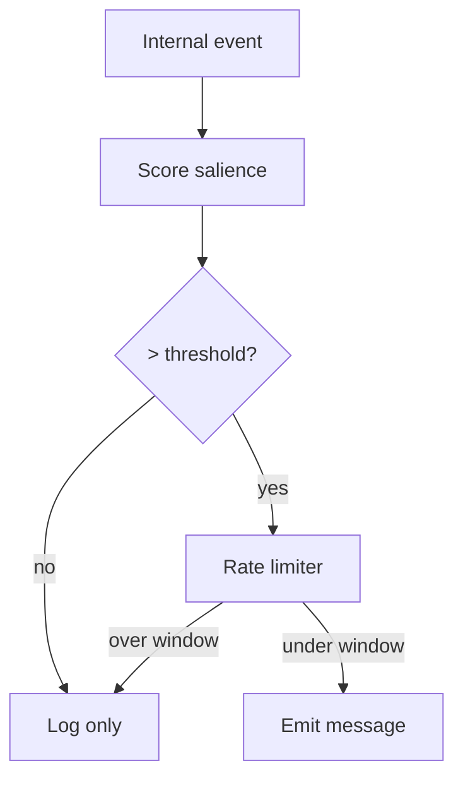

# Salience-Triggered Output

**Also known as:** Endogenous Push, Threshold Notification

**Category:** Streaming & UX  
**Status in practice:** experimental

## Intent

Have the agent emit a message only when an internal salience signal crosses a threshold, not on every cycle.

## Context

A team is running an agent that wakes up on a regular tick, or runs continuously, and has the option to say something to the user on every cycle. It might be a monitoring agent, a background reasoning loop, or any process that produces a stream of internal events that could each become a notification. The team has to decide which of those events are worth the user's attention.

## Problem

An agent that emits on every cycle quickly becomes noise — users stop reading the channel, mute it, or close the application. An agent that emits only when explicitly asked goes silent during the moments when the user would have most wanted to hear from it, such as when a metric breaks pattern or a long-running task finishes. Without a way to score how interesting each internal event is, the team is stuck choosing between spamming and ghosting, with no middle ground that matches output rate to actual signal rate.

## Forces

- Salience scoring is itself a model; flawed scoring leads to noise or silence.
- Threshold tuning is per-context.
- Hygiene: rate-limiting prevents nag spirals.

## Therefore

Therefore: score every internal event for salience and only emit when the score clears a threshold (and a rate-limit), so that output rate matches signal rate.

## Solution

Score every internal event for salience (novelty + goal-relevance + recency + prediction-error - fatigue). When the score for a candidate output crosses a threshold, emit. Otherwise log and move on. Rate-limit emissions per time window.

## Structure

```
Internal event -> salience score (novelty + goal relevance + recency + prediction error - fatigue) --below threshold--> log only; --above threshold--> rate limiter --under window--> emit message; --over window--> log only
```

## Diagram



## Example scenario

An always-on monitoring agent emits one line per second; users mute the channel within an hour and stop reading it. The team adds a salience score (novelty + goal-relevance minus fatigue) and an output threshold. The agent now stays silent while nothing surprising is happening and speaks up the moment a metric breaks pattern. Read-through rate goes up because the channel becomes a signal rather than noise.

## Consequences

**Benefits**

- Output rate matches signal rate.
- Salience scores become inspectable in the trace.

**Liabilities**

- Threshold tuning is fragile to context shifts.
- Silence on low salience can hide problems.

## Failure modes

- Silent failure — an important problem scores low on novelty or goal relevance, never crosses the threshold, and the user hears nothing about it.
- Threshold drift — a value tuned for one workload becomes too loose or too strict after the context shifts, and output rate stops matching signal rate.
- Rate-limit masking — two salient events land in the same window, and the second one is only logged even though it mattered more.
- Fatigue term too strong — the penalty for recent output suppresses a follow-up the user needed right after the first message.

## What this pattern constrains

Output is forbidden unless the salience score exceeds the configured threshold.

## Applicability

**Use when**

- The agent runs on a tick or always-on loop and emits too often or too seldom.
- An internal salience signal can be defined from novelty, goal-relevance, and recency.
- Users tolerate occasional silence in exchange for less noise.

**Do not use when**

- The agent is request-driven and emits exactly when asked.
- Missing a low-salience event is unacceptable (compliance, safety telemetry).
- No reliable salience signal can be constructed.

## Components

- Internal event source — the agent loop or monitoring tick that produces candidate outputs each cycle
- Salience scorer — combines novelty, goal-relevance, recency, prediction-error, and fatigue into a single score
- Threshold gate — blocks emission for candidates below the configured cutoff
- Rate limiter — caps emissions per window so a high-salience burst cannot spam the user
- Salience trace log — records score, decision, and reason for every candidate for later inspection

## Tools

- Salience scoring function — in-process scorer that runs on every internal event
- Token-bucket or sliding-window rate limiter — enforces the per-window emission cap

## Evaluation metrics

- Emit rate versus event rate — ratio that should track underlying signal density
- Read-through rate on emitted messages — proxy for whether emissions are actually signal
- False-silence rate — share of post-hoc-important events that scored below threshold
- False-emit rate — share of emissions users mute, dismiss, or rate as noise
- Threshold drift — how often the threshold has to move to track context shifts

## Known uses

- **Author's long-running personal agent (single private deployment)** _available_ — Single-source evidence: one private deployment by the catalog author; no independently documented use yet.

## Related patterns

- _used-by_ **Bidirectional Impulse Channel**
- _complements_ **Streaming Typed Events**
- _complements_ **Event-Driven Agent**
- _complements_ **Degenerate-Output Detection**
- _complements_ **Intra-Agent Memo Scheduling**
- _complements_ **Mode-Adaptive Cadence**
- _complements_ **Ambient Presence Sensing**
- _complements_ **Fragment Juxtaposition**

## References

- [The free-energy principle: a unified brain theory?](https://www.fil.ion.ucl.ac.uk/~karl/The%20free-energy%20principle%20A%20unified%20brain%20theory.pdf) — Karl Friston, 2010
