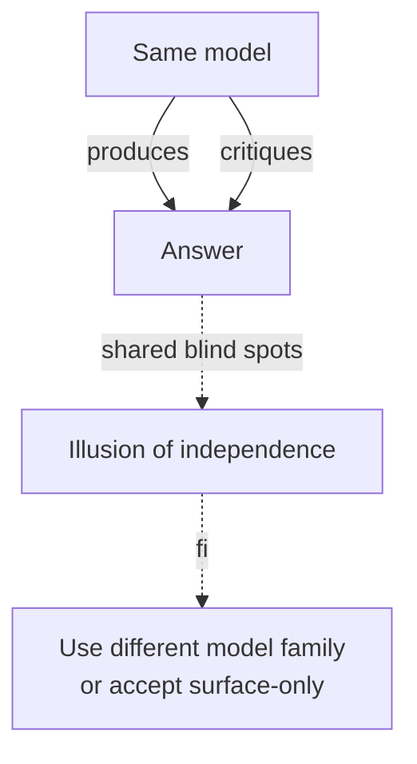

# Same-Model Self-Critique

**Also known as:** Echo-Chamber Reflection, Single-Model Reflexion

**Category:** Anti-Patterns  
**Status in practice:** deprecated

## Intent

Anti-pattern: have the same model both produce an answer and critique it, expecting independence.

## Context

A team builds a reflective agent — Reflexion, self-refine, or an evaluator-optimizer loop — where one call produces a candidate answer and a second call critiques and revises it. To keep cost and integration simple, both calls use the same model, often with prompts that share their wording about what 'good' looks like. The critique step is then presented internally or to users as an independent check on the answer.

## Problem

Because producer and critic come from the same weights and read overlapping prompts, the critic shares the producer's blind spots; whatever the model is confidently wrong about, it is also confidently wrong about when wearing the critic hat. Wrong answers come back from the loop endorsed and slightly polished, and the team reports higher confidence on what is, statistically, the same error rate. Replication studies through 2025 have repeatedly confirmed that single-model self-critique catches surface mistakes but does not act as independent verification.

## Forces

- Two models cost twice.
- Cross-model judges have their own biases.
- Self-critique feels free.

## Therefore

Therefore: route critique to a different model family or a programmatic verifier — and if you cannot, downgrade the claim to 'catches surface errors only' — so that shared blind spots stop being laundered as independent confirmation.

## Solution

Don't pretend it is independent. Either accept that self-critique catches surface errors only, or use a different model family for the critic. See reflection, evaluator-optimizer, llm-as-judge.

## Structure

```
Anti-pattern: model produces answer -> same model critiques -> shared blind spots -> wrong answer endorsed. Corrected: model produces answer -> critic from a different model family -> independent check; or treat self-critique as surface checks only.
```

## Diagram



## Example scenario

A team ships an agent where the same model writes an answer and then 'self-critiques' it before returning, and treats the critique as independent verification. Replication studies and their own evals show the critic confidently endorses confidently-wrong answers because it shares the producer's blind spots. They stop pretending independence: they either accept that self-critique catches surface errors only, or they swap the critic to a different model family.

## Consequences

**Benefits**

- Short-term: one model for both roles is cheap, simple, and does catch some surface errors.
- Naming it lets a team stop counting self-critique as an independent review.

**Liabilities**

- False confidence in flawed answers.
- Self-reinforced misconceptions across iterations.

## Failure modes

- Shared blind spot — the critic is wrong about the same thing as the producer, and approves the error.
- Polished mistake — the loop returns the wrong answer slightly reworded and marked as reviewed.
- Inflated confidence — the team reports higher confidence after critique while the error rate stays the same.

## What this pattern constrains

Avoiding it imposes an independence requirement: a critique stage must not be presented as independent review when producer and critic share weights; either label it surface-error checking or use a different model family.

## Applicability

**Use when**

- Cite this entry when a pipeline claims independent review but producer and critic are the same model.
- You are already here if the critic consistently approves answers that an external check rejects.
- Treat self-critique as surface-error checking only, or move the critic to a different model family (see llm-as-judge, evaluator-optimizer).

**Do not use when**

- Critique must be independent or trusted to catch deep errors.
- Cost of a wrong-but-confident answer is high.
- A second model family or programmatic verifier is available.

## Components

- Single model — produces both the candidate answer and the critique from the same weights
- Overlapping prompts — share wording about what 'good' looks like, reinforcing shared blind spots
- Reflection loop — folds the critic's verdict into a revised answer that inherits the same errors
- Missing independent verifier — would route critique to a different model family or programmatic check

## Tools

- Producer and critic prompt pair — both bound to the same model endpoint
- Cross-model judge or programmatic verifier — missing alternative that would break the shared blind spot

## Evaluation metrics

- Critic-endorsement rate on confidently-wrong answers — share of wrong answers the same-model critic approves
- Independence-of-critique signal — measured agreement between same-model critic and cross-model critic on identical answers
- Error-correction rate per reflection round — flat curve indicates self-critique is not catching deep errors
- Confidence-calibration gap — divergence between stated confidence after self-critique and true accuracy

## Known uses

- **Naive Reflexion implementations** _available_

## Related patterns

- _alternative-to_ **Reflection** — Same-model-self-critique is the misuse mode of reflection; well-engineered reflection (frozen-rubric or self-refine) avoids the failure.
- _conflicts-with_ **Evaluator-Optimizer**
- _conflicts-with_ **Self-Refine**
- _alternative-to_ **Degenerate-Output Detection**
- _alternative-to_ **Blind Grader with Isolated Context**
- _complements_ **Sycophancy**
- _alternative-to_ **Cross-Reflection**
- _complements_ **Consensus-Averaging Over Expertise** — Both are multi-agent aggregation failures; self-critique assumes false independence, consensus-averaging dilutes a genuinely better member by compromise.

## References

- [Theaiengineer.substack: ReAct vs Plan-and-Execute vs ReWOO vs Reflexion](https://theaiengineer.substack.com/p/the-4-single-agent-patterns) — 2025
- [Large Language Models Cannot Self-Correct Reasoning Yet](https://arxiv.org/abs/2310.01798) — Huang et al., 2023
