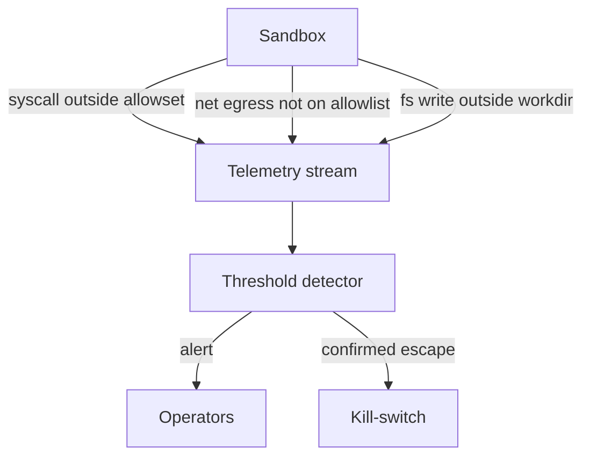

# Sandbox Escape Monitoring

**Also known as:** Sandbox Telemetry, Boundary Violation Alerts

**Category:** Governance & Observability  
**Status in practice:** emerging

## Intent

Treat sandbox boundary violations as telemetry; alert on syscalls, network egress, or filesystem writes outside expected scope.

## Context

A team runs an agent that executes generated code or manipulates files on behalf of users, inside an isolation boundary such as a container, microVM, or syscall-filtered sandbox. The boundary is designed to confine what the agent can read, write, and reach over the network. Real-world sandboxes have known escape vectors and zero-day vulnerabilities; isolation is necessary but not by itself sufficient.

## Problem

Treating the sandbox as a pure prevention mechanism means a successful escape, or even repeated escape attempts, can happen without anyone seeing them. A blocked network egress, an unexpected syscall, or a write outside the working directory will silently fail or succeed without any alert. The team is forced to choose between assuming the sandbox is impenetrable, which it is not, or learning about boundary violations from the downstream damage they cause.

## Forces

- Telemetry granularity vs cost.
- False positives on legitimate boundary-pushing operations.
- Egress patterns evolve faster than allowlists.

## Therefore

Therefore: instrument the sandbox to log every syscall, egress, and filesystem write outside the allowed set, stream to safety telemetry, and tie threshold breaches to the kill-switch, so that boundary violations become alertable signal rather than silent compromise.

## Solution

Instrument the sandbox: log every syscall outside the allowed set, every network egress not on the allowlist, every filesystem write outside the working directory. Stream to safety telemetry. Alert on threshold breaches. Pair with kill-switch for automatic halt on confirmed escape.

## Structure

```
Instrumented sandbox --(syscall outside allowed set | egress not on allowlist | write outside workdir)--> Safety telemetry stream --> Threshold detector --alert--> Operators / --confirmed escape--> Kill-switch halts agent
```

## Diagram



## Example scenario

A code-execution agent runs user-emitted Python in a container that should have no network. One day a contractor's prompt-injected payload triggers an outbound DNS request; sandbox-isolation alone would have allowed the egress to fail silently. With escape monitoring, the unexpected syscall and the blocked egress both stream to safety telemetry, an alert fires within seconds, and the team locks the offending tenant before any further attempts.

## Consequences

**Benefits**

- Detection of escape attempts and successes.
- Forensic trail when incidents occur.

**Liabilities**

- Telemetry volume.
- Alert fatigue if thresholds are mis-tuned.

## Failure modes

- Alert fatigue — thresholds are set too low, operators learn to ignore the stream of boundary alerts, and a real escape is lost among them.
- Stale allowed set — a legitimate new tool needs a syscall or egress target that is not listed, and its normal behaviour floods the telemetry as violations.
- Blind spot in instrumentation — the sandbox logs network and file events but not a class of syscalls, so one escape path produces no event.
- Detected but not stopped — a confirmed escape raises an alert, but the kill-switch link is missing and the agent keeps running until a human acts.

## What this pattern constrains

Sandbox events outside the allowed set must be logged and inspectable; silent boundary violations are forbidden.

## Applicability

**Use when**

- The agent executes code or operates a filesystem inside a sandbox.
- Sandbox boundaries can be instrumented to log syscalls, egress, and writes.
- A safety telemetry pipeline and kill-switch already exist or are being built.

**Do not use when**

- There is no sandbox to monitor (escape monitoring without isolation is theatre).
- Telemetry volume would overwhelm the safety pipeline without thresholds.
- Alerts have no responder and would be ignored.

## Components

- Instrumented Sandbox — container, microVM, or syscall-filter that emits boundary events
- Allowed-Set Definitions — explicit lists of permitted syscalls, egress destinations, and filesystem paths
- Safety Telemetry Stream — receives every boundary-violation event in near real time
- Threshold Detector — fires alerts on burst patterns and confirmed escape signatures
- Kill-Switch Bridge — auto-halts the agent fleet when escape is confirmed

## Tools

- E2B / Modal sandbox monitoring — production code-execution platforms with boundary telemetry
- Linux seccomp / eBPF — syscall-level instrumentation for sandboxed workloads
- Egress firewall with logging (Cilium, iptables) — captures network egress outside allowlist

## Evaluation metrics

- Boundary-violation detection rate — share of injected red-team violations that surface as alerts
- False-positive rate on legitimate operations — alerts on benign boundary-pushing actions
- Mean time from violation to alert — telemetry pipeline latency
- Kill-switch trigger precision — share of auto-halts that turned out to be real escapes
- Forensic-trail completeness on incidents — share of confirmed escapes with full event chain captured

## Known uses

- **Production code-execution platforms (E2B, Modal sandbox monitoring)** _available_

## Related patterns

- _complements_ **Sandbox Isolation**
- _composes-with_ **Kill Switch**
- _uses_ **Provenance Ledger**
- _complements_ **Adversary-Indistinguishability Blind Spot** — Sandbox-escape monitoring treats boundary violations as telemetry; this names why behavioural-anomaly detection alone misses a credential-legitimate agent adversary that never trips an obvious boundary.

## References

- [OWASP Top 10 for LLM Applications (2025)](https://genai.owasp.org/llm-top-10/) — 2025
