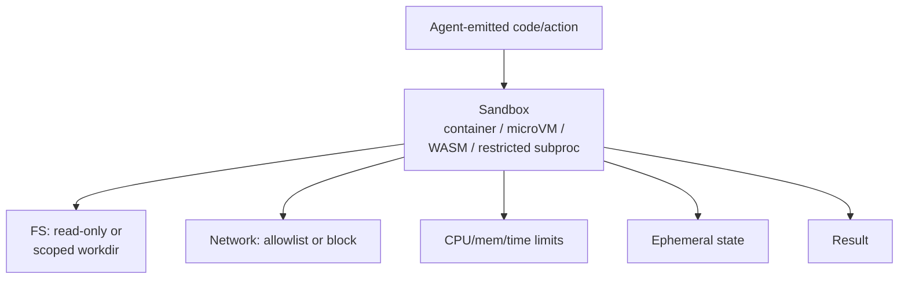

# Sandbox Isolation

**Also known as:** Code Sandbox, Container Isolation, Restricted Execution

**Category:** Tool Use & Environment  
**Status in practice:** mature

## Intent

Run agent-emitted code or actions in a contained environment with restricted filesystem, network, and process privileges.

## Context

A team is running an agent that executes model-generated code, runs shell commands, or operates the host filesystem as part of its action loop. The agent is exposed to user inputs, retrieved documents, or tool outputs that may be hostile or simply mistaken, and the host machine holds developer files, credentials, or shared infrastructure.

## Problem

An agent with full host access can damage the host either deliberately (a prompt-injection payload tells it to delete a directory or exfiltrate a secret) or accidentally (the model emits a destructive command targeting the wrong path). Once a wrong rm -rf, curl-piped-to-shell, or rogue tool call has run on the host, no amount of in-loop reasoning can undo it; the blast radius is whatever the host process can reach.

## Forces

- Sandbox setup adds latency.
- Strict sandboxes block legitimate work.
- Escape vulnerabilities are real and ongoing.

## Therefore

Therefore: run every agent-emitted action inside a container, microVM, or WASM runtime with allowlisted filesystem, network, and resource limits, so that mistakes and prompt injections cannot reach the host.

## Solution

Run code in a container, microVM, WASM runtime, or restricted subprocess with minimal privileges. Filesystem is read-only or scoped to a working directory. Network is allowlisted or blocked. Resource limits cap CPU/memory/time. Persistent state is ephemeral by default.

## Structure

```
Agent-emitted code or action --> Sandbox (container / microVM / WASM / restricted subprocess): filesystem read-only or scoped, network allowlisted or blocked, CPU/memory/time limits, ephemeral state --> Result
```

## Diagram



## Example scenario

A coding agent runs LLM-emitted shell commands directly on the developer's host and one day a `rm -rf` lands in the wrong directory. The team moves all agent-emitted execution into a microVM with read-only base filesystem, a scoped working directory, network allowlist, and CPU and memory caps. A subsequent destructive command is contained to a disposable VM and the host stays intact; the agent product stops being one mistake away from a nuked laptop.

## Consequences

**Benefits**

- Blast radius is contained.
- Same sandbox image is reproducible across runs.

**Liabilities**

- Some workflows need network or filesystem access the sandbox forbids.
- Sandbox tech (Docker, gVisor, Firecracker, WASM) is its own engineering.

## Failure modes

- Over-broad mount — the working directory is mapped to a path that includes secrets or the home folder, and injected code reads them.
- Open egress — network rules allow more hosts than needed, and data leaves through a call that looks legitimate.
- Sandbox opened for convenience — a workflow needs network or file access, the policy is loosened for all runs, and the protection is gone.
- Leaky persistence — state that should be ephemeral survives between runs, and one task's files are visible to the next.

## What this pattern constrains

Code may only access resources granted by the sandbox policy; outbound network and host filesystem are forbidden by default.

## Applicability

**Use when**

- The agent executes generated code or operates the filesystem.
- Host damage (deletion, exfiltration, malware) is a credible risk.
- A container, microVM, or WASM runtime can be deployed for execution.

**Do not use when**

- The agent never executes code or touches the filesystem.
- Isolation overhead breaks latency or cost targets and the workload is genuinely safe.
- Sandbox configuration is so loose it provides no real protection.

## Components

- Sandbox Container — container, microVM, WASM runtime, or restricted subprocess that executes the agent-emitted code
- Filesystem Policy — read-only or scoped working directory boundary
- Network Policy — allowlist or full block for outbound connections
- Resource Limiter — caps CPU, memory, and wall time per call
- Ephemeral State Layer — discards persistent changes by default at the end of each call

## Tools

- Container or microVM runtime (Docker, Firecracker, gVisor) — provides the isolation boundary
- WebAssembly runtime (Wasmtime, Wasmer) — offers a lighter-weight sandbox option for skill code
- Seccomp and Linux capabilities filters — restrict syscalls available to the sandboxed process

## Evaluation metrics

- Sandbox escape incidents — confirmed or attempted breaches per million runs
- Resource-cap trigger rate — how often CPU, memory, or time limits stop a run
- Per-call sandbox setup latency — cold-start cost of provisioning the isolated environment
- Disallowed-syscall rate — share of runs that hit the syscall filter
- Policy drift incidents — cases where the deployed filesystem or network policy diverged from intent

## Known uses

- **OpenAI Code Interpreter sandbox** _available_
- **E2B sandboxes** _available_
- **Claude Code's project-level write boundaries** _available_
- **[Sparrot](https://marco-nissen.com/sparrot/)** _available_ — Code execution and side-effecting tool calls run in an isolated sandbox mode that restricts the available surface; the mode is a runtime state, not a per-call flag.

## Related patterns

- _used-by_ **Code-as-Action Agent**
- _complements_ **Code Execution**
- _complements_ **Dual LLM Pattern**
- _composes-with_ **Input/Output Guardrails**
- _complements_ **Lethal Trifecta Threat Model**
- _complements_ **Sandbox Escape Monitoring**
- _composes-with_ **Subagent Isolation**
- _used-by_ **Todo-List-Driven Autonomous Agent**
- _generalises_ **WebAssembly Skill Runtime**
- _used-by_ **MCP-as-Code-API**
- _complements_ **JSON-Only Action Schema**
- _alternative-to_ **Agent-Generated Code RCE**
- _alternative-to_ **Self-Exfiltration**
- _complements_ **Authorized Tool Misuse**
- _alternative-to_ **Agent Privilege Escalation**
- _alternative-to_ **Authorized Tool Misuse**
- _used-by_ **Simulate Before Actuate**
- _complements_ **Code-Then-Execute with Dataflow Analysis**
- _complements_ **Progressive Tool Access**
- _used-by_ **Managed Agent Runtime**
- _used-by_ **Full-Desktop Computer Use**
- _used-by_ **Forkable Agent Sandbox** — Isolation supplies the containment boundary; this pattern adds a versioning primitive on top of it, turning the contained environment into something that can be forked and rolled back.

## References

- [E2B Sandboxes](https://e2b.dev/docs)
