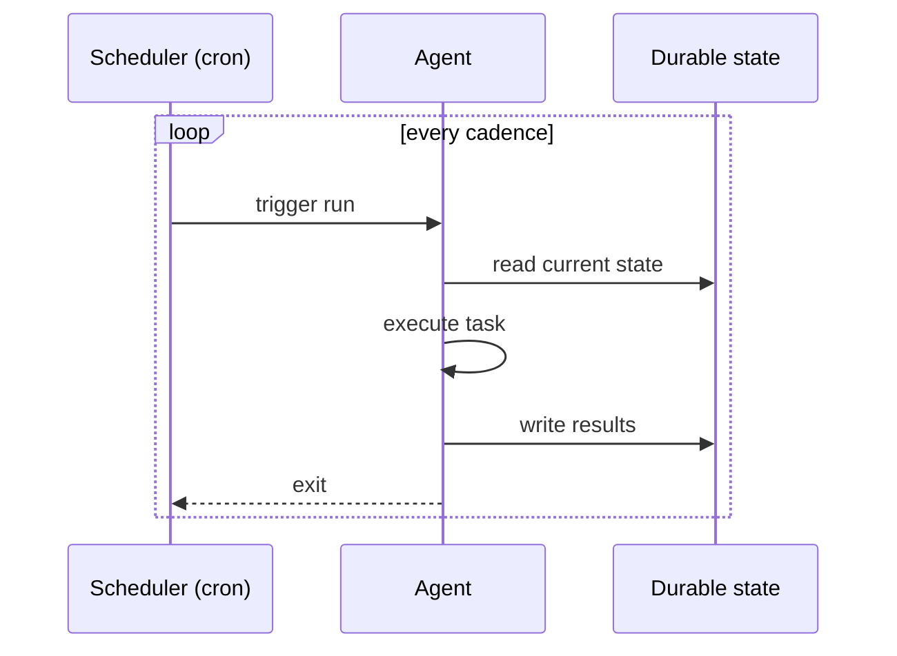

# Scheduled Agent

**Also known as:** Cron Agent, Time-Triggered Agent, Periodic Agent

**Category:** Planning & Control Flow  
**Status in practice:** mature

## Intent

Run the agent on a fixed schedule independent of user requests.

## Context

A team needs an agent to do work on a clock — produce an overnight summary, triage incoming issues every Monday morning, run an hourly health check, send a daily competitive-intelligence digest. The work has to happen whether or not a user remembers to ask. A scheduler (cron, a queue with delayed delivery, a managed scheduler service) and durable storage for the agent's state are available.

## Problem

Request-driven agents only act when someone calls them; if no user prompts the digest, the digest never goes out. Asking a human to trigger the agent every morning defeats the point of automation. Running the agent continuously in a polling loop wastes most of its budget on idle wakeups. Without persisted state between runs, each scheduled invocation starts from zero and cannot pick up where the previous one left off, so anything that needs continuity (last-seen items, in-progress investigations) is lost.

## Forces

- Schedule density trades cost for freshness.
- Failure modes when the agent's run is missed.
- Drift if the schedule is not authoritative.

## Therefore

Therefore: trigger the agent on a fixed schedule and persist its state to durable storage between runs, so that time-bounded tasks happen on the clock even when no human is around to ask.

## Solution

Schedule the agent run at fixed cadence (cron, scheduler service). The agent reads its current state, executes its task, writes results, and exits. State persists across runs in durable storage.

## Structure

```
Scheduler (cron) --tick--> Agent runtime --> read Durable state --> execute task --> Result writer (sink) --> write Durable state --> exit --> next tick
```

## Diagram



## Example scenario

A product manager wants a daily competitive-intelligence digest in their inbox. Building it as a request-driven agent forces them to remember to ask each morning, which they don't. The team schedules the agent to run at 06:00 cron, read its persisted state (last-seen items), execute its task, write results to email and storage, and exit. The digest now arrives reliably even when no human is awake, and the agent's state survives across runs.

## Consequences

**Benefits**

- Time-bounded tasks happen reliably.
- Idempotent runs make retries safe.

**Liabilities**

- Cost per run regardless of need.
- Skew between expected and actual cadence.

## Failure modes

- Idle-run cost — the agent runs every tick even when nothing has changed, and most of the spend produces nothing new.
- Cadence skew — runs fire late or overlap, and the output arrives after people needed it.
- Double tick — the scheduler fires twice, the idempotency guard is missing, and the digest goes out twice.
- Lost state — the state write fails at the end of a run, and the next run starts from zero and repeats old items.

## What this pattern constrains

The agent is not invoked by user requests; only the scheduler triggers runs.

## Applicability

**Use when**

- A task should run periodically regardless of user prompting.
- Agent state can be persisted in durable storage between runs.
- A scheduler (cron, queue, scheduler service) is available.

**Do not use when**

- The task only matters in response to a specific user request.
- Runs would frequently be wasted because no work is pending.
- Persistent state cannot be carried across runs.

## Components

- Schedule trigger — cron expression or scheduler entry that fires runs
- Agent runtime — invoked on each tick to do the work
- Durable state store — persists context across runs so continuity is preserved
- Result writer — emits the run's output to the chosen sink (email, dashboard, store)
- Idempotency guard — keeps retries safe when a tick fires twice

## Tools

- Scheduler — cron, queue with delayed delivery, or managed scheduler service
- LLM API — invoked per run for the actual task
- Durable state store — database, object store, or file system carrying state between runs
- Notification or output channel — email, webhook, or dashboard for results

## Evaluation metrics

- Missed-tick rate — scheduled runs that failed to fire
- Per-run cost on empty days — spend when no work was actually pending
- State-continuity correctness — runs that correctly picked up from prior state
- Schedule-skew drift — variance between expected and actual cadence
- Idempotency-failure incidents — duplicate side effects from double-fired ticks

## Known uses

- **Claude Code scheduled agents** _available_
- **[Sparrot](https://marco-nissen.com/sparrot/)** _available_ — The agent wakes on an internal schedule rather than waiting for a user message; chat is one wake source among several, not the only trigger.

## Related patterns

- _alternative-to_ **Event-Driven Agent**
- _alternative-to_ **Spec-Driven Loop**
- _complements_ **Agent Resumption**
- _complements_ **Now-Anchoring**
- _generalises_ **Intra-Agent Memo Scheduling**
- _alternative-to_ **Mode-Adaptive Cadence**
- _complements_ **Durable Workflow Snapshot**
- _complements_ **Local-to-Cloud Handoff**

## References

- [Message Batches](https://docs.claude.com/en/docs/build-with-claude/batch-processing) — 2025
