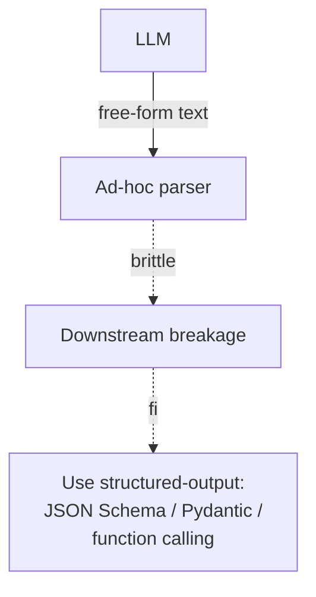

# Schema-Free Output

**Also known as:** Free-Form Tool Call, String-Parsing the Model

**Category:** Anti-Patterns  
**Status in practice:** deprecated

## Intent

Anti-pattern: parse free-form model output for downstream code instead of using structured output.

## Context

A team uses an LLM to produce values that downstream code consumes — a JSON-looking blob, a yes/no decision, a list of records — but the model is asked for free-form text and the consumer parses it with regular expressions, string splits, or substring checks like 'does the word yes appear here'. The provider offers structured output (a JSON Schema or function-calling contract that constrains the model's output), but the team has not adopted it, often because the integration looked like extra setup at the time. The model's text is treated as essentially typed even though nothing enforces that.

## Problem

The model varies its punctuation, capitalisation, field names, and ordering in ways the parser was not written for: smart quotes instead of straight quotes, a missing comma, a 'sure, here is the answer' preamble the parser tried to skip but did not. The downstream code fails in non-obvious ways, corrupts state, or silently misinterprets the result. Post-mortems then blame the model for being flaky when the real bug is in the parser, and the team chases evals that were never going to fix a parsing problem.

## Forces

- Structured output adds setup cost and provider lock-in.
- Some providers offered structured output later than tool use.
- Free-form feels flexible until it breaks.

## Therefore

Therefore: require typed structured output (JSON Schema, Pydantic, function calling) at the model boundary and validate before downstream consumption, so that parser bugs cannot be mis-attributed to model flakiness.

## Solution

Don't. Use structured-output (JSON Schema, Pydantic, function calling). See structured-output, tool-use.

## Structure

```
Anti-pattern: model free-form text -> hand-written parser -> format variation -> parse failure or silent corruption downstream. Corrected: schema (JSON Schema, typed model, function calling) -> structured output -> validated object -> downstream code.
```

## Diagram



## Example scenario

A team ships an agent whose downstream consumes free-form model output by regex-parsing 'looks like JSON.' Edge cases (smart quotes, missing commas, surprise prose preamble) fail in non-obvious ways, and post-mortems blame the model when most failures are parser bugs. They stop doing this and switch to structured output with a JSON Schema, validating against it and retrying on parse failure. The 'flaky model' framing dissolves into a parser-bug fix.

## Consequences

**Benefits**

- Short-term: asking for a format in plain words and parsing the reply works in early tests without schema setup.
- Naming it lets a team move format guarantees from the parser to a schema.

**Liabilities**

- Brittle parsing.
- Silent corruption of downstream state.
- Debugging blames the model when the parser is at fault.

## Failure modes

- Preamble breaks parser — the model adds an opening sentence before the data, and the parser reads the wrong thing.
- Quote and comma drift — curly quotes or a missing comma make parsing fail, or worse, succeed with wrong values.
- Misplaced blame — post-mortems call the model flaky and chase evals, when the bug is in the parser.

## What this pattern constrains

Avoiding it imposes an interface contract: downstream code must not parse free-form model text; every machine-consumed output needs a schema enforced at generation time or validated immediately after.

## Applicability

**Use when**

- Cite this entry when downstream code regex-parses prose the model happened to emit.
- You are already here if format drift in model output silently corrupts state.
- Use structured-output (JSON Schema, Pydantic, function calling); if the provider lacks it, validate strictly post-parse and retry.

**Do not use when**

- Downstream code depends on typed fields.
- Parser failure would propagate as a model bug and waste debugging time.
- Structured output or tool calling is available on the chosen provider.

## Components

- LLM call — asked for free-form text that downstream code will treat as typed
- Ad-hoc parser — regular expressions, string splits, or substring checks over the model's reply
- Downstream consumer — assumes typed fields and corrupts state when parsing skews
- Missing schema-bound surface — would constrain the model to JSON Schema, Pydantic, or function-calling output

## Tools

- Regex and string-split parser — brittle surface that fails on punctuation, casing, and prose preambles
- Structured-output contract — missing typed boundary that would validate before consumption

## Evaluation metrics

- Parse-failure rate per response — fraction of model outputs that the ad-hoc parser cannot process
- Downstream-corruption incident count — count of cases where mis-parsed output reached a write path
- Schema-validation coverage — share of LLM-to-code interfaces backed by a typed contract; near zero flags the anti-pattern
- Mis-attribution share — fraction of bugs blamed on the model that were in fact parser bugs

## Known uses

- **Pre-2024 LangChain agents** _available_

## Related patterns

- _alternative-to_ **Structured Output**
- _alternative-to_ **Tool Use**

## References

- [Tool use with Claude](https://docs.claude.com/en/docs/agents-and-tools/tool-use/overview) — 2025
- [Building Effective Agents](https://www.anthropic.com/engineering/building-effective-agents) — Anthropic, 2024
