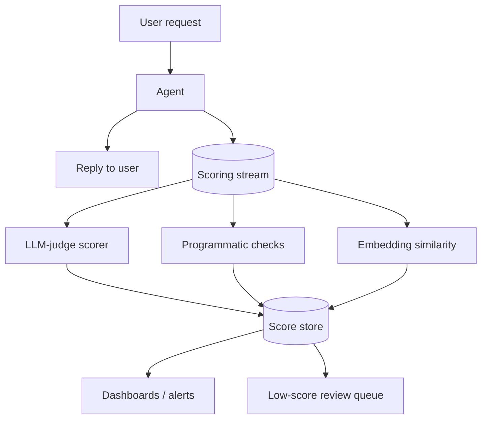

# Scorer Live Monitoring

**Also known as:** Live Evaluation, Production Scoring, Async Output Scorers

**Category:** Governance & Observability  
**Status in practice:** emerging

## Intent

Score agent outputs asynchronously in production with non-blocking scorers that observe, alert, and log but do not regenerate the output.

## Context

A team runs an agent that handles real user traffic and wants a continuous read on output quality, not just a snapshot at release time. The product has a tight latency budget — users will notice if every reply waits an extra second on a scoring model. Quality matters across several dimensions at once: helpfulness judged by another model, forbidden phrases checked programmatically, similarity to a curated reference, and rubric-based checks.

## Problem

Pre-release evaluations on a fixed held-out dataset only cover distributions the team thought of in advance and say nothing about what real traffic looks like today. Closed-loop approaches that re-run the model whenever a score is low double latency and cost for every request, even though most outputs are fine. The team is forced to choose between flying blind on live quality, paying the latency tax of inline scoring, or running expensive batch analyses long after the bad reply has already reached the user.

## Forces

- Live quality data is the only honest signal that production matches lab.
- Blocking the response on a judge model doubles latency and cost.
- Async scorers can fall behind during traffic spikes and need back-pressure.
- Open-loop scoring is informational only — the user already saw the output by the time the score lands.
- Multiple scorer kinds (LLM judge, programmatic check, embedding-similarity, rubric) emit on different timescales.

## Therefore

Therefore: emit each agent output onto a scoring stream that asynchronous, non-blocking scorers consume, so that production quality is monitored continuously without blocking the response or regenerating the output.

## Solution

After the agent returns to the user, publish `{request_id, input, output, context}` to a scoring stream. Independent scorer workers consume the stream and emit `{request_id, scorer, score, evidence}` records. Scorers may be LLM judges, programmatic checks, embedding-similarity to a reference, or rubric checks. Aggregate scores into dashboards and alert rules; route low scores into a re-evaluation queue rather than triggering re-generation in the user's request path. Distinct from evaluator-optimizer (which closes the loop by re-prompting on failure) and from eval-harness (which scores on a fixed set, not live traffic).

## Structure

```
Agent → user (fast). Agent → scoring stream → [scorer worker, scorer worker, ...] → score store → dashboard / alerting.
```

## Diagram



## Example scenario

A customer-support agent serves thousands of replies per hour. The team wants a continuous read on reply quality but cannot afford to block each reply on a judge model. They emit every reply onto a scoring stream that three workers consume: an LLM-judge scorer for helpfulness, a programmatic scorer for forbidden phrases, and an embedding-similarity scorer against a curated reference set. Scores populate a dashboard with rolling p50/p95; replies below threshold flow into a human-review queue but the user has already seen the reply. When the LLM-judge score drops sharply after a model swap, the team rolls back before the next deploy.

## Consequences

**Benefits**

- Continuous live-traffic quality signal without latency cost in the user path.
- Many scorer kinds can run side-by-side without contention.
- Low-score events accumulate into a review queue rather than firing in the moment.
- Cost is bounded by sampling rates per scorer.

**Liabilities**

- Open-loop: the bad output already reached the user; this pattern observes rather than corrects.
- Async scorers under traffic spikes can lag the signal by minutes.
- Judge-model scorers can drift across model versions; rubric versioning matters.
- Scorer cost can creep — sampling rates need governance.

## Failure modes

- Treated as a fix — teams assume low scores get corrected, but the bad reply has already reached the user and nothing changes it.
- Lagging signal — a traffic spike backs up the scoring stream, and the dashboard reports a quality drop minutes after it began.
- Judge version drift — the scorer's judge model is upgraded without a rubric version, and score trends jump for reasons unrelated to the agent.
- Unread review queue — low-score items keep piling into the review queue, and no one is assigned to work through it.

## What this pattern constrains

Scorers do not run in the user's request path and may not modify or regenerate the agent's output; the user-visible response must not block on a scorer.

## Applicability

**Use when**

- Production quality must be observed continuously, not just at release.
- Latency budget on the user path does not allow a blocking judge call.
- Multiple scorer kinds (LLM judge, programmatic check, embedding similarity) should run side by side.

**Do not use when**

- The agent's reply must be regenerated on low score — use evaluator-optimizer.
- Pre-release coverage is sufficient and live traffic risk is low (use eval-harness alone).
- Scorer cost would dominate the budget — sample more aggressively or drop the scorer.

## Components

- Scoring-Stream Publisher — emits {request_id, input, output, context} after the agent replies to the user
- Async Scorer Workers — independent consumers (LLM judge, programmatic check, embedding similarity, rubric) running off the user path
- Score Store — persists {request_id, scorer, score, evidence} records
- Dashboard and Alert Layer — rolling p50/p95 per scorer with thresholds
- Low-Score Review Queue — routes failing outputs to humans without re-prompting the user path

## Tools

- Mastra Scorers — async live evaluators that run alongside agents and workflows
- Langfuse / LangSmith / Helicone live evals — production scoring on traced outputs
- Stream broker (Kafka, NATS, Redis Streams) — back-pressure-aware scoring fan-out

## Evaluation metrics

- Scorer lag p95 — seconds between user reply and the score landing in the store
- User-path latency impact — confirmation that scoring adds no latency to the response (target zero)
- Per-scorer sampling rate — share of traffic each scorer consumed
- Low-score review-queue depth — backlog of outputs awaiting human review
- Cross-scorer disagreement rate — divergence between LLM-judge, programmatic, and embedding scorers on the same output

## Known uses

- **[Mastra Scorers (live evaluations)](https://mastra.ai/docs/evals/overview)** _available_ — Mastra scorers run asynchronously alongside agents and workflows, scoring outputs without blocking responses.
- **[Langfuse / LangSmith / Helicone live evals](https://langfuse.com/docs/scores)** _available_ — Observability platforms ship live-eval / scorer features that run on traced production outputs.

## Related patterns

- _complements_ **Eval Harness**
- _alternative-to_ **Evaluator-Optimizer**
- _uses_ **LLM-as-Judge**
- _uses_ **Agent-as-a-Judge**
- _complements_ **Shadow Canary**
- _complements_ **Rigor Relocation**
- _complements_ **Dual Evaluation (Offline + Online)**
- _alternative-to_ **Trajectory Anomaly Monitor** — Output scoring is async and post-hoc; the trajectory monitor gates the action sequence pre-damage.
- _used-by_ **Re-Contact-Subtracted Resolution Gate** — The re-contact and wrong-answer signals that feed the subtraction come from asynchronous production monitoring rather than the live response path.
- _complements_ **Chance-Corrected Judge Validation** — Production scorers emit numbers continuously; the measured agreement is what says whether those numbers carry information.

## References

- [Mastra — Live evaluations](https://mastra.ai/docs/evals/overview) — Mastra
