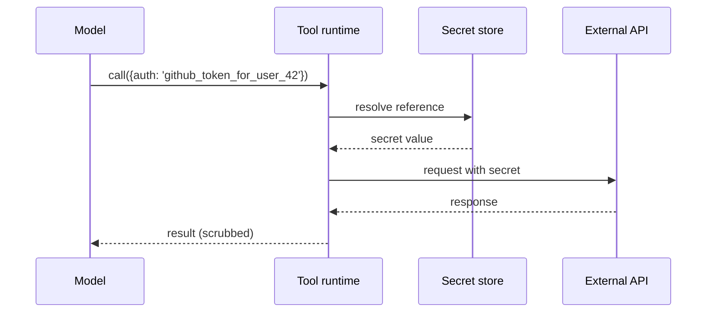

# Secrets Handling

**Also known as:** Tool-Side Credential Injection, Model-Never-Sees-Secrets

**Category:** Safety & Control  
**Status in practice:** emerging

## Intent

Ensure the model never receives secrets in plaintext; tools resolve credentials from references at runtime.

## Context

A team builds an agent whose tools need authentication — API keys, OAuth tokens, database credentials, service-account JSON, signed URLs. Tool authors often find it convenient to pass the secret as a tool argument, which means it flows through the model's context. The model's context is then captured in the conversation history, the application's trace store, the evaluation harness, and (for hosted models) the provider's logs.

## Problem

Once a plaintext secret enters the model's context window, it is no longer recoverable: it sits in the chat log, in the trace export, in the eval dataset, and on the third-party model provider's infrastructure. Rotating the credential helps for the next call but does nothing for the copies already scattered across systems. Asking the model to please not reveal secrets it has seen is unreliable. Without a way to keep credentials out of the model's context entirely, every tool call that needs auth is a potential leak with permanent consequences.

## Forces

- Tool authors prefer simple credential passing.
- Reference-based credential resolution adds tool runtime complexity.
- Some integrations require credentials in URL or header (cannot avoid).

## Therefore

Therefore: have the agent emit only typed credential references and let the tool runtime resolve the secret outside the model's context window, so that plaintext credentials never enter prompts, logs, or third-party traces.

## Solution

Tool runtime resolves credentials from typed references the agent emits (e.g., `{auth: 'github_token_for_user_42'}`). Credential values are injected outside the model context. Input/output guards reject any payload matching credential signatures. Provenance ledger and traces are scrubbed at write time.

## Structure

```
Model --tool call with credential reference--> Tool runtime --resolve--> Secret store --value--> Tool runtime --request with secret--> External API --response--> Tool runtime --scrubbed result--> Model; guards reject credential-shaped payloads
```

## Diagram



## Example scenario

A debugging session shows that a customer's GitHub PAT once appeared in the model's input and therefore in the prompt log, the eval harness export, and the third-party model vendor's training-data request form. Containment is impossible after the fact. The team rebuilds tool calls so the agent emits only typed references like `{auth: 'github_token_for_user_42'}` and the tool runtime resolves the credential outside the model context. Plaintext secrets never enter the chat log again.

## Consequences

**Benefits**

- Secrets never appear in agent context, logs, or traces.
- Compliance posture improves.

**Liabilities**

- Tool runtime complexity rises.
- Credential reference scheme must be maintained.

## Failure modes

- Leak through tool result — an API echoes the credential in its response, and the result is not scrubbed before it returns to the model.
- Stale reference — a reference points to a rotated or removed secret, the call fails, and someone pastes the value into the prompt to unblock it.
- Unscrubbed trace — the runtime injects the secret correctly, but the request is written to the trace before scrubbing runs.

## What this pattern constrains

The model may emit credential references but never plaintext secrets; runtime injects values out-of-context.

## Applicability

**Use when**

- Tools require credentials and any leak would propagate to logs and providers.
- A tool runtime can resolve typed credential references outside the model context.
- Compliance or security policy forbids plaintext secrets in prompts.

**Do not use when**

- No tool requires secrets and nothing sensitive is exchanged.
- The runtime cannot inject credentials outside the model context.
- Cost of indirection outweighs leak risk for a low-value internal demo.

## Components

- Credential reference — typed handle the model emits in place of a plaintext secret
- Tool runtime — resolver that fetches the secret outside the model context
- Secret vault — out-of-context store keyed by reference id
- Egress scrubber — strips secret-shaped tokens from tool results before they return to the model
- Credential-signature guard — input/output validator that rejects payloads matching known secret shapes

## Tools

- HashiCorp Vault or equivalent — secret store with per-reference access policies
- Pattern-matching scrubber — regex for API keys, PATs, JWT shapes, signed URLs

## Evaluation metrics

- Plaintext-secret occurrences in prompts or logs — leak count over time
- Reference-resolution latency — added milliseconds on every authenticated tool call
- Egress-scrubber catch rate — secrets removed from results before returning to context
- Credential rotation effectiveness — share of leaked secrets that were already rotated when discovered

## Known uses

- **Anthropic Claude with workspace credentials** _available_
- **MCP servers with server-side OAuth** _available_
- **Production agent gateways (Portkey, Helicone)** _available_

## Related patterns

- _complements_ **PII Redaction**
- _composes-with_ **Input/Output Guardrails**
- _complements_ **Model Context Protocol**
- _complements_ **Session Isolation**
- _complements_ **Sovereign Inference Stack**
- _complements_ **WebAssembly Skill Runtime**
- _complements_ **Shadow AI**
- _complements_ **Vibe-Coding Without Security Review**
- _complements_ **Delegated Agent Authorization** — Scoped short-lived delegated tokens keep the principal's primary secrets out of the agent.
- _complements_ **Agent Credential Vault**

## References

- [MCP authentication](https://modelcontextprotocol.io/specification)
