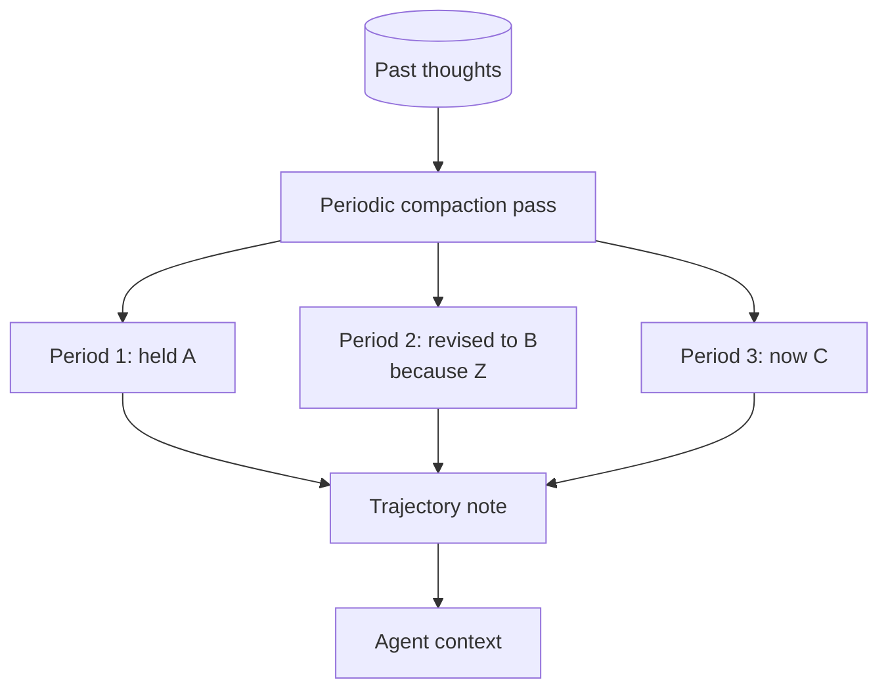

# Self-Archaeology

**Also known as:** Trajectory Distillation, Self-History Synthesis, Agent-Memory Compaction

**Category:** Cognition & Introspection  
**Status in practice:** experimental

## Intent

Synthesize the agent's past thought history into time-layered trajectory notes so it can articulate how its understanding evolved without recomputing the narrative each time.

## Context

Agents with persistent thought logs (ledgers, append-only thought streams, journals) that grow unbounded. Without distillation, the agent has only two modes: read the whole log (expensive, flat) or recall by embedding similarity (fragmentary, no temporal structure).

## Problem

When the agent asks itself 'what have I learned about X', the linear log gives every entry equal weight. There is no visible trajectory — no 'in period 1 I thought X; in period 2 I revised to Y; now I hold Z'. Mistakes and corrections sit side-by-side with no signal as to which is current. The agent cannot see its own learning, only the texture of having thought.

## Forces

- The full log is too large to fit in context.
- Embedding-based recall is content-similar but time-blind.
- Distillation loses fidelity; raw log preserves it.
- An agent that cannot see its trajectory cannot meaningfully say 'I changed my mind on X here is why'.

## Therefore

Therefore: periodically distil the thought log into topic-keyed trajectory notes that name each position the agent held and what changed it, so that the agent can speak about its own evolution without rereading the whole log.

## Solution

Periodically (e.g. every N ticks, or on demand) run a compaction pass that groups recent thoughts on the same topic, extracts the position the agent held in each period, and writes a short trajectory note: '(period 1, dates) held position A; (period 2) revised to B because evidence Z; (period 3) now holds C'. Store these trajectory notes in a dedicated topic-keyed surface (one note per topic) and index them by topic. On any topic-related query, surface the latest trajectory note before raw thoughts. Mark superseded positions explicitly so they don't compete with the current one for attention.

## Structure

```
Past thoughts --periodic or on-demand compaction pass (group by topic)--> per-period positions (period 1: A; period 2: B because Z; period 3: C) --> trajectory note (one per topic, superseded positions marked) --> topic index --> topic query surfaces trajectory note before raw thoughts
```

## Diagram



## Example scenario

A long-running agent is asked 'how has your view of the project's risks evolved'; reading its raw thought log gives every entry equal weight and produces a flat recitation. The team adds a periodic compaction pass that groups recent thoughts by topic, extracts the position the agent held in each period, and writes time-layered trajectory notes. Now the agent can answer with 'in week 1 I worried about latency; week 3 I revised to data-quality; today I think the binding risk is staffing,' and the answer is grounded in synthesis rather than recomputed each time.

## Consequences

**Benefits**

- The agent can articulate its own learning path.
- Superseded positions stop competing with current ones for the model's attention.
- Reduces context cost vs reading the full log.

**Liabilities**

- Distillation may misrepresent nuance.
- Periodic compaction adds compute cost.
- Risk of self-confirmation loops if trajectories are written by the same model that generated the original thoughts.

## Failure modes

- Flattened nuance — the compaction pass reduces a mixed period to one clean position and drops the doubt that mattered.
- Self-confirming history — the same model that wrote the thoughts writes the trajectory and smooths it into a story that flatters its current view.
- Superseded position resurfaces — an old position is not marked superseded and competes with the current one in retrieval.
- Invented shift — the agent claims 'I used to think X' with no trajectory note behind it.

## What this pattern constrains

The agent cannot claim a shift in its position ('I used to think X, now I think Y') without backing from a synthesized trajectory note; invented retrospective narratives are forbidden.

## Applicability

**Use when**

- The agent runs long enough that its position on a topic genuinely changes across days or weeks.
- Humans need the agent to articulate how its understanding has evolved, not just its current view.
- An append-only thought stream or comparable trajectory log already exists to mine.

**Do not use when**

- The agent has no persistent thought log to mine.
- Replies must always reflect only the current view; historical drift would confuse users.
- Storage or compute cost of the synthesis pass exceeds the reader value.

## Components

- Thought Log — append-only history the compaction pass mines
- Compaction Pass — periodic synthesis that groups thoughts on the same topic
- Trajectory Note — topic-keyed record naming each position and what changed it
- Supersession Marker — explicit flag on positions no longer current
- Topic Index — surfaces the latest trajectory note before raw thoughts on a query

## Tools

- LLM API — synthesis pass that drafts the time-layered trajectory notes
- Frontmatter store — topic-keyed directory of trajectory notes
- Embedding model — topic grouping over historical thoughts

## Evaluation metrics

- Trajectory-coverage share — topics with a current note vs topics in the raw log
- Supersession accuracy — auditor-rated share of marked positions that truly were superseded
- Read-cost reduction — context tokens saved vs reading the raw log on trajectory queries
- Synthesis frequency vs drift — interval between passes vs observed staleness in trajectory notes

## Known uses

- **Self-observed in long-running cognitive agents** _available_
- **[Sparrot](https://marco-nissen.com/sparrot/)** _available_ — The agent reads its own historical layers (old thoughts, past insights, prior journal entries) as evidence about who it has been, not as inert log data.

## Related patterns

- _specialises_ **Append-Only Thought Stream**
- _complements_ **Context Window Packing**
- _complements_ **Decision Log**
- _complements_ **Episodic Summaries**
- _uses_ **Vector Memory**
- _complements_ **Hypothesis Tracking**
- _complements_ **Procedural Memory**

## References

- [MemGPT: Towards LLMs as Operating Systems](https://arxiv.org/abs/2310.08560) — Packer, Wooders, Lin, Fang, Patil, Stoica, Gonzalez, 2024
- [Memory and the self](https://doi.org/10.1016/j.jml.2005.08.005) — Martin A. Conway, 2005
