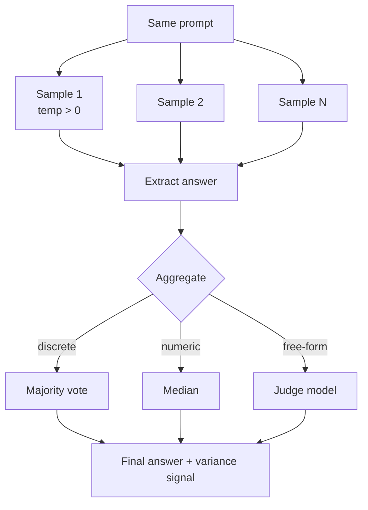

# Self-Consistency

**Also known as:** Sample-and-Vote, Empirical Introspection, Marginalised Reasoning

**Category:** Verification & Reflection  
**Status in practice:** mature

## Intent

Sample the same question multiple times at non-zero temperature and aggregate by majority or judge to mitigate hallucination.

## Context

A team uses a large language model on reasoning-heavy tasks like math word problems, multi-step logic puzzles, or multiple-choice questions where the model is mostly right but occasionally invents a wrong intermediate chain and confidently produces the wrong answer. The team can extract a comparable answer (a number, a class, a final choice) from each generation. Inference cost permits running the same prompt several times in parallel.

## Problem

A single sample at zero temperature gives the model's single most likely chain of reasoning, but that chain is sometimes the wrong one and there is no way for downstream code to tell. Trying again with a different seed can produce a different answer, and the team has no principled way to decide which sample to trust. Without a way to combine multiple samples, the team either accepts whatever the first call returned or picks among samples arbitrarily. They are also missing a free signal: the spread across samples is itself informative about how confident the model should be, but a one-shot pipeline never gets to see it.

## Forces

- N samples cost N times more.
- Aggregation logic depends on whether the answer is a class, a number, or free text.
- Variance is itself signal: a high-variance question is one the model is uncertain on.

## Therefore

Therefore: sample the same prompt N times at non-zero temperature and aggregate by vote, median, or judge, so that the answer reflects the modal trajectory and the spread becomes a usable confidence signal.

## Solution

Run the same prompt N times with non-zero temperature. Extract the answer from each. Aggregate: majority vote for discrete answers, median for numeric, judge for free-form. Variance across samples is logged as a confidence signal.

## Structure

```
Same prompt -> N samples (temperature > 0) -> extract answer from each -> aggregate (majority vote for discrete | median for numeric | judge for free-form) -> final answer + variance as confidence signal
```

## Diagram



## Example scenario

A math-tutoring agent at zero temperature gives one wrong answer per ten problems and is confidently wrong every time. The team samples each problem five times at temperature 0.7, extracts the numeric answer from each, and majority-votes. The right answer is the one most chains converge on; variance across samples becomes a useful 'unsure' signal. Per-problem cost is five times higher, but accuracy on the long-tail of tricky problems climbs noticeably.

## Consequences

**Benefits**

- Higher accuracy on reasoning benchmarks at moderate cost.
- Variance is a free uncertainty estimate.

**Liabilities**

- Linear cost scaling.
- Free-form aggregation needs a judge model.

## Failure modes

- Consistent but wrong — the model makes the same mistake in most samples, the vote picks it, and low variance reads as high confidence.
- Bad answer extraction — the extractor misparses some samples, and the majority is counted over the wrong values.
- Judge bias on free-form — the judge model prefers one style of answer, so aggregation reflects its taste rather than agreement.
- Linear cost creep — N is raised for every request, including easy ones where one sample was enough.

## What this pattern constrains

The final answer is the aggregate, not any single sample; individual samples have no authority.

## Applicability

**Use when**

- Reasoning-heavy questions where the model is mostly right but sometimes invents a wrong chain.
- Answers are extractable in a comparable form (discrete, numeric, or judgeable).
- Cost of N samples is acceptable relative to the quality lift.

**Do not use when**

- The task is deterministic and zero-temperature already wins.
- Answers are free-form and no aggregator (vote, judge) is available.
- Latency budget cannot afford N parallel samples.

## Components

- Sampler — runs the same prompt N times at non-zero temperature
- Answer extractor — pulls a comparable answer (class, number, free text) from each sample
- Aggregator — majority vote, median, or judge that produces the final answer
- Variance reporter — surfaces sample spread as a confidence signal
- Judge model — only present in the free-form aggregation variant

## Tools

- LLM API — N parallel inference calls per question
- Parsing utility — extracts the comparable answer from each generation
- Judge LLM API — separate call used only when aggregation requires free-form ranking

## Evaluation metrics

- Accuracy lift over single-sample baseline — gain from voting across N
- Inter-sample agreement — modal-share that doubles as a confidence signal
- Variance vs correctness correlation — validates whether spread tracks uncertainty
- Quality-per-extra-call slope — accuracy gain per additional sample, finds the elbow
- Judge-vs-vote divergence — gap between free-form aggregator and discrete vote on shared cases

## Known uses

- **Chain-of-Thought + Self-Consistency benchmarks** _available_

## Related patterns

- _specialises_ **Parallelization**
- _alternative-to_ **Best-of-N Sampling**
- _complements_ **Debate**
- _used-by_ **Confidence Reporting**
- _specialises_ **Test-Time Compute Scaling**
- _complements_ **Language Agent Tree Search**
- _alternative-to_ **MapReduce for Agents**
- _complements_ **Chain of Thought**
- _complements_ **Chain of Verification**
- _complements_ **STaR Bootstrapping**
- _specialises_ **Voting-Based Cooperation**
- _complements_ **Adaptive Branching Tree Search**
- _alternative-to_ **Trajectory-Summary Test-Time Scaling** — Self-consistency votes over short comparable answers; trajectories are not comparable verbatim, so the vote runs over their summaries.
- _alternative-to_ **Confident Inconsistency** — Self-consistency samples one query at one time and aggregates; confident inconsistency is the failure across time, where re-running the same query later gives a materially different answer single-run sampling never surfaces.
- _complements_ **Epistemic Fault-Domain Quorum** — Samples one model on one prompt, so its root-fault cut is one by construction; naming that makes explicit what sampling buys and what it cannot.
- _complements_ **Prior-Estimate Anchoring** — Sampling and aggregating helps only while the samples are independent; a shared prior score correlates them and the vote inherits the anchor.
- _alternative-to_ **Modality-Conflict Arbitration** — Both derive a signal from repeated answers, but sampling one channel several times cannot surface a contradiction that only exists between channels, and a majority vote has no notion of which channel is authoritative.

## References

- [Self-Consistency Improves Chain of Thought Reasoning in Language Models](https://arxiv.org/abs/2203.11171) — Wang, Wei, Schuurmans, Le, Chi, Narang, Chowdhery, Zhou, 2022
