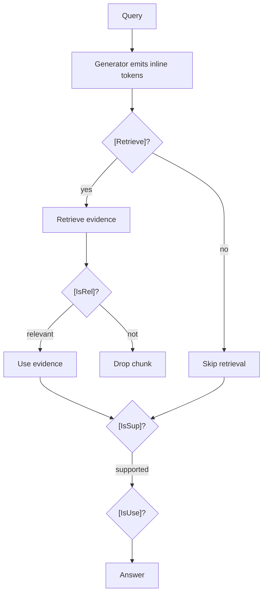

# Self-RAG

**Also known as:** Self-Reflective RAG

**Category:** Retrieval & RAG  
**Status in practice:** emerging

## Intent

Fine-tune the model to emit reflection tokens that decide when to retrieve, evaluate retrieved relevance, and assess generated support.

## Context

A team is building a retrieval-augmented system where retrieval is not always the right thing to do. Some queries are easy and can be answered from the model's parametric knowledge; others genuinely require fresh evidence from the corpus. Even when retrieval happens, the chunks returned may not be relevant, and even when they are relevant, the final generation may not actually be supported by them. The team needs the model itself to reason about each of these decisions per request, instead of forcing every query through the same fixed pipeline.

## Problem

Static retrieve-then-generate pipelines retrieve regardless of whether retrieval is needed, and they generate regardless of whether the retrieved evidence is actually relevant or whether the generation is grounded in it. Cheap queries that did not need retrieval still pay for it. Bad retrievals still feed the generator. Ungrounded generations still ship to the user. Without explicit reflective steps where the model decides whether to retrieve, judges the relevance of what it retrieved, and checks whether its own draft is supported by the evidence, the system both wastes calls and quietly admits hallucinations into production.

## Forces

- Token vocabulary expansion adds training complexity.
- Reflection tokens must be enforced at inference, not just trained.
- Self-evaluation correlates with the model's blind spots.

## Therefore

Therefore: teach the model to emit reflection tokens that gate retrieval, relevance, and support, so that the model itself decides when to retrieve and whether the result helps.

## Solution

A critic model is first trained to label data with reflection tokens. The generator is then fine-tuned on the labeled data to emit four reflection tokens inline at inference: [Retrieve], [IsRel] (is retrieved evidence relevant?), [IsSup] (is generation supported?), [IsUse] (is generation useful?). The host enforces the reflection grammar and uses tokens to control flow.

## Structure

```
Query --> Fine-tuned generator --[Retrieve]=yes--> Retriever --> chunks --[IsRel]--> keep relevant / drop irrelevant --> generate segment --[IsSup]--> supported? --[IsUse]--> useful? --> Answer; --[Retrieve]=no--> generate segment --> [IsSup] / [IsUse] checks; host enforces the reflection grammar and decoder ranks branches by [IsSup] and [IsUse]
```

## Diagram



## Example scenario

A document-QA agent always retrieves three chunks per query, even for trivial questions, and always generates an answer regardless of whether the retrieved chunks support one. The team fine-tunes a Self-RAG variant that emits inline reflection tokens: `[Retrieve]` decides per-query whether to retrieve, `[IsRel]` filters retrieved chunks, `[IsSup]` checks whether the generated claim is supported. Useless retrievals drop and unsupported answers are flagged before they reach the user.

## Consequences

**Benefits**

- Adaptive retrieval: skip when not needed.
- Inline self-evaluation grounds generation.

**Liabilities**

- Requires fine-tuning; not zero-shot.
- Reflection-token quality bounded by training data.

## Failure modes

- Wrong [Retrieve] call — the model decides it knows the answer, skips retrieval, and generates an unsupported claim.
- Lenient [IsSup] — the model rates its own draft as supported when the evidence does not back it, so the gate passes a hallucination.
- Shared blind spot — the critic and generator both miss the same kind of error, so the reflection tokens confirm it.
- Grammar not enforced — the host treats reflection tokens as hints, and generations that skip or malform them still reach the user.

## What this pattern constrains

Generation steps are gated by the reflection grammar; the model cannot generate freely without emitting the appropriate reflection tokens.

## Applicability

**Use when**

- Retrieval-augmented generation needs to decide when to retrieve and whether evidence is relevant.
- Static retrieve-then-generate wastes calls or admits hallucination.
- Fine-tuning the model with reflection tokens is feasible.

**Do not use when**

- A simpler RAG pipeline meets quality targets.
- Fine-tuning the generator on reflection tokens is not feasible.
- Latency or cost of inline reflection tokens is unacceptable.

## Components

- Critic model — labels training data with reflection tokens that the generator learns to emit
- Fine-tuned generator — emits [Retrieve], [IsRel], [IsSup], [IsUse] reflection tokens inline with text
- Reflection-grammar enforcer — host-side controller that gates flow on the emitted tokens (retrieve, drop, accept, reject)
- Retriever — fires only when [Retrieve] is yes, returning chunks for [IsRel] judgement
- Decoder strategy — greedy or tree-decoding policy that scores branches by [IsSup] and [IsUse]

## Tools

- Fine-tuning infrastructure — produces the critic and the reflection-token generator
- LLM with extended vocabulary — generator that includes the four reflection tokens
- Vector index — retrieval backend invoked when [Retrieve] fires

## Evaluation metrics

- Adaptive-retrieval rate — share of queries on which [Retrieve] correctly skips retrieval
- [IsRel] precision/recall against human relevance labels — quality of the model's own relevance judgements
- [IsSup] groundedness audit — fraction of [IsSup]=yes outputs whose claims actually appear in the cited chunks
- Tree-decoding lift over greedy — does branch selection by reflection tokens improve final answer quality
- Per-query inference cost — extra tokens and retrieval calls reflection adds vs static RAG

## Known uses

- **Self-RAG paper baseline** _available_

## Related patterns

- _specialises_ **Agentic RAG**
- _uses_ **Reflection**

## References

- [Self-RAG: Learning to Retrieve, Generate, and Critique through Self-Reflection](https://arxiv.org/abs/2310.11511) — Asai, Wu, Wang, Sil, Hajishirzi, 2023
