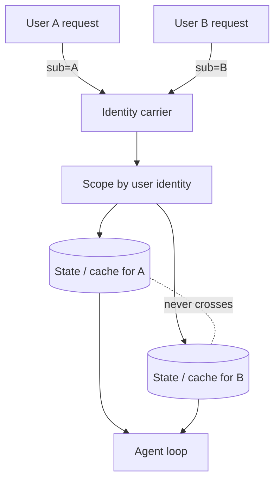

# Session Isolation

**Also known as:** Tenant Separation, Per-User State

**Category:** Memory  
**Status in practice:** mature

## Intent

Keep one user's session state and memory unreachable from another user's agent.

## Context

A team is shipping an agent product to many users. Each user expects their conversation history, preferences, and any data they share to stay private to them. For cost and operational reasons, the backend shares some infrastructure across users — caches, vector stores, model contexts — rather than running a fully isolated stack per user.

## Problem

A shared memory backend or a shared model context can leak one user's data into another user's response. A misindexed cache key returns user A's history to user B. A prompt-cache prefix that includes user-specific context is reused across users. A vector store query without per-user partitioning surfaces another user's documents as 'relevant'. Any of these is a privacy and security failure that can be much worse than an ordinary bug, because the leak may go unnoticed for a long time and the consequences for user trust and regulatory exposure are severe.

## Forces

- Cache hits across users are tempting for cost; they break isolation.
- Auth scope must travel with every read and write.
- Multi-tenant prompt injection becomes a real attack surface.

## Therefore

Therefore: key all session state, caches, and retrieval by a per-user identity that travels with every read and write, so that no user's content can ever surface inside another user's agent.

## Solution

Session state is keyed by per-user identity (OAuth/JWT subject). Reads and writes carry that identity end-to-end. Caches are scoped per user. Prompts never include another user's content.

## Structure

```
User request --identity (OAuth/JWT sub)--> Identity carrier --scope by user--> Per-user state / cache --> Agent loop; reads and writes carry identity end-to-end; user A scope never crosses user B scope
```

## Diagram



## Example scenario

A multi-tenant assistant uses a shared vector cache across all users and one day a competitive-intelligence answer for tenant A surfaces in tenant B's context because the embedding match was strong. The team scopes every cache key, every memory backend read, and every prompt context to the per-user OAuth subject end-to-end. Cross-tenant contamination becomes structurally impossible rather than 'we hope it doesn't happen.'

## Consequences

**Benefits**

- Privacy and security boundary is explicit and testable.
- Multi-tenant compliance posture is simpler.

**Liabilities**

- Loss of cross-user cache benefits.
- Auth plumbing in every layer.

## Failure modes

- Cache key collision — a cache key omits the user identity, and user B gets user A's history.
- Shared prompt prefix — a prompt-cache prefix holding user-specific context is reused for another user.
- Unpartitioned search — a vector query runs without a per-user filter and returns another user's documents as relevant.
- Dropped identity — one internal call loses the subject claim and falls back to a shared default scope.

## What this pattern constrains

No code path may read or cache user A's state under user B's identity.

## Applicability

**Use when**

- Multiple users share an agent backend and cross-user leaks are unacceptable.
- Session state and caches can be keyed end-to-end by user identity.
- Auth identity (OAuth, JWT subject) flows through the stack.

**Do not use when**

- The agent serves a single user or fully trusted tenant.
- Identity propagation cannot be enforced through every cache and store.
- Session state genuinely is shared and intended (collaborative workspaces).

## Components

- Identity carrier — OAuth/JWT subject that travels with every request from edge to backend
- Cache key scoper — wraps every cache and store key with the per-user identity so collisions across users are impossible
- Per-user state store — session state, scratchpads, and memory partitioned strictly by user ID
- Retrieval partitioner — vector and document queries are filtered by user-scope before any similarity ranking
- Prompt assembler — refuses to include another user's content in any prompt, including cache prefixes

## Tools

- OAuth/JWT identity provider — Auth0, Cognito, or the host platform's IdP supplying the subject claim
- Partitioned vector store — namespaces in Pinecone/Weaviate or row-level security on a Postgres pgvector table
- Scoped cache — Redis with per-user prefixes or a cache layer that rejects unscoped reads

## Evaluation metrics

- Cross-tenant leak count — confirmed incidents where one user's content surfaced inside another's session
- Identity-propagation coverage — fraction of read/write paths that carry the subject claim end-to-end (CI gate)
- Cache-scope audit — sampled cache keys checked for the per-user prefix; any unscoped key is a bug
- Prompt-cache hit rate impact — measured cost of losing cross-user prefix reuse
- Authorisation-test pass rate — multi-tenant red-team suite exercising cache, vector, and prompt boundaries

## Known uses

- **Bobbin (Stash2Go)** _available_ — Per-user OAuth/JWT scope for tools and state.
- **Weft** _available_ — Bearer-wrapped per-user OAuth 1.0a tokens.

## Related patterns

- _complements_ **Short-Term Thread Memory**
- _complements_ **Input/Output Guardrails**
- _complements_ **Cross-Session Memory**
- _complements_ **Tool Result Caching**
- _complements_ **Prompt Injection Defense**
- _complements_ **PII Redaction**
- _complements_ **Secrets Handling**
- _complements_ **Sovereign Inference Stack**
- _alternative-to_ **Memory Extraction Attack**
- _complements_ **Shadow AI**
- _complements_ **Managed Agent Runtime**
- _complements_ **Tenant-Scoped Tool Binding** — Session isolation separates conversations; tenant binding separates customers' data at the tool layer.
- _complements_ **Cumulative Disclosure Accounting** — Isolation keeps principals apart; the account has to be bound to the principal so a fresh session cannot refill it.

## References

- [Prompt caching](https://docs.claude.com/en/docs/build-with-claude/prompt-caching) — 2025
