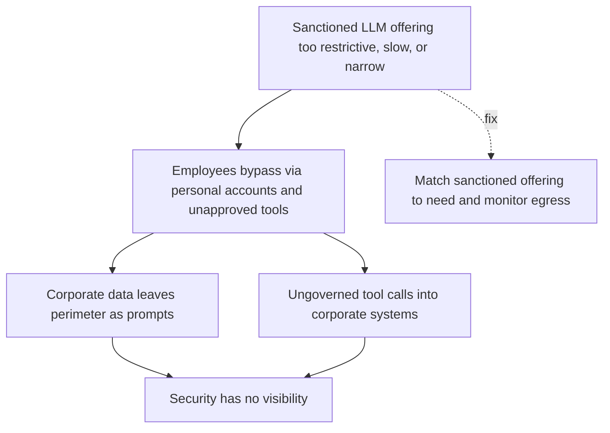

# Shadow AI

**Also known as:** Unsanctioned LLM Tooling, Parallel-Economy AI Use

**Category:** Anti-Patterns  
**Status in practice:** deprecated

## Intent

Anti-pattern: leave the corporate LLM offering so restrictive, slow, or narrow that employees bypass it with personal accounts and unapproved agent tools, creating data leakage and ungoverned tool calls that security cannot see.

## Context

An organisation has rolled out a sanctioned LLM tool — a corporate chat assistant, an internal agent platform — but the offering is constrained by data-residency policies, model-version lag, narrow scope, or slow procurement. Employees have personal accounts on consumer LLM services and access to free agent tools, and they have everyday work that the corporate offering cannot do. The security team's threat model assumes the corporate offering is the only the model surface in the organisation.

## Problem

Employees paste corporate data into personal-account LLMs, run agent tools that call into corporate systems with personal API keys, and connect unsanctioned MCP servers to their workstations. The security team has no visibility into any of it. Corporate data leaves the perimeter as prompts; outputs come back as decisions and code that flow into production. The Atea (Norway) source names the dynamic explicitly: 'employees adopt their own unsecured tools because the company does not offer good enough solutions.' English-language corroboration is overwhelming — Gartner predicts 40% of enterprises will suffer shadow-the model incidents by 2030, IBM's 2025 Cost of a Data Breach report shows shadow-the model breaches average $670k more than standard breaches, and Microsoft research found 71% of UK employees use unapproved the model at work. The failure mode is bilateral: restrictive controls drive the workaround, but permissive access drives the leak.

## Forces

- Sanctioned LLM offerings lag the consumer frontier by 6-18 months on capability and model version.
- Procurement and data-residency policies legitimately restrict corporate LLM but also legitimately frustrate users.
- Shadow the model is invisible to the security team by design — the corporate logging surface does not see personal accounts.

## Therefore

Therefore: close the capability gap between sanctioned and consumer LLM offerings while monitoring egress and SaaS traffic for unsanctioned LLM use, and treat the gap-closure work as a security control rather than as a productivity nice-to-have.

## Solution

Don't ignore the gap. Match the sanctioned offering to user need: a model that is current enough, fast enough, and broad enough that employees do not feel the friction of going outside. Monitor egress and SaaS-discovery traffic for unsanctioned LLM and agent-tool use; treat detection as a security control, not a productivity audit. Provide a fast-track for new the model capabilities (sandboxed agent tools, MCP-server allow-list with quick onboarding) so users have a sanctioned path. Pair this with secrets-handling and session-isolation to bound the blast radius when shadow the model is found. Recognise that purely restrictive controls increase the shadow rate; permissive offerings with monitoring reduce it.

## Structure

```
Anti-pattern: Restrictive or slow sanctioned offering -> employees use personal LLM accounts and tools -> ungoverned data egress and tool calls. Corrected: Sanctioned offering matched to need + fast-track for new capabilities + egress monitoring -> use stays inside the perimeter.
```

## Diagram



*Shadow AI failure-mode pathway.*

## Example scenario

A regulated firm rolls out a corporate LLM chat tool restricted to one older model with strict data-residency rules. Within three months, security egress logs show traffic spikes to a consumer LLM provider during business hours, originating from finance, legal, and engineering. An internal survey finds 60% of those teams routinely paste corporate data into personal-account chats because the sanctioned tool 'cannot handle real work.' Two months later, a sensitive M&A document appears in an unrelated consumer-LLM training-data investigation. Postmortem: the gap between sanctioned capability and user need was a security exposure that the team had been treating as a productivity complaint. The fix is to upgrade the sanctioned offering to current-frontier capability, add SaaS-discovery monitoring, and provide a fast-track sanctioning path for new tools.

## Consequences

**Benefits**

- Short-term: a narrow, locked-down offering looks safer and is cheaper to run and approve.
- Naming it lets a team treat the capability gap itself as a security risk and monitor egress for unsanctioned use.

**Liabilities**

- Corporate data leaks as prompts to consumer LLMs outside the perimeter and outside audit logs.
- Ungoverned agent tool calls reach corporate systems through personal API keys and unsanctioned MCP servers.
- IBM 2025 Cost of a Data Breach Report: shadow-model breaches average $670k higher than standard breaches.

## Failure modes

- Data in personal prompts — employees paste corporate data into personal-account LLMs, and it leaves the perimeter with no audit log.
- Personal-key tool calls — unapproved agent tools reach corporate systems with personal API keys that security cannot see.
- Unsanctioned MCP server — a developer connects an unvetted MCP server to a workstation and gives it access to internal data.
- Restriction backfire — tighter controls on the official offering push more staff toward unsanctioned tools.

## What this pattern constrains

No useful constraint; the missing constraint is a sanctioned offering that closes the capability gap, paired with egress monitoring.

## Applicability

**Use when**

- Never. Cite when reviewing an enterprise model-governance posture that relies solely on restrictive controls.
- Close the capability gap between sanctioned and consumer offerings as a security control.
- Monitor egress and SaaS-discovery traffic for unsanctioned LLM and agent-tool use.

**Do not use when**

- Any organisation whose sanctioned LLM offering trails consumer frontier capability by more than a model generation.
- Any setting where the model access is governed only by acceptable-use policy without egress monitoring.
- Any deployment without a fast-track for new the model capabilities (agent tools, MCP servers) under sanctioned control.

## Components

- Trigger condition — what causes the shadow ai pattern to manifest
- Affected surface — the part of the system where the failure shows up
- Detection signal — what an operator would observe when this is happening

## Tools

- Observability — logs, traces, and metrics that surface the pattern
- Eval harness — runs that quantify exposure to the pattern

## Evaluation metrics

- Shadow-model detection rate — share of egress and SaaS traffic identified as unsanctioned LLM or agent-tool use
- Capability-gap delta — months by which the sanctioned offering trails consumer-frontier capability on common tasks
- Sanctioned-tool adoption rate — share of model-using employees whose primary tool is the corporate offering
- Time-to-sanction new capability — days between user request for a new the model tool and a sanctioned path being available
- Shadow-incident impact — average cost of incidents traced to unsanctioned LLM tools vs sanctioned ones

## Known uses

- **[Atea — Slik lykkes du med AI-agenter og Agentic AI](https://www.atea.no/siste-nytt/kunstig-intelligens/fra-ai-assistenter-til-handlekraft-hvorfor-2026-blir-aret-for-agentic-ai/)** _available_ — Norwegian enterprise integrator naming Shadow AI explicitly in the restrictive-vs-permissive trade-off.
- **[Gartner — Emerging Risk Deep Dive: Shadow AI (July 2025)](https://www.gartner.com/en/documents/6714034)** _available_ — Predicts 40% of enterprises will experience shadow-AI security incidents by 2030.
- **[IBM — 2025 Cost of a Data Breach Report](https://www.ibm.com/reports/data-breach)** _available_ — Shadow-AI breaches average $4.63M, $670k higher than standard breaches.
- **[Microsoft — 2025 UK Workplace AI Survey](https://ukstories.microsoft.com/features/rise-in-shadow-ai-tools-raising-security-concerns-for-uk/)** _available_ — 71% of UK employees report using unapproved AI tools at work; 51% at least weekly.

## Related patterns

- _complements_ **Secrets Handling** — personal API keys for shadow agent tools are the leakage surface
- _complements_ **Session Isolation**
- _complements_ **Agentic Supply Chain Compromise** — unsanctioned MCP servers and agent tools are an agentic supply-chain exposure
- _alternative-to_ **Sovereign Inference Stack** — owning the inference surface eliminates one driver of shadow use
- _complements_ **Vibe-Coding Without Security Review**
- _complements_ **Agent Identity Sprawl** — Shadow AI is unsanctioned use; sprawl is sanctioned agents minting identities governed too slowly.
- _complements_ **Agent Sprawl** — Shadow AI is unsanctioned tools that bypass corporate provision; agent sprawl is sanctioned agents shipped by teams but never centrally owned or retired.

## References

- [Slik lykkes du med AI-agenter og Agentic AI](https://www.atea.no/siste-nytt/kunstig-intelligens/fra-ai-assistenter-til-handlekraft-hvorfor-2026-blir-aret-for-agentic-ai/) — 2026
- [Emerging Risk Deep Dive: Shadow AI](https://www.gartner.com/en/documents/6714034) — 2025
- [Gartner: 40% of Firms to Be Hit By Shadow AI Security Incidents](https://www.infosecurity-magazine.com/news/gartner-40-firms-hit-shadow-ai/) — 2025
- [Shadow AI explained: risks, costs, and enterprise governance](https://www.vectra.ai/topics/shadow-ai) — 2025
