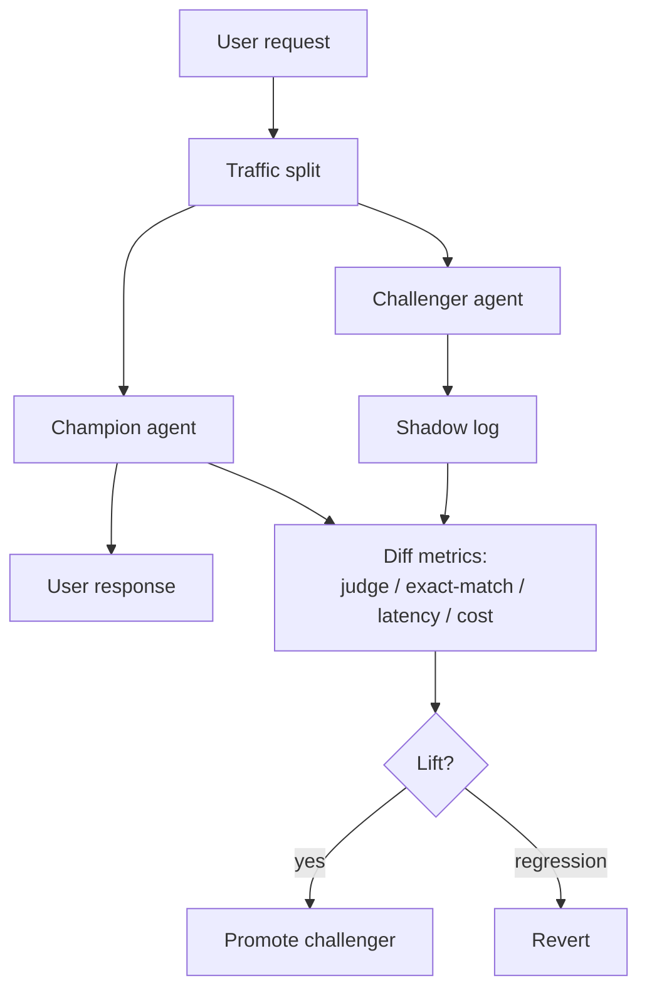

# Shadow Canary

**Also known as:** Shadow Agent, Canary Deployment

**Category:** Governance & Observability  
**Status in practice:** mature

## Intent

Run a candidate agent version in shadow alongside the champion, comparing outputs without affecting users.

## Context

A team wants to roll out a new model, a tweaked prompt, or a reworked tool wiring to an agent already serving real users. They have an existing version (the champion) that they trust on live traffic and a candidate version (the challenger) they want to validate before promoting. The traffic distribution in production includes long-tail queries that no pre-release evaluation set fully captures.

## Problem

Pre-release evaluations cover the distributions the team thought to put in the test set, not the surprising ones that show up in real usage. Releasing the challenger directly to a fraction of users exposes those users to whatever regressions it has. The team is forced to choose between launching blind and hoping nothing breaks, or building a separate evaluation set so comprehensive that it never actually matches live behaviour.

## Forces

- Shadow runs cost money for output never shown.
- Comparison logic for free-form outputs is non-trivial.
- Shadow latency must not affect the user-visible path.

## Therefore

Therefore: dual-route a fraction of real traffic through both champion and challenger, return the champion's output to the user, and diff the challenger's logged output on agreed metrics, so that a candidate is validated on live distribution before it can affect anyone.

## Solution

Route a fraction of real traffic through both champion and challenger. Champion's output reaches the user. Challenger's output is logged. Diff the outputs on agreed metrics (judge model, exact match on tool calls, latency, cost). Promote on lift; revert on regression.

## Structure

```
User request --> Traffic splitter --> Champion agent --> User response; same request --> Challenger agent --> Shadow log (not user-visible); Champion output + Shadow log --> Diff evaluator (judge, exact-match tool calls, latency, cost) --> Promotion gate --lift--> Promote / --regression--> Revert
```

## Diagram



## Example scenario

A team wants to upgrade the underlying model on an in-production agent but pre-release evals miss real-traffic regressions. They route ten percent of real traffic through both champion (current) and challenger (candidate); only champion's reply reaches the user. A judge model diffs the two on agreed metrics over a week. They catch a regression on a niche legal-style query that no eval covered, fix it, then promote the challenger.

## Consequences

**Benefits**

- Field-quality regression detection.
- Confidence to roll out non-deterministic changes.

**Liabilities**

- 2x cost during shadow window.
- Diff-noise on free-form outputs is hard to attribute.

## Failure modes

- Shadow side effects — the challenger runs real tool calls during shadow, and its writes reach external systems even though its reply is hidden.
- Noisy free-form diff — champion and challenger word answers differently, and the diff metric cannot tell style changes from real regressions.
- Long shadow window — the shadow run is left on for weeks, and the doubled cost outlasts any decision it was meant to inform.
- Leaked challenger output — a routing bug sends the challenger's reply to some users, breaking the promise that shadow is invisible.

## What this pattern constrains

Challenger output is not user-visible during shadow; only logging.

## Applicability

**Use when**

- Agent changes are non-deterministic and CI cannot capture field behaviour.
- Real traffic can be replayed through a challenger without affecting users.
- A diff metric (judge model, exact match, latency) can be defined.

**Do not use when**

- Privacy rules forbid duplicating traffic through a shadow path.
- Cost of running both champion and challenger is prohibitive.
- No diff metric exists that reliably catches regressions.

## Components

- Traffic Splitter — dual-routes a fraction of real requests through both versions
- Champion Agent — the trusted production version whose output reaches the user
- Challenger Agent — the candidate version running in shadow, output logged only
- Shadow Log — captures challenger outputs without exposing them to users
- Diff Evaluator — compares champion and challenger on judge score, exact-match tool calls, latency, and cost
- Promotion Gate — promotes the challenger on lift, reverts on regression

## Tools

- Traffic mirroring layer (gateway, service mesh) — duplicates requests onto the shadow path
- Judge model — scores free-form output diffs between champion and challenger
- Trace store (Langfuse, LangSmith) — captures both responses keyed by request id for diffing

## Evaluation metrics

- Field-regression catch rate — share of real-traffic regressions the shadow detected pre-promotion
- Diff agreement on free-form outputs — share of comparisons where judge and exact-match agree
- Shadow-path cost overhead — extra spend incurred during the shadow window
- Promotion success rate — share of shadow-validated challengers that held up after promotion
- Long-tail coverage — share of low-frequency query categories exercised by the shadow run

## Known uses

- **Standard practice in ML/agent platforms** _available_

## Related patterns

- _complements_ **Eval Harness**
- _uses_ **LLM-as-Judge**
- _alternative-to_ **Perma-Beta**
- _complements_ **Eval as Contract**
- _complements_ **Prompt Versioning**
- _complements_ **Scorer Live Monitoring**
- _alternative-to_ **Demo-to-Production Cliff**
- _complements_ **Dual Evaluation (Offline + Online)**
- _complements_ **Demo-Production Cliff (Multi-Agent)**
- _complements_ **Context Gap (Security)**
- _alternative-to_ **Bayesian Bandit Experimentation**
- _complements_ **crawl-walk-run-automation-gating**
- _complements_ **evaluation-driven-development**
- _complements_ **Sampled Prompt Trace Eval**
- _complements_ **Progressive Delegation**
- _complements_ **Trust and Reputation Routing**
- _alternative-to_ **Prompt Variant Evaluation**
- _used-by_ **Agent-to-Rule Distillation** — Replay and shadow validation of a mined rule against historical traces before cut-over is a canary run of the deterministic candidate.
- _complements_ **Co-Tenant Interference Profiling** — There the unit under test is one challenger version of the same agent against its own champion; here every controller is already trusted individually and the unit under test is the pair, so the output is an interference matrix rather than a promote-or-hold decision.

## References

- [Site Reliability Engineering: Release Engineering](https://sre.google/sre-book/release-engineering/) — Google SRE, 2016
