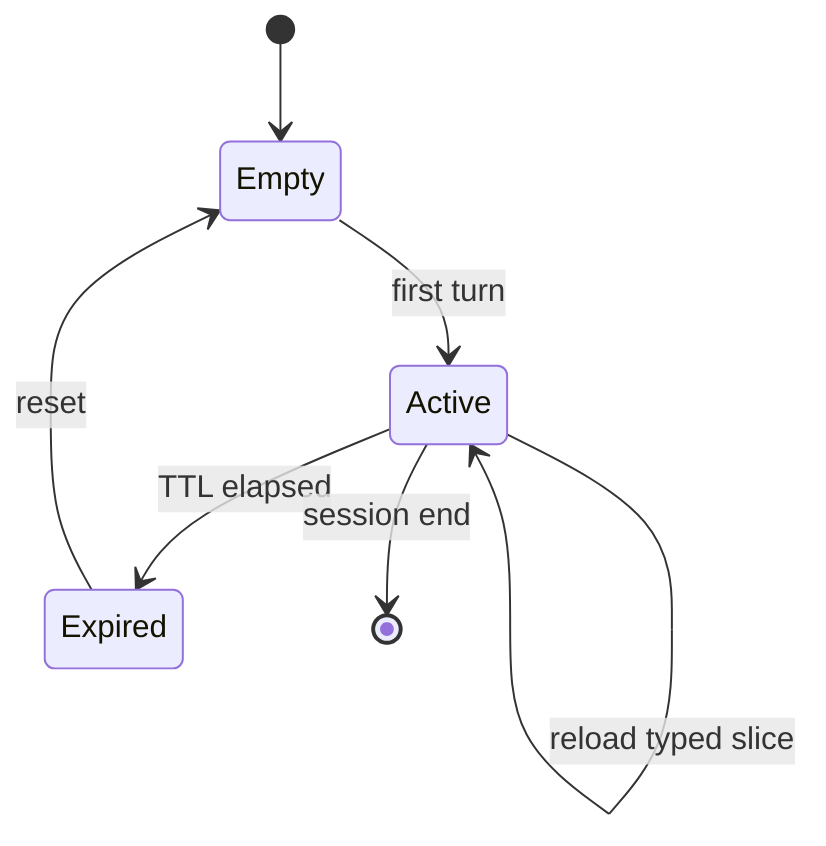

# Short-Term Thread Memory

**Also known as:** Conversation State, Per-Thread State, Working Memory

**Category:** Memory  
**Status in practice:** mature

## Intent

Carry the relevant slice of conversation context across turns within a session.

## Context

A multi-turn agent needs continuity across recent turns — what screen the user is currently on, what the active plan looks like, what tools have been called and what they returned — but it does not need this information forever. The next few turns will use it; the next conversation almost certainly will not.

## Problem

Replaying the entire conversation history on every turn becomes expensive quickly and pollutes the context with stale facts that no longer matter. On the other hand, throwing away history between turns breaks continuity: the agent forgets what it was just doing, the user has to re-state their goal, and tool results disappear before the agent has a chance to use them. The team needs a bounded, recent slice of state that survives turn-to-turn within a session and is bounded by something other than 'everything that has ever been said'.

## Forces

- TTL choice (minutes? hours? days?) trades freshness for cost.
- What to keep vs. summarise is a quality-vs-cost tension.
- Multi-device sessions complicate where state lives.

## Therefore

Therefore: persist a typed per-thread state object with an explicit TTL, so that the next turn loads exactly the slice that is still fresh and lets stale state expire on its own.

## Solution

Define a typed state object per thread (messages, current screen, active plan, agent step). Persist with a TTL (commonly 24h). Reload on the next turn; expire and reset on TTL.

## Structure

```
First turn --> Typed thread state (messages, screen, plan, step) --persist with TTL--> Store --reload--> Next turn --update--> Store; TTL elapsed --> expire --> reset to empty
```

## Diagram



## Example scenario

A chat assistant replays the entire conversation each turn and by message thirty the prompt is bloated with stale facts and the cost-per-turn has tripled. The team defines a typed thread state (recent messages, current screen, active plan, agent step) persisted with a 24-hour TTL and reloads only that on the next turn. Token cost per turn flatlines; the assistant still feels continuous within a session and resets cleanly on TTL.

## Consequences

**Benefits**

- Continuity without full-history replay.
- Bounded memory footprint per active user.

**Liabilities**

- TTL boundaries surprise users when state vanishes mid-task.
- Schema migrations are painful for live state.

## Failure modes

- Mid-task expiry — the TTL runs out while the user is still working, and the active plan vanishes.
- Stale slice — the reloaded state holds an old screen or step, and the agent acts on it as current.
- Schema break — a deploy changes the state object shape, and live sessions fail to reload.
- Over-trust — the agent relies on a fact older than the TTL window without re-fetching it.

## What this pattern constrains

The agent cannot rely on facts older than the TTL window without re-fetching them.

## Applicability

**Use when**

- Multi-turn agent needs continuity across turns within a session.
- Replaying full conversation each turn is expensive or pollutes context.
- A typed state object with TTL can capture the relevant slice.

**Do not use when**

- The agent is single-turn or stateless by design.
- All history truly matters and pruning would lose important context.
- TTL semantics cannot be enforced reliably in storage.

## Components

- Typed thread-state object — schema covering recent messages, current screen, active plan, and agent step
- Per-thread state store — durable backing for the typed object, keyed by thread ID
- TTL controller — expires state after the configured window and resets the slot to empty
- Reload step — pulls the typed slice at the start of each turn and rehydrates the agent loop
- Schema-migration shim — handles in-flight live state when the typed object changes shape

## Tools

- Key-value store with TTL — Redis, DynamoDB TTL, or Cloud Memorystore for the per-thread slot
- Schema validation library — Pydantic or zod to enforce the typed state contract on read and write
- Checkpointer — LangGraph MemorySaver or equivalent when the agent runs as a graph

## Evaluation metrics

- Per-turn token saving — tokens avoided vs full-history replay
- Mid-task TTL expiry rate — sessions interrupted by state expiring before the user finished
- State-rehydrate latency — milliseconds added to the turn by reading and validating the typed slice
- Continuity quality — answer coherence across turns vs a stateless baseline on a labelled set
- Migration breakage — incidents where a schema change broke in-flight sessions

## Known uses

- **Bobbin (Stash2Go)** _available_ — Per-thread state in chat/backend/state.py with 24h TTL.
- **LangGraph MemorySaver checkpoints** _available_

## Related patterns

- _complements_ **Episodic Summaries**
- _complements_ **Session Isolation**
- _used-by_ **Agent Resumption**
- _complements_ **Cross-Session Memory**
- _complements_ **Scratchpad**
- _generalises_ **Reasoning Trace Carry-Forward**
- _complements_ **Co-Located Memory Surfacing**
- _used-by_ **Interrupt-Resumable Thought**
- _used-by_ **Echo Recognition**
- _used-by_ **Augmented LLM**
- _complements_ **Three Layers of Agentic AI Memory**
- _used-by_ **History-Dependent Admissibility** — The session ledger and the posture derived from it live in per-thread state, which is what makes admissibility depend on turns that have already happened.

## References

- [LangGraph: Persistence](https://langchain-ai.github.io/langgraph/concepts/persistence/)
