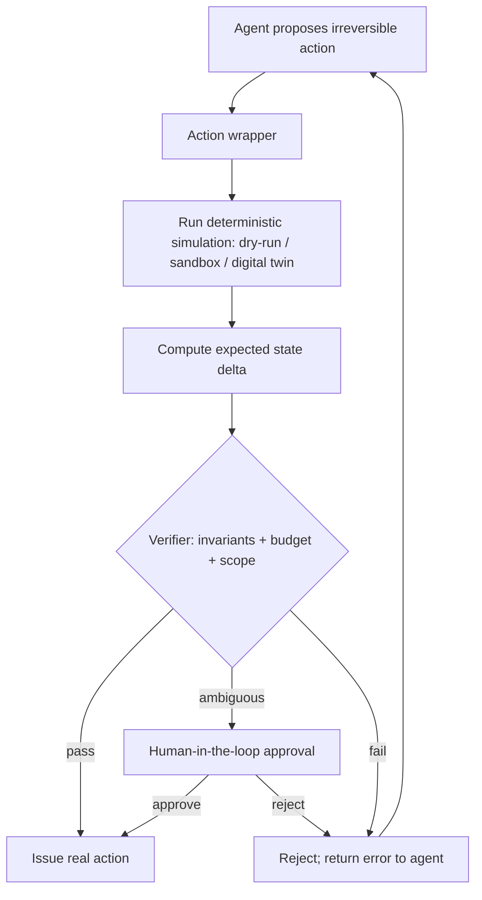

# Simulate Before Actuate

**Also known as:** Dry-Run Harness, Simulate-Then-Commit, Pre-Action Simulation Gate

**Category:** Safety & Control  
**Status in practice:** emerging

## Intent

Before issuing an irreversible action, run a deterministic simulation that computes pre-conditions, invariants, and expected deltas; require a verifier — automated or human — to green-light the simulated outcome before the real command is sent.

## Context

An agent has tools that take irreversible actions: filesystem writes, database mutations, infrastructure changes, browser actions on a live site, payments, emails. The cost of a wrong action is high. The agent itself is non-deterministic and occasionally proposes plausible-looking actions that are wrong in subtle ways: deletes the wrong key, sends to the wrong recipient, mutates the wrong row.

## Problem

Letting the agent commit irreversible actions on a single proposal exposes the system to silent, hard-to-rollback damage. Pure human-in-the-loop is too slow for the volume; pure trust-the-agent is too dangerous. Recent practitioner write-ups (Joakim Vivas' '17 agentic architectures' survey) and an arXiv chapter on architectures for building agentic systems and 'Deterministic Pre-Action Authorization' preprint converge on a deterministic simulation step: run the proposed action against a digital twin, sandbox replay, or dry-run flag; compute the resulting state and the diff; require sign-off on the diff before committing.

## Forces

- Irreversible actions deserve more scrutiny than reversible ones, but the agent's proposal does not distinguish.
- Full human-in-the-loop is too slow at production volume; a deterministic verifier can scale.
- A simulation has to be faithful enough that 'passes the sim' implies 'safe in reality' — otherwise the gate is theatre.
- Some action surfaces have no simulator (external APIs without sandboxes, partner systems); the pattern then degrades to dry-run flags, schema validation, or HITL.

## Therefore

Therefore: between the agent's proposed action and the live execution, insert a deterministic simulation + verifier step that computes the expected state delta and blocks commit until the delta is approved.

## Solution

Decompose the action surface: for each irreversible tool, define a faithful simulator (digital twin, sandbox replay, dry-run mode, snapshot DOM for web, transactional rollback for DBs). Wrap the tool so every call runs simulation → verifier → execute. The verifier is automated where the invariants can be encoded (no destructive deletes without explicit flag, no out-of-budget transfers) and falls back to human-in-the-loop where they cannot. Where no simulator exists, refuse to call without HITL approval.

## Structure

```
Agent proposes irreversible action --> Action wrapper --> Deterministic simulation (dry run / sandbox / digital twin) --> Expected state delta --> Verifier (invariants, budget, scope) --pass--> Real action | --ambiguous--> Human approval | --fail--> Reject, error back to agent
```

## Diagram



## Example scenario

A devops agent receives a request to clean up unused Kubernetes resources. It proposes 'kubectl delete pod app-prod-7d3'. The wrapper intercepts the call, runs it with --dry-run=server, reads the simulated diff: 'will delete 1 pod, will scale Deployment app-prod from 3 to 2, will not affect Service'. The verifier checks invariants: target namespace is in the agent's allowed scope, deletion count is under cap, no destructive label match. All green; the real call goes out. On a different invocation the agent proposes deleting a pod in kube-system; same flow, the verifier rejects (namespace not in allowed scope), the agent gets an error back and replans.

## Consequences

**Benefits**

- Catches a class of wrong actions before any state changes — silent damage from agent mis-proposals goes near zero on instrumented surfaces.
- Verifier sign-off is cheap and scales; only the genuinely ambiguous cases escalate to HITL.
- Postmortems become richer — the simulated-but-rejected actions are themselves data about agent failure modes.
- Encourages tools to expose dry-run / sandbox surfaces that did not exist before.

**Liabilities**

- Simulators drift from reality; a stale sim gives false-green on actions that fail in production.
- Per-action latency increases by the simulation cost; some workloads cannot afford it.
- Surfaces without simulators have to fall back to HITL or dry-run flags, partly defeating the pattern.
- Verifier rules are themselves a maintained artifact; a stale verifier blocks the wrong things or waves through the wrong things.

## Failure modes

- False green — the simulator has drifted from production, the dry run passes, and the real action fails or causes damage.
- Stale verifier — invariant rules no longer match current policy, so the verifier blocks safe actions or waves through unsafe ones.
- Silent HITL fallback — most tools lack a simulator, every call falls back to human approval, and the volume problem the pattern meant to solve returns.

## What this pattern constrains

Forbids the agent from invoking irreversible tools directly; every such call must pass through the simulator + verifier gate. The LLM's tool-call freedom is conditional on the gate's approval.

## Applicability

**Use when**

- Agent has tools whose actions are irreversible or expensive to undo (DB mutations, deletes, payments, infrastructure changes, browser writes on live sites).
- Action surface has a faithful simulator available (digital twin, dry-run flag, sandbox replay, transactional rollback).
- Production volume is too high for blanket human-in-the-loop but errors are too costly to trust pure agent autonomy.
- Verifier invariants can be encoded (budget caps, no destructive deletes without flag, allow-listed recipients).

**Do not use when**

- All actions are reversible and cheap to undo — the simulation overhead is wasted.
- Action surface has no faithful simulator and HITL cannot scale to the volume.
- Latency budget cannot absorb the simulation step.
- Simulator-vs-reality drift cannot be monitored, so 'passes the sim' is unreliable.

## Components

- Action wrapper — intercepts every irreversible tool call from the agent
- Simulator — faithful representation of the action surface (dry-run flag, digital twin, sandbox replay)
- Delta computer — extracts the expected state change from the simulator output
- Verifier — automated invariant / budget / scope checks against the delta
- HITL fallback — handles the cases the verifier cannot decide alone
- Drift monitor — compares simulator predictions against post-commit reality to catch sim/reality divergence

## Tools

- kubectl --dry-run, terraform plan, git apply --check — first-class dry-run modes
- Digital twin / staging copy — for surfaces without native dry-run
- Transactional sandbox — DB transactions opened, simulated, rolled back
- DOM snapshot harness — for browser-agent actions on live pages
- Policy engine — OPA, Cedar, custom rule set, encoding the verifier invariants

## Evaluation metrics

- Sim/reality fidelity — share of post-commit states matching the simulator's predicted delta
- Verifier rejection rate — share of agent proposals blocked by the verifier (high = agent or verifier needs tuning)
- HITL-escalation rate — share of proposals the verifier could not decide alone
- Prevented-damage rate — count of rejected actions that would have caused incidents had they committed
- Per-action latency overhead — added cost of the simulate+verify step

## Known uses

- **[arXiv 2512.09458 — 'Architectures for Building Agentic AI' chapter formalising the gateway + verifier + simulator-before-actuator pattern](https://arxiv.org/pdf/2512.09458)** _available_
- **[arXiv 2603.20953 — 'Before the Tool Call: Deterministic Pre-Action Authorization for Autonomous AI Agents'](https://arxiv.org/pdf/2603.20953)** _available_
- **[Joakim Vivas — 17 agentic-architecture patterns survey, listed as 'Dry-Run Harness'](https://www.joakimvivas.com/tech/17-patrones-arquitecturas-agenticas-ia/)** _available_
- **[Algomox AI-powered dry runs for IT operations — production deployment of the pattern in DevSecOps pipelines](https://web.archive.org/web/2024/https://www.algomox.com/resources/blog/ai_powered_dry_run_simulation_secure_it_operations/)** _available_
- **[Microsoft Agent Governance Toolkit — open-source runtime security framing simulate-before-commit as a primary safety control](https://opensource.microsoft.com/blog/2026/04/02/introducing-the-agent-governance-toolkit-open-source-runtime-security-for-ai-agents/)** _available_

## Related patterns

- _complements_ **Human-in-the-Loop** — HITL is the fallback when the verifier cannot decide; simulate-before-actuate scales the cases the verifier can handle
- _complements_ **World Model as Tool** — world-model-as-tool gives the LLM a callable simulator; simulate-before-actuate enforces simulation as a gate
- _complements_ **Approval Queue**
- _alternative-to_ **Compensating Action** — compensating-action recovers after a wrong commit; this pattern prevents the commit
- _complements_ **Policy-as-Code Gate**
- _uses_ **Sandbox Isolation**
- _complements_ **Kill Switch**
- _complements_ **Blind Grader with Isolated Context** — the verifier can itself be implemented as a blind grader
- _composes-with_ **Control-Flow Integrity**
- _generalises_ **Dry-Run Harness**
- _generalises_ **Mental-Model-In-The-Loop Simulator**
- _complements_ **Affordance Grounding Before Action** — Both screen actions before execution, but simulate-before-actuate runs a deterministic side-effect simulation; the affordance gate is a perception-side feasibility check with no simulator.
- _alternative-to_ **Reversibility-Aware Action Filter** — Both gate an irreversible action before it fires, but simulation dry-runs the step and asks a verifier to approve it, whereas this filter classifies reversibility directly and re-samples for a reversible action with no simulator and no reviewer.
- _complements_ **Formal-Proof Compliance Gate** — Simulation computes expected post-action deltas and invariants and asks a verifier to green-light them; a formal proof establishes the invariants hold for all inputs in the modelled domain rather than for the one simulated trajectory.
- _complements_ **Physical Hallucination** — Simulating an irreversible action before issuing it catches exactly the physically-infeasible command this anti-pattern lets through.
- _used-by_ **Action-Admissibility Tiering** — Physical-consequence simulation is the last hard tier here, reached only after evidence, hazard understanding, authority and procedure have already cleared, so the simulator is not spent on actions that were never permitted.
- _complements_ **Co-Tenant Interference Profiling** — That gates one irreversible action at issue time on a per-action simulation; this gates fleet membership before any action is issued, and the harm it catches is emergent over sustained joint operation rather than present in any single call.
- _complements_ **Feasibility-Negotiated Intent Contract** — Simulation predicts the effects of an action that has already been formed; the feasibility audit runs earlier, on the goal, before any action exists to simulate, and a simulator is one reasonable way to implement the audit.
- _complements_ **Physical-Evidence Progress Gate** — The simulator predicts an outcome before committing; this gate observes the real outcome after committing, in a domain where no simulator is authoritative about what the gripper actually did.

## References

- [Chapter 3: Architectures for Building Agentic AI](https://arxiv.org/pdf/2512.09458) — 2025
- [Before the Tool Call: Deterministic Pre-Action Authorization for Autonomous AI Agents](https://arxiv.org/pdf/2603.20953) — 2026
- [17 Patrones de Arquitecturas Agénticas de IA y su Rol en Sistemas de Gran Escala](https://www.joakimvivas.com/tech/17-patrones-arquitecturas-agenticas-ia/) — 2025
- [Simulate Before You Fix: The Role of AI-Powered Dry Runs in Secure IT Ops](https://web.archive.org/web/2024/https://www.algomox.com/resources/blog/ai_powered_dry_run_simulation_secure_it_operations/) — 2025
- [Microsoft Agent Governance Toolkit — Open-source runtime security for AI agents](https://opensource.microsoft.com/blog/2026/04/02/introducing-the-agent-governance-toolkit-open-source-runtime-security-for-ai-agents/) — 2026
