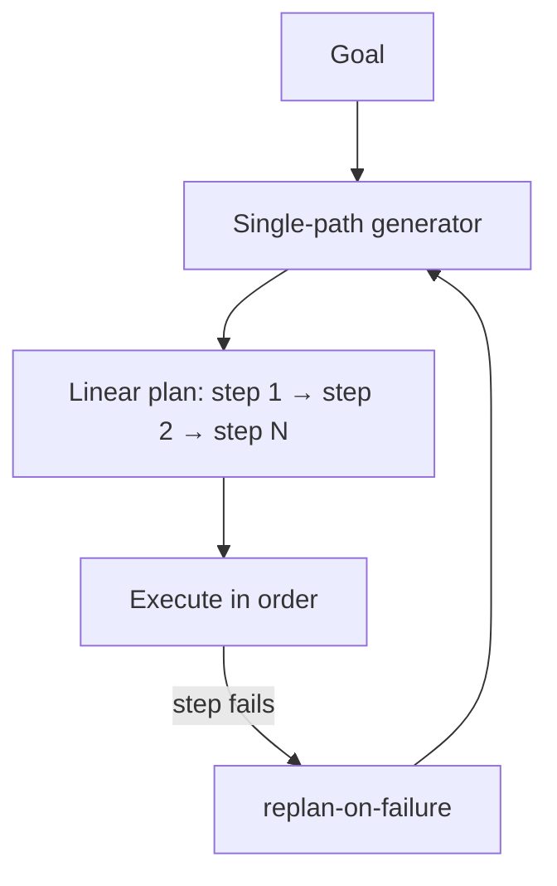

# Single-Path Plan Generator

**Also known as:** Linear Plan Generator, Sequential Plan Producer

**Category:** Planning & Control Flow  
**Status in practice:** mature

## Intent

Generate one linear sequence of intermediate steps from current state to goal — the lightweight planning alternative to tree-of-thoughts and multi-path generation.

## Context

A team has a planning agent. The default in recent literature is multi-path / tree-of-thoughts search, which is expensive. For straightforward tasks, exploring multiple paths is overkill.

## Problem

Default-to-tree-search planning is expensive for straightforward tasks. A single linear path is often the right level of effort — but is rarely named as a deliberate choice. Differs from tree-of-thoughts (multi-path search) by intentionally producing one path.

## Forces

- Multi-path planning is more thorough but expensive.
- Single-path can miss better paths the search would find.
- For straightforward tasks the marginal value of multi-path is low.

## Therefore

Therefore: name single-path plan generation as a deliberate choice — produce one linear plan, accept it cannot recover from path-choice errors mid-plan, and pair with replan-on-failure for recovery.

## Solution

Plan generator produces one sequence of intermediate steps. No exploration of alternatives. If a step fails or reveals goal mismatch, trigger replan-on-failure to produce a new single path from the new state. Pair with multi-path-plan-generator (alternative), tree-of-thoughts (alternative), replan-on-failure, plan-and-execute.

## Structure

```
Goal --> Single-path generator --> linear plan (step 1 -> step 2 -> ... -> step N) --> Sequential executor --step fails or goal mismatch--> replan-on-failure --> Single-path generator (from new state)
```

## Diagram



## Example scenario

A scheduling agent plans 'book the next available 1h slot with team A'. Single-path planner: [check calendar, find slot, book, confirm]. No exploration. If 'check calendar' returns no slots in next 2 weeks, replan-on-failure produces a fresh plan: [extend search window, find slot, book, confirm]. Cheaper than tree-of-thoughts for this kind of task.

## Consequences

**Benefits**

- Cheap — one plan generation call, no search.
- Simple control flow — execute steps in order.
- Pairs cleanly with replan-on-failure for recovery.

**Liabilities**

- Cannot recover from path-choice errors mid-plan without full replan.
- Misses better paths multi-path search would find.
- Not suitable for tasks where path quality varies significantly.

## Failure modes

- Wrong path committed — the generator picks a poor route early, and the run only finds out after several steps have executed.
- Replan churn — steps keep failing on a task whose paths differ a lot in quality, and each failure forces a full new plan.
- Missed better route — a cheaper or safer path existed, but the single path never considered it.
- Used where search was needed — the team applies the linear generator to a hard task, and plan quality drops with no signal that alternatives were skipped.

## What this pattern constrains

Only one path is generated; alternative paths are not explored unless replan-on-failure triggers a fresh single-path plan.

## Applicability

**Use when**

- Plan paths are roughly equivalent in quality.
- Cost budget favors cheap planning.
- Replan-on-failure can handle path-choice errors.

**Do not use when**

- Path quality varies significantly — multi-path search is worth its cost.
- Replan-on-failure is unavailable.
- Tasks where mid-plan recovery requires backtracking, not full replan.

## Components

- Single-path generator — produces one linear sequence
- Sequential executor — runs steps in order
- Replan trigger — fires on step failure

## Tools

- LLM API — one plan-gen call
- Sequential executor
- Replan-on-failure trigger

## Evaluation metrics

- Plan completion rate
- Replan rate
- Cost per plan vs multi-path

## Known uses

- **[elcamy: 【論文紹介】LLMベースのAIエージェントのデザインパターン18選](https://blog.elcamy.com/posts/20431baf/)** _available_

## Related patterns

- _alternative-to_ **Multi-Path Plan Generator**
- _alternative-to_ **Tree of Thoughts**
- _complements_ **Plan-and-Execute**
- _complements_ **Replan on Failure**
- _complements_ **Incremental Model Querying**

## References

- [【論文紹介】LLMベースのAIエージェントのデザインパターン18選](https://blog.elcamy.com/posts/20431baf/) — 2026
