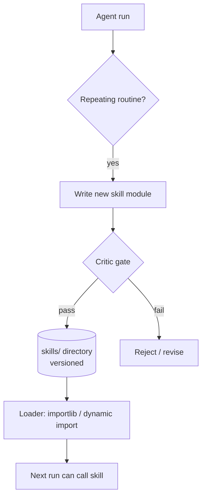

# Skill Library

**Also known as:** Tool-Creating Agent, Meta-Tool Use, Self-Authored Tools

**Category:** Tool Use & Environment  
**Status in practice:** emerging

## Intent

Let the agent grow its own toolkit by writing reusable skills that subsequent runs can call.

## Context

A team operates a long-running agent that handles recurring task shapes — weekly competitor reports, periodic data cleans, repeating customer-onboarding workflows. The same scrape-clean-summarise pipeline gets re-derived from first principles every run, and the runtime supports loading new code modules without restarting the agent.

## Problem

Without a place to crystallise repeated work into reusable artefacts, every run pays the full cost of working the routine out again, including the cost of the model's wrong turns along the way. The team has no way to review or remove a routine once it exists in the model's habits, because the only place it ever lived was the model's working memory for that session.

## Forces

- New skills can be wrong or unsafe.
- The library must be loadable without restart in a long-running agent.
- Skill discovery (which skill applies?) is itself a retrieval problem.

## Therefore

Therefore: give the agent a writable skills directory plus a critic-gated, hot-reloading loader, so that a long-running agent grows its own toolkit without restarts and without silently overwriting working code.

## Solution

A directory (often `skills/*.py` or `skills/*.md`) where the agent can write new modules. A loader (importlib in Python, dynamic import in JS) makes them callable. A critic gates additions. Old skills are versioned, not overwritten silently.

## Structure

```
Agent run --(repeating routine)--> Write new skill module --> Critic gate --pass--> skills/ directory (versioned) --> Loader (dynamic import) --> Next run calls skill; --fail--> Reject or revise
```

## Diagram



## Example scenario

An agent that fetches similar reports every week keeps re-deriving the same scrape-clean-summarise pipeline from scratch. The team gives it a `skills/` directory: when the agent finishes a recurring task it can write a small reusable module (with a critic gating the addition); subsequent runs import and call it directly. Over a few months the agent crystallises a library of named skills for the domain and recurring tasks complete in a fraction of the original turns.

## Consequences

**Benefits**

- Compounding capability over time.
- Skills are reviewable and removable, unlike weights.

**Liabilities**

- Skill-name collisions and silent shadowing.
- Library quality decays without periodic review.

## Failure modes

- Silent shadowing — a new skill takes the name of an existing one, and later runs call the new version without anyone noticing the change.
- Library decay — skills written for old tasks pile up untested, and the agent keeps calling routines that no longer work.
- Weak critic — the gate passes a skill with a hidden bug, and every later run that reuses it repeats the same error.
- Near-duplicates — the agent writes a new skill instead of finding an existing one, and the library fills with overlapping routines.

## What this pattern constrains

New skills enter the library only after passing the critic; they cannot mutate existing skills without quorum.

## Applicability

**Use when**

- Patterns of tool use repeat across runs and rederivation costs are noticeable.
- The agent can write and version reusable modules safely.
- A critic or reviewer gates additions to the library.

**Do not use when**

- Each task is novel and no skill would be reused.
- Skill additions cannot be reviewed and the library would rot.
- The runtime cannot dynamically load new modules safely.

## Components

- Skill Writer — agent component that crystallises a repeated routine into a new module
- Critic Gate — reviews proposed skills before they enter the library
- Skills Directory — versioned store of skill modules, typically skills/*.py or skills/*.md
- Skill Loader — importlib in Python or dynamic import in JS that makes skills callable
- Skill Index — catalogue with descriptions used to retrieve relevant skills per task

## Tools

- Dynamic import (importlib, ESM dynamic import) — loads skill modules at runtime
- Version control (git) — tracks skill changes so old skills are versioned, not overwritten silently
- Critic LLM or rule-based linter — gates new skills before merge

## Evaluation metrics

- Skill reuse rate — how often each skill is invoked across runs after creation
- Critic-rejection rate — share of proposed skills the gate blocks
- Skill-induced task success lift — accuracy delta on tasks for which a skill exists versus does not
- Skill churn rate — edits per skill per week as a signal of instability
- Library size and dead-skill share — count of skills and fraction never invoked over a horizon

## Known uses

- **[Voyager (Minecraft agent)](https://voyager.minedojo.org/)** _available_ — Skill library that grows through self-play.
- **[Sparrot](https://marco-nissen.com/sparrot/)** _available_ — Author-written procedures (skills) are loaded on demand for specific task types from a sibling skills/ tree; each skill is a folder with its own code, prompts, and tests, separable from the core loop.

## Related patterns

- _uses_ **Self-Modification Diff Gate**
- _composes-with_ **Code Execution**
- _complements_ **Exploration vs Exploitation**
- _alternative-to_ **Agent Skills**
- _complements_ **App Exploration Phase**
- _complements_ **WebAssembly Skill Runtime**
- _complements_ **Tool/Agent Registry**
- _alternative-to_ **On-Demand Tool Synthesis** — Skill Library accumulates critic-gated skills over runs for long-term reuse; On-Demand Tool Synthesis fabricates a tool just-in-time to close a capability gap in the current task, with an explicit creator/user role split.
- _complements_ **Dependency-Aware Skill Retrieval** — Skill-library is how an agent grows a toolkit; dependency-aware retrieval is how that toolkit is selected so prerequisites come with each match.
- _alternative-to_ **Agent-to-Rule Distillation** — Both capture recurring solutions; the skill library stores them as code the agent itself invokes, distillation moves them outside the agent into governed rules the process evaluates without the model.

## References

- [Voyager: An Open-Ended Embodied Agent with Large Language Models](https://arxiv.org/abs/2305.16291) — Wang et al., 2023
