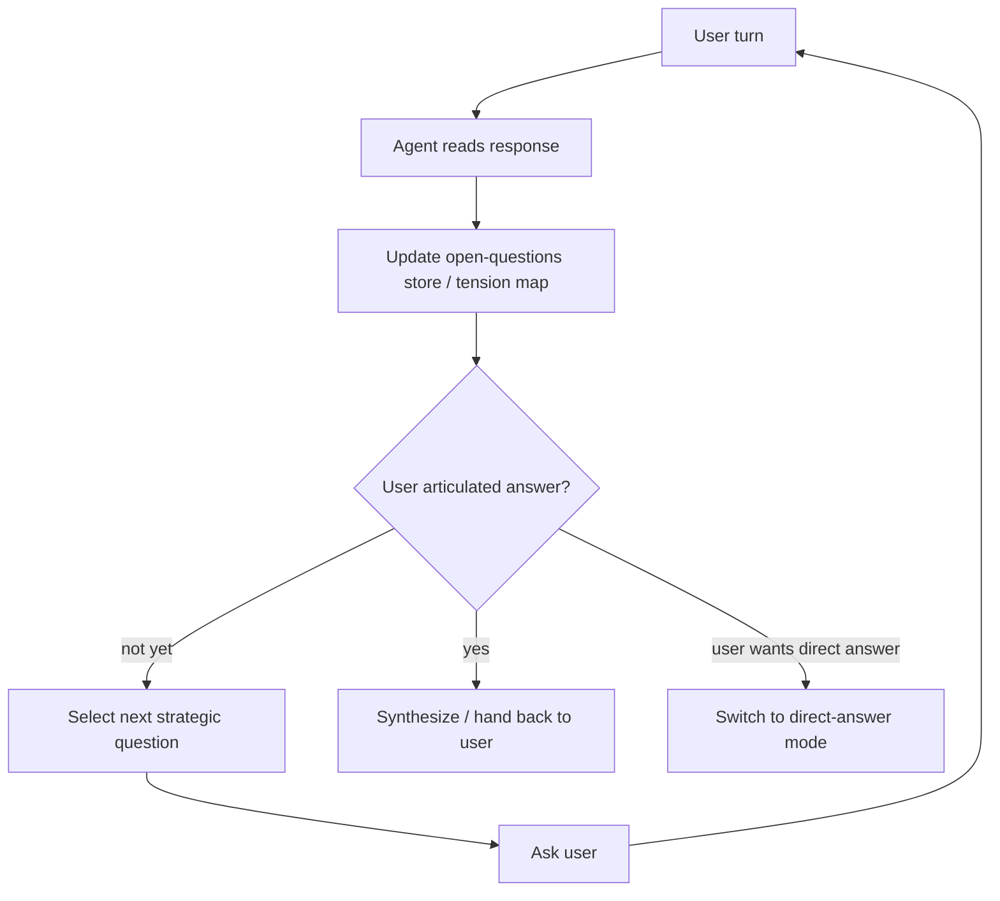

# Socratic Questioning Agent

**Also known as:** Dialog-Driven Agent, Socratic/対話駆動 エージェント, SocraticAI

**Category:** Reasoning  
**Status in practice:** emerging

## Intent

Drive the agent toward its goal by asking the user a sequence of strategic, open-ended questions that surface the user's own latent knowledge, goal, or context — rather than producing an answer directly.

## Context

The agent operates in a domain where the user holds the ground truth or has to discover it for themselves: tutoring, requirements elicitation, coaching, self-knowledge, code review walkthroughs, therapy-adjacent tools. A direct answer would either be wrong (the agent does not know the user's situation) or actively unhelpful (the user needs to construct the understanding themselves).

## Problem

Default agent shape — receive prompt, return answer — fits poorly when the answer must come from the user's own context or learning process. Princeton NLP's SocraticAI demonstration and Anthropic-style tutoring evaluations both find that a question-first agent produces materially better outcomes than a fact-first agent on these workloads. But the shape is not just 'ask a question' (that is disambiguation) and not 'ask yourself' (that is self-ask): it is a deliberately staged sequence of probing questions, calibrated to the user's responses, that ends in the user articulating the answer.

## Forces

- Direct answers are faster but wrong-shaped when the goal is user learning or user-context surfacing.
- A bad question is worse than a bad answer — it can mislead or frustrate; the question sequence is itself a design surface.
- Users sometimes want answers, not questions; the agent must read when to switch modes.
- Question-driven dialogs are longer and more expensive in tokens than direct answers; the cost only pays off in workloads where understanding is the actual goal.

## Therefore

Therefore: design the agent's primary action as 'formulate the next strategic question' rather than 'produce an answer', and track which question moved the user closer to their own articulation as the success signal.

## Solution

Structure the agent loop around question selection: at each turn, choose a question that (a) targets the largest remaining uncertainty about the user's goal/context, (b) is answerable by the user with what they already know or can introspect, (c) advances toward a user-articulated conclusion. Maintain an explicit 'open questions' store. Switch modes to direct-answer when the user signals they want one or when the user has articulated enough that synthesis is now low-risk. Pair with frozen-rubric reflection so the agent does not slide into rote question templates.

## Structure

```
User turn --> agent reads response --> update open-questions store --> user has articulated answer? --not yet--> select next strategic question (largest uncertainty, answerable by user) --> ask --> User | --yes--> synthesize and hand back | --user wants direct answer--> direct-answer mode
```

## Diagram



## Example scenario

A self-knowledge assistant takes the user through a weekly reflection. Instead of summarizing the user's notes, it opens with 'Which moment this week did you feel most yourself?' Based on the user's answer it picks the next question: 'What was different about that moment from how you usually spend that time?' The agent maintains an internal store of open tensions ('user said X about work but Y about energy') and selects questions targeting the largest tension. After 4–6 turns the user articulates a pattern the assistant could not have produced cold. The session ends with the user, not the agent, writing the conclusion.

## Consequences

**Benefits**

- Output is grounded in the user's actual context, not the LLM's prior — fewer confabulated answers.
- User learning, self-knowledge, or requirements quality go up; the user owns the articulated conclusion.
- The agent's failure modes become legible — bad questions are visible, bad answers can hide.

**Liabilities**

- Slower and more expensive than direct-answer for users who just want an answer.
- Misjudged question sequences frustrate or mislead users; the question is now a quality surface.
- Hard to evaluate offline — the success criterion (user articulates the answer) requires the actual user in the loop.

## Failure modes

- Withheld answer — the user clearly wants a direct answer, but the agent keeps asking questions and the user gives up.
- Rote questions — the agent slides into the same question templates every turn, and the questions stop surfacing new context.
- Misled user — a badly sequenced question steers the user toward a conclusion the agent assumed rather than one the user holds.
- Premature synthesis — the agent switches to synthesis before the user has articulated enough, and its summary fills gaps with guesses.

## What this pattern constrains

Forbids the agent from producing direct answers when the goal is user understanding or context-surfacing. Restricts the LLM's freedom to assert, requiring it to interrogate instead.

## Applicability

**Use when**

- Tutoring, coaching, and pedagogical workloads where user understanding is the goal.
- Requirements elicitation where the user holds context the agent cannot guess.
- Self-knowledge / journaling assistants where the user is the source of truth.
- Code review walkthroughs where the goal is the engineer's understanding, not just the patch.

**Do not use when**

- Pure information-retrieval tasks where the user just wants an answer.
- Time-pressured workflows where dialog rounds cost more than direct answers save.
- Workloads where misjudged questions could mislead in safety-critical ways without an expert in the loop.
- Settings where the success criterion cannot be measured (no follow-up signal from the user).

## Components

- Question selector — picks next question targeting largest remaining tension
- Open-questions / tension store — what the agent does not yet know about the user's situation
- Mode switch — detects when the user wants a direct answer instead of more questions
- Articulation detector — recognises when the user has reached the conclusion themselves
- Frozen-rubric reflection — keeps the agent from sliding into rote question templates

## Tools

- LLM — for question generation and articulation detection
- Tension store — explicit memory of what is still open
- Dialog history — turn-by-turn store the question selector reads
- Optional retrieval — to ground questions in domain knowledge (e.g., curriculum, prior sessions)

## Evaluation metrics

- User-articulated-conclusion rate — share of sessions where the user, not the agent, states the conclusion
- Question quality — human-rated relevance and openness of agent questions (held-out sample)
- Mode-switch precision — agent correctly switches to direct-answer when the user signals they want one
- Session-length / cost vs direct-answer baseline — quantifies the tax the pattern imposes
- Follow-up signal — user satisfaction, learning gain, or requirement completeness measured after the session

## Known uses

- **[Princeton NLP — SocraticAI demonstration of the method for self-discovery with LLMs](https://princeton-nlp.github.io/SocraticAI/)** _available_
- **[MedTutor-R1 — clinical multi-agent tutoring simulation reporting +20% pedagogical-score improvement](https://arxiv.org/abs/2512.05671)** _available_
- **[Sparrot — long-running cognitive agent whose dialogue protocol leans on Socratic questioning for self-observation and human-agent bridging](https://marco-nissen.com/sparrot/)** _available_
- **[Reported in Japanese pattern surveys (Qiita syukan3 22-pattern comparison, listing 'Socratic/対話駆動 エージェント') and Russian habr practitioner write-ups (self-knowledge bot with LLM-as-periphery dialog architecture)](https://qiita.com/syukan3/items/174e43235bde8a1a0694)** _available_

## Related patterns

- _complements_ **Disambiguation** — disambiguation is one-shot clarification; Socratic is multi-turn structured questioning
- _complements_ **Self-Ask** — self-ask is agent-to-self; Socratic is agent-to-user
- _uses_ **Open-Question Tension Store**
- _complements_ **Frozen Rubric Reflection**
- _complements_ **Human-in-the-Loop**
- _alternative-to_ **Passive Goal Creator** — passive waits for the user to state the goal; Socratic actively elicits it
- _used-by_ **Tacit-Knowledge Elicitation Agent** — The interview phase drives the expert with strategic open-ended questions to surface latent, unwritten know-how rather than asking them to summarise it directly.
- _alternative-to_ **Hint Ladder** — Socratic questioning responds only in questions to surface the learner's own knowledge; the hint ladder releases help of rising specificity keyed to consecutive failures, and its rungs may be statements, not only questions.

## References

- [The Socratic Method for Self-Discovery in Large Language Models](https://princeton-nlp.github.io/SocraticAI/) — 2024
- [Beyond Automation: Socratic AI, Epistemic Agency, and the Implications of the Emergence of Orchestrated Multi-Agent Learning Architectures](https://arxiv.org/abs/2508.05116) — 2025
- [Closing the Expression Gap in LLM Instructions via Socratic Questioning](https://arxiv.org/pdf/2510.27410) — 2025
- [Investigating the effects of an LLM-based Socratic conversational agent on students' academic performance and reflective thinking in higher education](https://www.sciencedirect.com/science/article/abs/pii/S0360131525002623) — 2025
- [多様な AI エージェント設計パターン22選を比較](https://qiita.com/syukan3/items/174e43235bde8a1a0694) — 2025
- [Я строю AI-бот для самопознания. Вот спек, архитектура и почему LLM — это периферия, а не ядро](https://habr.com/ru/articles/1027210/) — 2026
