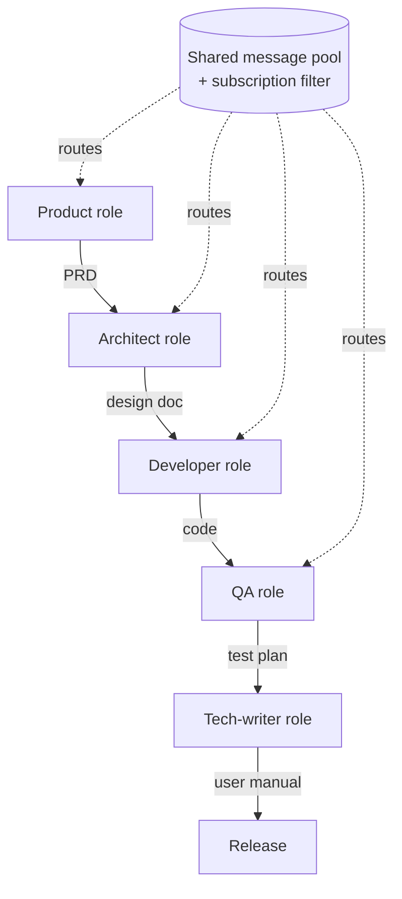

# SOP-Encoded Multi-Agent Workflow

**Also known as:** Standard Operating Procedure Multi-Agent, Assembly-Line Agents, Software-Company Agents

**Category:** Multi-Agent  
**Status in practice:** emerging

## Intent

Encode a human Standard Operating Procedure (roles, ordered phases, standardised hand-off artefacts) into a multi-agent pipeline so that agents communicate through structured documents rather than free-form chat.

## Context

A team is automating a complex, repeatable task — software development, document production, a regulatory submission — that already has a well-known human Standard Operating Procedure (SOP). The SOP names specific roles (product manager, architect, engineer, quality assurance) and specifies the deliverables that pass between them: a requirements document, then a design, then code, then a test report. The shape of the work is already understood; what is being automated is the execution.

## Problem

If the agents simply chat freely, they hallucinate context the SOP would have pinned down, drift off-task between roles, and produce no auditable trail of which agent did what. Without typed hand-off deliverables, agents redo each other's work or quietly skip steps, and ambiguity that the SOP would catch at a phase boundary propagates to the end. The team ends up with a multi-agent system that looks lively in the transcript but produces worse artefacts than a single human following the same procedure would.

## Forces

- The model is good at playing a role; it is bad at inventing the workflow that connects roles.
- Free chat between agents is cheap to write but expensive to debug.
- Defined artefacts (PRD, design doc, test plan) compress context across role hand-offs.
- Rigid SOPs lose the model's ability to adapt; the SOP has to leave room for the role to think.

## Therefore

Therefore: encode the human SOP as named roles, ordered phases, and typed artefact contracts at every phase boundary, so that agents communicate through documents rather than drifting free-form chat.

## Solution

Encode the SOP as: (a) a fixed set of named roles each with role-specific prompt and tool palette, (b) an ordered sequence of phases, (c) a typed artefact contract for each phase boundary (e.g. PRD → design doc → code → test plan → user manual). Agents communicate via the artefacts; a shared message pool plus a subscription filter routes only relevant context to each role.

## Structure

```
Role_A -- artefact_1 --> Role_B -- artefact_2 --> Role_C ... ; shared message pool; per-role subscription filter.
```

## Diagram



## Example scenario

A four-agent product-development chat keeps drifting because agents talk free-form and re-do each other's work. The team rewrites it as an SOP-encoded pipeline: PM writes a typed PRD artefact, Architect transforms PRD into an Architecture artefact, Engineer transforms Architecture into Code, QA transforms Code into Test Report. Each phase boundary is a typed contract, not a chat. Drift stops, the trail is auditable, and review focuses on the artefacts rather than the conversation.

## Consequences

**Benefits**

- Auditable trail of artefacts at every phase boundary.
- Specialised role prompts beat one mega-prompt on long tasks.
- Standardised artefact schemas catch ambiguity at the hand-off, not at the end.

**Liabilities**

- Designing the artefact contract is the real work; bad contracts propagate to every role.
- Procedure rigidity makes the system brittle when the task does not match the SOP.
- Token cost scales with the number of phases.

## Failure modes

- Bad artefact contract — the design-doc schema leaves out a field the developer needs, and every later role inherits the gap.
- Task outside the SOP — a request does not fit the fixed phases, and the pipeline forces it through steps that make no sense for it.
- Over-strict filter — the subscription filter withholds context a role needed, and that role produces an artefact on partial information.
- Phase cost — every request pays for every phase, even when only one or two of them matter.

## What this pattern constrains

Agents may not communicate outside the artefact contract; a role's output that does not conform to the next role's expected schema is rejected at the phase boundary.

## Applicability

**Use when**

- A complex repeatable task already has a documented human SOP with named roles.
- Hand-off artefacts between phases can be typed (PRD, design doc, code, test plan).
- An auditable trail of artefacts is required.

**Do not use when**

- The task is one-off and writing an SOP is more work than doing it.
- Free-form chat between agents is sufficient and cheaper.
- Phases cannot be cleanly separated and artefact contracts cannot be defined.

## Components

- SOP-encoded role — fixed agent persona (PM, Architect, Engineer, QA, tech-writer) with scoped prompt
- Typed artefact contract — schema for each phase boundary deliverable (PRD, design doc, code, test plan)
- Phase sequencer — ordered controller that gates phase transitions on artefact conformance
- Shared message pool — blackboard-style store of all artefacts and intermediate messages
- Subscription filter — routes only relevant artefacts to each role's inbox

## Tools

- MetaGPT or ChatDev framework — provides role definitions and SOP phase scaffolding
- Artefact-schema validator — enforces typed contracts at every phase boundary
- LLM API — invoked once per role-turn inside each phase
- Versioned artefact store — keeps every PRD, design, and test plan inspectable after the fact

## Evaluation metrics

- Artefact-conformance rate — share of role outputs that pass the next role's schema
- Phase rework rate — handoffs sent back upstream for failing the predicate
- End-to-end success vs free-form-chat baseline — does the SOP actually improve outputs
- SOP-mismatch incidents — tasks where the encoded SOP did not fit the input task
- Token cost per phase — spend distribution across phases, used to find the heavy step

## Known uses

- **[MetaGPT](https://github.com/geekan/MetaGPT)** _available_ — Five roles (Product Manager, Architect, Project Manager, Engineer, QA) producing standardised artefacts in an assembly-line pipeline.
- **[ChatDev](https://github.com/OpenBMB/ChatDev)** _available_ — CEO/CTO/Programmer/Reviewer/Tester roles in a phased pipeline with artefact hand-offs.

## Related patterns

- _uses_ **Role Assignment**
- _complements_ **Supervisor**
- _uses_ **Blackboard** — Shared message pool plus subscription filter is a blackboard variant.
- _complements_ **Spec-First Agent** — The SOP is itself a spec for the multi-agent system.
- _alternative-to_ **Hero Agent**
- _uses_ **Structured Output**
- _complements_ **Chat Chain**
- _alternative-to_ **Control-Loop-Mapped Agent Chain** — A standard operating procedure is a sequential hand-off of artefacts; a control chain is a set of loops acting at the same sample, arbitrated by structural priority rather than by order of work.

## References

- [MetaGPT: Meta Programming for A Multi-Agent Collaborative Framework](https://arxiv.org/abs/2308.00352) — Hong et al., 2023
- [ChatDev: Communicative Agents for Software Development](https://arxiv.org/abs/2307.07924) — Qian et al., 2023
