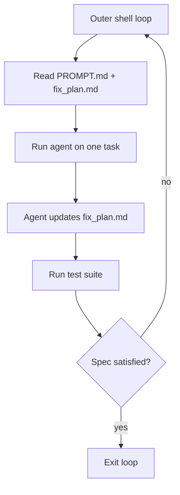

# Spec-Driven Loop

**Also known as:** Naive Iterative Loop, Ralph Wiggum Loop, Ralph Loop

**Category:** Planning & Control Flow  
**Status in practice:** emerging

## Intent

Run the same prompt against a fixed spec in a deterministic outer loop until the spec is satisfied.

## Context

A team works on a task with a clear or steadily-improvable specification — a long bug-fix list, a feature build that decomposes into small chunks, a migration whose end state is well-defined. Each iteration can move the codebase a little closer to the spec without trying to land everything at once. The team has a test suite or a similar gate that can tell whether the spec has been satisfied.

## Problem

Agents that try to plan and implement the whole feature in a single turn are brittle because they have to hold too many decisions in one context and they cannot back out of a bad early commitment. Agents driven from a free-form chat wander, lose their plan, and produce work that is hard to resume after an interruption. Custom orchestration frameworks add their own complexity for what should be a simple loop. The team wants something brutally simple — re-run the agent against the spec until the spec is satisfied — without losing the ability to inspect, pause, and resume.

## Forces

- The spec must be good or the loop polishes the wrong artefact.
- Tests gate progress; without them the loop has no error signal.
- Cost per iteration must be tolerable for hundreds of runs.

## Therefore

Therefore: drive the agent from a deterministic outer shell loop pinned to one prompt, an agent-updated fix_plan, and a test gate per iteration, so that progress is legible and the loop converges instead of wandering.

## Solution

An outer shell loop (`while :; do cat PROMPT.md | claude-code ; done`) runs the same prompt repeatedly. The prompt encodes one task at a time, references a fix_plan.md that the agent itself updates, and ends with a test invocation that gates the next iteration. Subagents are used for parallel reads; build/test stays serial.

## Structure

```
Outer shell loop --> read PROMPT.md + fix_plan.md --> agent works one task --> agent updates fix_plan.md --> test gate --spec not satisfied--> next iteration. Test gate --spec satisfied--> exit loop
```

## Diagram



## Example scenario

A team is fixing a long-tail bug list across a large repo. A free-form chat session wanders, plans become stale, and progress is hard to measure. They write a deterministic outer loop (`while :; do cat PROMPT.md | claude-code; done`) where the prompt names one task, references a fix_plan.md the agent itself updates, and exits when the spec is satisfied. Progress becomes legible: tasks tick off, the loop terminates, and resuming after interruption is a no-op.

## Consequences

**Benefits**

- Brutally simple. No orchestration framework required.
- Self-improving in practice: the agent updates the spec as it learns.

**Liabilities**

- Easy to burn tokens on the wrong shape.
- Hard to share state between iterations beyond what the agent writes to disk.

## Failure modes

- Wrong-shape burn — the prompt or spec is off, and the loop runs many iterations producing work nobody wanted.
- Weak test gate — the tests pass without checking the spec, and the loop exits on unfinished work.
- Fix-plan drift — the agent rewrites fix_plan.md in ways that drop tasks, and later iterations never return to them.
- Disk-only memory — anything the agent did not write to disk is gone next iteration, and the same dead end is retried.

## What this pattern constrains

Each loop iteration is constrained by the spec and the test gate; the agent cannot expand scope without editing the spec first.

## Applicability

**Use when**

- A task has a clear (or improvable) spec and incremental iteration adds value.
- Each iteration's output can be gated by a test or check.
- An outer shell loop can run the same prompt repeatedly without supervision.

**Do not use when**

- The task has no spec and cannot be incrementally improved.
- There is no test gate and the loop cannot tell when to stop.
- Unsupervised loops would consume cost without convergence.

## Components

- Outer shell loop — deterministic while-loop that re-runs the agent
- Fixed prompt file — single pinned PROMPT.md referenced every iteration
- Agent-updated fix_plan — file the agent edits to record progress and next tasks
- Test gate — runs at the end of each iteration to decide whether to continue
- Convergence check — exits the loop when the spec is satisfied

## Tools

- Shell or process runner — re-invokes the agent each iteration
- LLM API — runs the agent on the pinned prompt per iteration
- Test suite or check command — provides the per-iteration gate
- Version-controlled file system — holds PROMPT.md and fix_plan.md across iterations

## Evaluation metrics

- Iterations to convergence — loop count before the spec is satisfied
- Per-iteration cost — tokens and wall-clock spent per loop pass
- Test-gate pass rate — fraction of iterations that pass the gate
- fix_plan drift — incidents where the agent rewrote the plan in unexpected ways
- Resumption fidelity — ability to resume mid-loop after interruption with no rework

## Known uses

- **[Geoffrey Huntley's Ralph](https://ghuntley.com/ralph/)** _available_ — The canonical write-up.
- **[Sparrot](https://marco-nissen.com/sparrot/)** _available_ — The frameworks-picker path runs an iterative loop against a framework spec until satisfied; a deterministic outer loop over a fixed prompt-against-spec rather than free-form chat.

## Related patterns

- _uses_ **Spec-First Agent**
- _complements_ **Step Budget**
- _alternative-to_ **Scheduled Agent**
- _composes-with_ **Pre-Flight Spec Authoring**
- _used-by_ **Control-Flow Integrity**
- _complements_ **Rigor Relocation**
- _complements_ **Deterministic Control Flow, Not Prompt**
- _complements_ **Own Your Prompts (12-Factor Agents)**

## References

- [Ralph Wiggum as a 'software engineer'](https://ghuntley.com/ralph/) — Geoffrey Huntley, 2025
