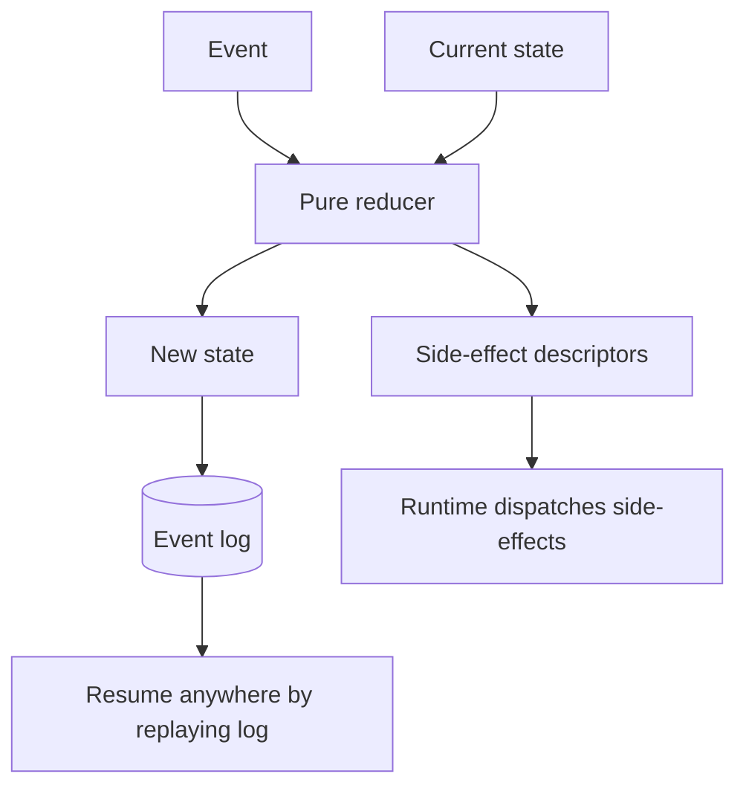

# Stateless Reducer Agent

**Also known as:** Pure-Function Agent, Event-Sourced Agent, 12-Factor Stateless Agent

**Category:** Planning & Control Flow  
**Status in practice:** emerging

## Intent

Design the agent as a pure function (state, event) → newState; entire execution history is held in an external event log; enables pause / resume / replay / time-travel without bespoke checkpointing.

## Context

A team builds an agent. The default is to hold state in process memory (Python objects, in-memory dicts). Pausing, resuming, or replaying the agent requires custom checkpointing logic that is inevitably incomplete.

## Problem

In-memory agent state cannot be paused, resumed across processes, or time-travelled. Each capability requires bespoke checkpointing that misses edge cases. Differs from durable-workflow-snapshot (which is a snapshot mechanism) by being a programming-model constraint — the agent is *designed* as a reducer, not made into one after the fact.

## Forces

- Stateless-reducer discipline constrains how agent code is structured.
- External event log adds infrastructure dependency.
- Some operations are naturally stateful (caches, connections) and need separate handling.

## Therefore

Therefore: the agent is a pure function (state, event) → newState; all execution history is in an external event log; pause/resume/replay/time-travel come from replaying the log against the reducer.

## Solution

The agent's core is a pure function: takes (current state, next event) → (new state, side-effect descriptors). Side effects are descriptors, not executions — the runtime dispatches them. All events are appended to a durable log. Pause = stop dispatching. Resume = restart dispatching from current log position. Replay = re-run reducer against earlier log slice. Time-travel = re-run against any log slice. Pair with durable-workflow-snapshot, event-driven-agent, deterministic-control-flow-not-prompt, own-the team's-prompts.

## Structure

```
(Current state, Event) --> Pure reducer --> (New state, side-effect descriptors) --> Event appended to durable log --> Runtime dispatches descriptors. Pause = stop dispatch; Resume / Replay / Time-travel = re-run reducer over a log slice
```

## Diagram



## Example scenario

A coding agent encounters a long-running test step. The runtime pauses by stopping event dispatch. A user requests resumption from a different worker. The new worker reads the agent's event log, replays the reducer from log start to current position, then resumes dispatch. Time-travel: the user later replays the log up to step 12 to debug a problem; the agent reconstructs its state at step 12 exactly.

## Consequences

**Benefits**

- Pause / resume / replay / time-travel are first-class with no bespoke checkpointing.
- Debugging by replaying production logs locally.
- Multiple runtimes can dispatch the same agent in different environments.

**Liabilities**

- Discipline required — no hidden state in closures or globals.
- External event log dependency.
- Side-effect dispatch is a separate concern that must be designed carefully.

## Failure modes

- Hidden state — a closure or global keeps data outside the reducer, and replay produces a different result from the original run.
- Executed side effect — the reducer calls an API directly instead of returning a descriptor, and replay repeats the real action.
- Log dependency outage — the external event log is unavailable, and the agent cannot advance or resume.
- Dispatch gap — the runtime crashes between logging a descriptor and executing it, and the side effect is lost or run twice.

## What this pattern constrains

All agent state changes flow through the reducer; no hidden state in process memory; all events are persisted to the durable log.

## Applicability

**Use when**

- Long-running agents that need pause/resume.
- Debugging by replay is valuable.
- Multiple runtimes / environments need to dispatch the same agent.

**Do not use when**

- Short-lived agents where bespoke state is fine.
- External event log infrastructure unavailable.
- Programming-model constraints are too heavy for prototype.

## Components

- Pure reducer function — (state, event) → (new state, side-effect descriptors)
- Durable event log — append-only, persistent
- Side-effect dispatcher — runtime component that executes descriptors
- Replay tool — re-runs reducer against log slices for debug/time-travel

## Tools

- Pure reducer function
- Durable event log
- Side-effect dispatcher

## Evaluation metrics

- Replay success rate
- Resume latency from log
- Event volume per agent run

## Known uses

- **[devstockacademy: 12-Factor Agents (Polish roundup) — Stateless Reducer Pattern](https://devstockacademy.pl/blog/narzedzia-i-automatyzacja/12-factor-agents-jak-budowac-agenty-ai-w-produkcji/)** _available_
- **[humanlayer/12-factor-agents](https://github.com/humanlayer/12-factor-agents)** _available_

## Related patterns

- _complements_ **Durable Workflow Snapshot**
- _complements_ **Event-Driven Agent**
- _complements_ **Deterministic Control Flow, Not Prompt**
- _complements_ **Own Your Prompts (12-Factor Agents)**
- _complements_ **Agent Resumption**
- _complements_ **Blocking Sync Calls in Agent Loop**
- _complements_ **Subject-First Agent Architecture (ENA Stateful Core)**
- _complements_ **Orchestrator as Bottleneck**
- _complements_ **Hidden State Coupling**
- _complements_ **Execution-State Ledger** — The reducer is the programming model that derives state from an event log; this pattern says what that derived state must contain for a mutating environment and how it gates each step.

## References

- [12-Factor Agents: jak budować agenty AI](https://devstockacademy.pl/blog/narzedzia-i-automatyzacja/12-factor-agents-jak-budowac-agenty-ai-w-produkcji/) — 2026
- [humanlayer/12-factor-agents](https://github.com/humanlayer/12-factor-agents) — 2026
