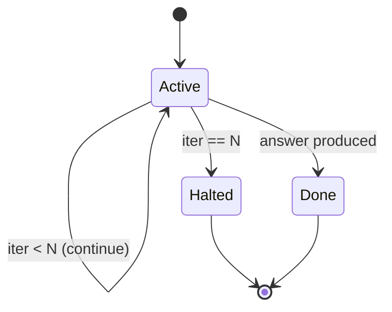

# Step Budget

**Also known as:** Max Steps, Iteration Cap, Loop Bound

**Category:** Safety & Control  
**Status in practice:** mature

## Intent

Cap the number of tool calls or loop iterations the agent is allowed within a single request.

## Context

A team runs an agent inside some kind of loop — a ReAct loop, a plan-execute loop, a multi-agent debate — where the model is invoked repeatedly to take more steps until it decides it is finished. Each loop iteration costs model tokens, tool-call money, and wall-clock time, and the loop has no naturally bounded length: the model itself decides when to stop. In real traffic, some sessions wander into pathological states where the model keeps deciding to take one more step.

## Problem

If termination relies on the model saying 'I am done', then a confused, stuck, or over-eager agent will simply never declare itself done, and the loop runs until something else stops it — a timeout, a crash, or an angry invoice at the end of the month. The team has no way to bound the worst-case cost or latency of a single request, and one pathological session can burn through more budget than thousands of normal ones combined. Without a hard numeric cap that the loop respects regardless of the model's opinion, runaway behaviour is always one bad prompt away.

## Forces

- Cap too low cuts off legitimate work.
- Cap too high lets pathological runs burn budget.
- What to do when hit (return partial? error?) is its own design choice.

## Therefore

Therefore: cap the loop at a numeric N tool calls or iterations and terminate with the best partial answer when the counter hits the cap, so that runaway loops are impossible by construction regardless of what the model believes.

## Solution

Define a numeric cap (max_steps=N) in the agent loop. Increment per tool call or per loop iteration. When N is hit, terminate the loop and return the best partial answer with a note that the cap was reached.

## Structure

```
Request --> Active loop --step < N--> continue (step++) | --answer produced--> Done | --step == N--> Halted --> return best partial answer + cap-reached note
```

## Diagram



*The loop terminates either when the agent produces an answer or when the iteration counter hits N — whichever comes first.*

## Example scenario

An autonomous bug-fixing agent is given a step budget of 30. After 30 rounds of think-act-observe, the loop halts even if the agent insists it is 'almost done.' This stops a confused agent from spinning forever and racking up a $50 OpenAI bill on what should have been a five-minute task.

## Consequences

**Benefits**

- Bounded worst-case cost per request.
- Surfaces pathological prompts as cap-hits.

**Liabilities**

- Can hide deeper bugs (the agent really should stop earlier).
- Choosing N is empirical.

## Failure modes

- Masked bug — the agent hits the cap on most requests, the partial answer looks fine, and the reason it never stops on its own goes unfixed.
- Cap too low — N is chosen without data, and real multi-step tasks are cut off just before they finish.
- Unclear partial answer — the cap-reached note is dropped or ignored, so users treat an incomplete answer as complete.

## What this pattern constrains

The loop terminates after N iterations regardless of agent's own opinion.

## Applicability

**Use when**

- The agent has any kind of loop (ReAct, plan-execute, debate).
- Cost or latency must have a hard ceiling regardless of the agent's opinion.
- Runaway behaviour must be impossible by construction.

**Do not use when**

- Never. Step Budget is universal hardening for any agent loop.

## Components

- Loop counter — integer incremented on every tool call or iteration
- Numeric cap N — configured ceiling chosen empirically per workload
- Termination handler — produces the best partial answer with a cap-hit note when N is reached
- Cap-hit logger — records halted runs so N can be tuned against real traffic

## Tools

- Counter primitive in the agent loop — increments and checks against the cap each step
- Token-usage meter — backing the alternative token-budget variant
- Wall-clock timer — backing the alternative real-time-deadline variant

## Evaluation metrics

- Cap-hit rate by task class — fraction of runs that reached N rather than finishing
- Worst-case cost per request — bounded ceiling the cap actually delivered
- Partial-answer quality at cap — usefulness of returned state when N forced termination
- Cap-hit-to-deeper-bug ratio — share of cap hits later traced to a real underlying agent bug

## Known uses

- **Bobbin (Stash2Go)** _available_ — max_steps=4 in the agent lane.
- **[Claude Code (max_turns)](https://docs.claude.com/en/docs/claude-code/overview)** _available_
- **[OpenAI Agents SDK (max_iterations)](https://openai.github.io/openai-agents-python/)** _available_
- **[Sparrot](https://marco-nissen.com/sparrot/)** _available_ — A bounded number of steps per tick / per loop terminates work regardless of the agent's own opinion that more is needed.

## Related patterns

- _complements_ **Cost Gating**
- _complements_ **Human-in-the-Loop**
- _alternative-to_ **Infinite Debate**
- _alternative-to_ **Unbounded Subagent Spawn**
- _alternative-to_ **Unbounded Loop**
- _complements_ **Spec-Driven Loop**
- _complements_ **Plan-and-Execute**
- _generalises_ **Stop Hook**
- _complements_ **Stop / Cancel**
- _used-by_ **Outer-Inner Agent Loop**
- _complements_ **Agent-as-Tool Embedding**
- _complements_ **Mode-Adaptive Cadence**
- _complements_ **Typed Tool-Loop Failure Detector**
- _complements_ **Iteration Node**
- _alternative-to_ **Demo-to-Production Cliff**
- _complements_ **Token-Economy Blindness**
- _complements_ **Missing max_tokens Cap**
- _complements_ **Compound Error Degradation**
- _generalises_ **Composable Termination Conditions**
- _complements_ **Session-Scoped Payment Authorization** — Step-budget bounds compute steps; a session cap bounds money. Both are exhaustible envelopes around autonomy.
- _complements_ **Advisor Consult** — A per-request consult cap is a step budget for the advisor, bounding the one cost the executor controls.

## References

- [OpenAI Agents SDK](https://github.com/openai/openai-agents-python)
- [Anthropic: Building agents](https://platform.claude.com/docs/en/agents-and-tools/tool-use/overview)
