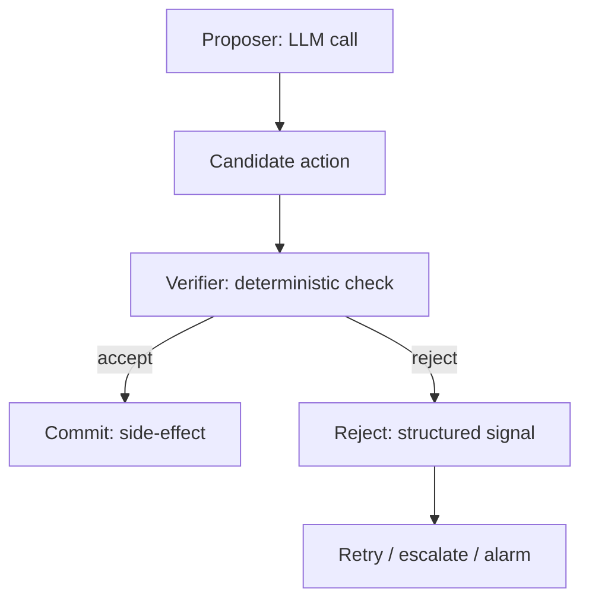

# Stochastic-Deterministic Boundary (SDB)

**Also known as:** SDB, Proposer-Verifier-Commit-Reject Contract

**Category:** Verification & Reflection  
**Status in practice:** emerging

## Intent

Formalize the seam between an LLM proposal and a system action as a four-part contract — proposer, verifier, commit step, reject signal — so the contract itself, not the agent's good intent, gates side-effects.

## Context

A production agent runtime takes LLM outputs and turns them into real-world actions. The team has ad-hoc validation scattered across the codebase: some calls are wrapped, some are not; verifiers exist but are not contractual; rejection has no standard signal that downstream systems can react to.

## Problem

Without a named contract at the boundary, validation is implicit and inconsistent. An LLM proposes something; somewhere downstream it commits; somewhere there may be a check. Audit cannot say 'every action passed verification' because verification is not architecturally enforced. The team has no shared vocabulary for the seam where stochastic generation becomes deterministic effect.

## Forces

- Inline validation per call site drifts and decays.
- Formalizing the contract demands a small amount of upfront discipline.
- Without a named primitive the team cannot reason about boundary failures uniformly.

## Therefore

Therefore: name the boundary as a SDB primitive with four explicit parts — Proposer (the LLM call), Verifier (the deterministic check), Commit (the side-effect), Reject (the structured failure signal) — and require every LLM-to-action path to instantiate all four.

## Solution

Treat the SDB as the load-bearing primitive of the runtime. Define the four parts explicitly per action class: Proposer is the LLM call that emits a candidate action; Verifier is a deterministic function that returns accept/reject with reason; Commit is the side-effect that fires only on accept; Reject is a structured signal (typed error, retry hint, escalation token) that downstream systems can react to. Audit reports group by SDB instance. Pair with supervisor-plus-gate, policy-as-code-gate, eval-as-contract.

## Structure

```
Proposer (LLM call) -> candidate action -> Verifier (deterministic, accept/reject + reason) --accept--> Commit (side-effect) ; --reject--> Reject signal (typed error / retry hint / escalation token) -> retry, escalate or alarm; audit grouped per boundary instance
```

## Diagram



## Example scenario

A trading agent proposes 'sell 50 NVDA at market'. SDB: Proposer = the LLM call producing the order JSON; Verifier = deterministic check (cash sufficient, within risk limits, market hours); Commit = order-submit API call; Reject = typed error {reason: limit-exceeded, retry_with: smaller_order}. Every order goes through this seam; auditor counts commits-with-matching-accept as 100%.

## Consequences

**Benefits**

- Shared vocabulary for the LLM-to-action boundary across the codebase.
- Audit can demonstrate 'every commit had a matching verifier accept'.
- Reject signals are structured, so retries and escalations can be programmatic.

**Liabilities**

- Requires upfront contract definition per action class — engineering investment.
- Inflexible boundary — ad-hoc validation patterns must be refactored to fit.
- Verifier quality dominates — a weak verifier rubber-stamps everything.

## Failure modes

- Rubber-stamp verifier — the verifier checks only shape, accepts nearly everything, and the contract gives a false sense of safety.
- Silent fallback — a reject is swallowed and a default action runs, so downstream systems never see the structured signal.
- Unwrapped action class — a new action is added without its four parts, and LLM output reaches a side-effect with no verifier.
- Commit before accept — the side-effect is started for speed while verification runs, and a rejected action has already taken effect.

## What this pattern constrains

No LLM output reaches a side-effect without instantiating all four SDB parts; rejection produces a structured signal, not a silent fallback.

## Applicability

**Use when**

- Production runtime where LLM outputs drive consequential actions.
- Team needs shared vocabulary across multiple action classes.
- Audit requires demonstrable per-action validation.

**Do not use when**

- Prototype or experimental agents where ad-hoc validation suffices.
- Single-call agents with one action class — overhead exceeds benefit.
- Validation cannot be expressed deterministically for the domain.

## Components

- Proposer — the LLM call that emits a candidate action
- Verifier — deterministic accept/reject function
- Commit — side-effect that fires only on accept
- Reject — structured failure signal with reason and retry hints

## Tools

- LLM API — proposer
- Deterministic verifier function — accept/reject
- Structured reject signal channel

## Evaluation metrics

- Verifier-reject rate — proposals refused
- False-accept rate — verifier passed proposals that should have failed
- Per-class action volume — how many actions flow through each SDB instance

## Known uses

- **[Production LLM Agents Runtime Patterns survey (arXiv 2605.20173)](https://arxiv.org/abs/2605.20173v1)** _available_

## Related patterns

- _complements_ **Supervisor-Plus-Gate**
- _complements_ **Policy-as-Code Gate**
- _complements_ **Eval as Contract**
- _complements_ **Typed Refusal Codes**
- _complements_ **Compensating Action**
- _complements_ **Planner-Executor-Verifier (PEV)**
- _generalises_ **Formal-Proof Compliance Gate** — Specialises the proposer-verifier-commit-reject contract by fixing the verifier as a theorem prover and the admission test as a proof check, so the boundary's guarantee is mathematical rather than contract-shaped.
- _complements_ **Replay Divergence** — An SDB verifier and reject signal can catch a divergent replayed proposal before it commits; this names the hazard that lives at the replay seam the boundary guards.
- _generalises_ **Action-Admissibility Tiering** — That names the four-part contract shape of the proposer-verifier seam; this specifies the ordered content of the verifier for physical actions and forbids compensation between its parts.
- _generalises_ **Control-Loop-Mapped Agent Chain** — The proposer-verifier-commit contract instantiated for process control, with the loop agent as proposer and the chain's selector and override layer as the deterministic commit step.
- _generalises_ **Feasibility-Negotiated Intent Contract** — Applies that seam to declarative goals and widens its verdict from accept-or-reject to a three-valued reply, where the counter-offer carries a named relaxation back to the proposer.
- _complements_ **Semantic Decision Node** — The decision model is the proposer and the code threshold is the verifier; the abstain band is the structured reject signal.

## References

- [A Methodology for Selecting and Composing Runtime Architecture Patterns for Production LLM Agents](https://arxiv.org/abs/2605.20173v1) — 2026
