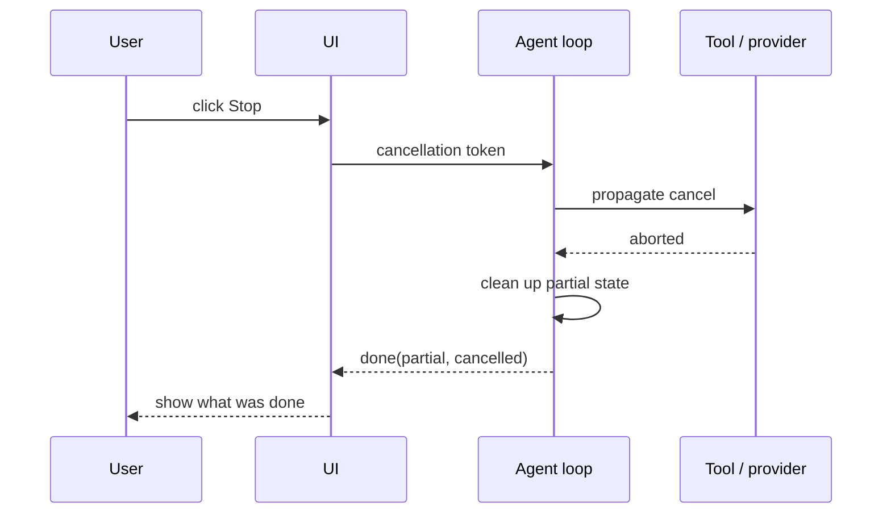

# Stop / Cancel

**Also known as:** User Interrupt, Abort Generation

**Category:** Streaming & UX  
**Status in practice:** mature

## Intent

Let the user interrupt an in-flight agent run cleanly, releasing resources and surfacing partial state.

## Context

A team is running an agent whose individual runs can take tens of seconds to minutes, with multiple tool calls and a streaming response. Halfway through such a run, the user can often see that the agent has misunderstood the request or gone down the wrong path. The team needs a way for the user to stop the run cleanly without closing the tab and without leaving half-written state behind.

## Problem

Without a real cancellation path, the user has only bad options: wait for the run to finish, abandon the page (which leaves orphaned tool calls and partial writes in flight), or kill the process and hope nothing important was mid-write. Meanwhile the agent keeps spending tokens, tool calls, and external API quota on work the user already knows is wrong. Implementing a stop button on the user-interface alone is not enough either — the cancellation has to propagate through the agent loop, through each tool call, and into the streaming connection to the model provider, or the run continues invisibly underneath a stopped-looking interface.

## Forces

- Cancellation must reach upstream tools and providers.
- Partial state may or may not be useful.
- Race conditions between completion and cancellation.

## Therefore

Therefore: propagate a cancellation token from a visible stop control all the way through the loop, tools, and provider streams, so that wrong-direction runs cost seconds, not minutes.

## Solution

Surface a stop control in the UI. On click, propagate a cancellation token through the agent loop, tool calls, and provider streams. Clean up partial state. Show what was done. Optionally save partial output for later resumption.

## Structure

```
User clicks Stop -> UI -> cancellation token -> Agent loop -> propagate to tool calls and provider streams -> aborted -> clean up partial state -> (optional) save partial output -> UI shows done(partial, cancelled)
```

## Diagram



## Example scenario

A user kicks off an agent run that is going off-track within five seconds; right now there is no UI control to stop it and they wait two minutes for completion while cost burns. The team adds a stop control that propagates a cancellation token through the agent loop, tool calls, and provider streams, cleans up partial state, and surfaces what was done. Wrong-direction runs cost seconds rather than minutes and users feel in control.

## Consequences

**Benefits**

- User control restores when the agent goes wrong.
- Cost is bounded by user attention.

**Liabilities**

- Cancellation plumbing is non-trivial across providers.
- Partial state may be inconsistent.

## Failure modes

- UI-only stop — the button stops the display, but the token never reaches the agent loop, and tool calls and provider streams keep running and spending.
- Late tool call — a step already queued before the cancel fires one more model or tool call after the run was marked cancelled.
- Half-written state — cancellation lands mid-write, cleanup does not roll it back, and later runs see inconsistent partial data.
- Lost partial work — the run stops cleanly but nothing records what was done, so the user cannot judge what changed or resume from it.

## What this pattern constrains

Once cancelled, no further model or tool calls may be issued for the cancelled run.

## Applicability

**Use when**

- Long-running agents where the user may notice a wrong direction mid-run.
- A cancellation token can be propagated through agent loop, tools, and provider streams.
- Partial state can be cleaned up and surfaced cleanly.

**Do not use when**

- Runs are short and cancellation provides no real value.
- Cancellation cannot propagate cleanly and would leave inconsistent state.
- The UI has no surface to expose a stop control.

## Components

- Stop control — visible UI affordance (button, keybinding) that initiates cancellation
- Cancellation token — first-class signal threaded through the agent loop, tools, and provider streams
- Agent loop interceptor — checks the token between steps and halts further model or tool calls
- Tool and provider adapter — propagates cancel to in-flight HTTP and streaming calls
- Partial-state reconciler — cleans up half-written state and surfaces what was done

## Tools

- HTTP client with abort support — cancels in-flight provider and tool requests
- Streaming LLM API with cancellation — provider stream that honours mid-response abort
- Checkpoint store — optional persistence target for resumable cancel variants

## Evaluation metrics

- Cancellation latency — wall-clock from stop click to last billable model or tool call
- Post-cancel call leakage — count of model or tool calls issued after the cancel signal
- Token and tool-call cost saved per cancel — bounded resource spend relative to letting the run finish
- Partial-state usefulness — fraction of cancelled runs whose surfaced partial output the user keeps or resumes
- Cancel completion rate — share of stop clicks that resolve cleanly versus leaving orphan calls

## Known uses

- **ChatGPT Stop button** _available_
- **Claude Code's Esc-to-interrupt** _available_

## Related patterns

- _complements_ **Streaming Typed Events**
- _complements_ **Step Budget**
- _complements_ **Decision Paralysis**

## References

- [Streaming Messages](https://docs.claude.com/en/api/messages-streaming) — 2025
