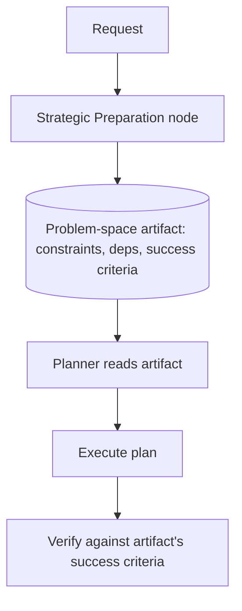

# Strategic Preparation Phase

**Also known as:** Problem-Space Mapping, Mental Model Build Phase

**Category:** Planning & Control Flow  
**Status in practice:** emerging

## Intent

Mandate an explicit problem-space representation step before the agent attempts solutions, mirroring how expert humans build a mental model of constraints and dependencies before solving.

## Context

An agent receives a complex request with interconnected constraints — schedule that depends on this and conflicts with that. The default LLM behavior is premature-closure: produce a fluent answer immediately, optimized for sounding right rather than holding the constraint web in mind.

## Problem

Without a forced preparation step, the agent commits early to a path that ignores cross-constraint interactions. By the time errors surface, the plan has compounded. Cognitive-science research (Newell & Simon 1972, Langley & Simon 1987) shows expert human problem-solvers explicitly spend disproportionate time on preparation before attempting solutions; the agent is structurally biased the opposite way.

## Forces

- Preparation adds latency before any visible progress.
- On easy tasks the preparation step is dead weight.
- The preparation artifact must be usable by the planner — not just produced and discarded.

## Therefore

Therefore: insert a Preparation step before the planner that produces an explicit problem-space artifact (constraints, dependencies, success criteria, candidate decompositions) which the planner must read before generating any plan.

## Solution

Add a Preparation node to the agent's pipeline: given the goal, produce a structured problem-space representation as the first step. The artifact lists explicit constraints, dependency graph, declared success criteria, known unknowns. The planner is required to read and cite the artifact. Triggered by problem complexity heuristics so easy tasks skip it. Pair with generate-and-test-strategy (uses the artifact to test candidates), decision-context-maps (gather inputs into the artifact), planner-executor-verifier.

## Structure

```
Request --> Complexity gate --trivial--> Planner. Complexity gate --complex--> Preparation step --> Problem-space artifact (constraints, dependency graph, success criteria, known unknowns) --> Planner reads and cites artifact --> Execute --> Verifier checks against artifact success criteria
```

## Diagram



## Example scenario

A crossword-solving agent given a 6x6 puzzle. Naive LLM fills cells in clue order and gets five intersections wrong. With Strategic Preparation: first step is 'Mapping out the crossword puzzle clues, listing both the across and down entries, and determining the letter count for each.' Only after producing this map does the agent attempt solutions. Result: nearly perfect solution in 2 minutes vs five errors in seconds.

## Consequences

**Benefits**

- Premature-closure failure mode reduced — constraints are explicit before any plan commits.
- The preparation artifact is itself auditable as evidence the agent considered the right things.
- Plans become reviewable against declared constraints, not against tacit assumptions.

**Liabilities**

- Latency overhead on every task, including easy ones unless gated.
- Artifact format design is engineering work — too rigid and it doesn't fit, too loose and it's not useful.
- Planner discipline to actually read the artifact must be enforced, not just hoped for.

## Failure modes

- Ungated overhead — every request goes through preparation, and easy tasks pay latency for an artifact nobody needed.
- Uncited artifact — the planner produces a plan without reading the problem-space artifact, and the preparation step is wasted.
- Ill-fitting format — the artifact template is too rigid for the task, and key constraints end up left out or forced into the wrong field.
- Missed constraint interaction — the artifact lists constraints one by one but not how they depend on each other, and the plan still breaks on their combination.

## What this pattern constrains

The planner may not generate a plan without producing and citing a preparation artifact; complexity-gating may skip the artifact for trivial tasks, but the gate itself must be explicit.

## Applicability

**Use when**

- Tasks with interconnected constraints (puzzles, scheduling, multi-objective).
- Errors are costly enough to justify latency.
- Preparation artifact format can be designed for the domain.

**Do not use when**

- Trivial single-step tasks.
- Latency budget cannot absorb extra step.
- No way to enforce the planner actually reads the artifact.

## Components

- Complexity gate — skip prep for trivial requests
- Preparation step — produces structured problem-space artifact
- Problem-space artifact — constraints, dependency graph, success criteria
- Planner — reads artifact before generating plan
- Verifier — checks plan against the declared success criteria

## Tools

- Preparation node in agent pipeline
- Problem-space artifact schema
- Planner-reads-artifact enforcement

## Evaluation metrics

- Preparation-step coverage on complex tasks
- Premature-closure rate before/after preparation
- Artifact-citation rate in plans

## Known uses

- **[Bornet et al. — Agentic Artificial Intelligence, Chapter 6 (observed in LRM crossword puzzle behavior)](https://www.worldscientific.com/worldscibooks/10.1142/14380)** _available_
- **[Newell & Simon, Human Problem Solving (1972)](https://psycnet.apa.org/record/1973-10478-000)** _available_

## Related patterns

- _complements_ **Decision Context Maps**
- _complements_ **Generate-and-Test Strategy**
- _complements_ **Planner-Executor-Verifier (PEV)**
- _alternative-to_ **Premature Closure** — Strategic preparation is the explicit fix for the premature-closure anti-pattern.
- _complements_ **Pre-Flight Spec Authoring**
- _alternative-to_ **Context Fragmentation**

## References

- [Agentic Artificial Intelligence — Chapter 6: Reasoning](https://www.worldscientific.com/worldscibooks/10.1142/14380) — 2025
- [Newell & Simon — Human Problem Solving](https://psycnet.apa.org/record/1973-10478-000) — 1972
