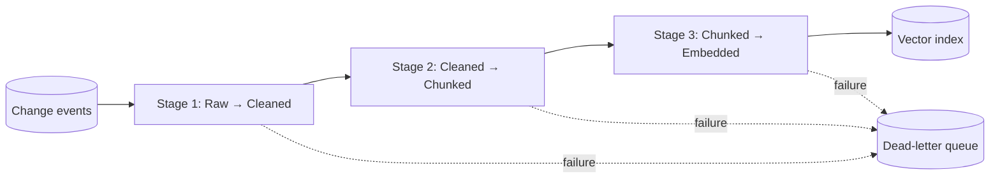

# Streaming Feature Pipeline

**Also known as:** Real-Time RAG Feature Pipeline, Bytewax-Style RAG Ingest

**Category:** Retrieval & RAG  
**Status in practice:** emerging

## Intent

Process raw documents into RAG features as a continuous stream rather than a batch job, with typed models pinning each stage.

## Context

An LLM application's vector index must stay close to the live state of an evolving corpus. Batch rebuilds run every N hours and lag the source. The team wants the pipeline to consume change events as they happen and update the index immediately.

## Problem

Batch ingestion lags the source by the rebuild cadence and wastes compute re-processing unchanged documents. Ad-hoc streaming code without a stage-pinning discipline (raw → cleaned → chunked → embedded) accumulates implicit data shape transitions that break silently as the pipeline evolves. Without a typed stream pipeline, real-time RAG ingestion becomes a debug nightmare on every schema or chunking change.

## Forces

- Lag between source change and vector update should be seconds, not hours.
- Each stage (clean, chunk, embed) has different cost and parallelism profile.
- Typed data at each stage catches shape drift early.
- Failure of one event should not poison the stream.

## Therefore

Therefore: build the feature pipeline as a streaming dataflow with one typed model per stage (raw, cleaned, chunked, embedded), so events flow continuously, shape is pinned at each transition, and failures isolate to single events.

## Solution

Use a streaming framework (Bytewax, Flink, Kafka Streams) to consume change events. Define a Pydantic (or equivalent) model per stage: RawDocument → CleanedDocument → ChunkedDocument → EmbeddedDocument. Each stage is a map operation that takes one model and emits the next; type errors surface at the stage boundary. Failed events go to a dead-letter queue for inspection rather than blocking the stream. Upserts to the vector index happen as the embedded model flows out of the last stage.

## Structure

```
Change events --> Stream consumer --> Stage 1: RawDocument -> CleanedDocument --> Stage 2: CleanedDocument -> ChunkedDocument --> Stage 3: ChunkedDocument -> EmbeddedDocument --upsert--> Vector index; any stage failure --> Dead-letter queue
```

## Diagram



## Example scenario

A documentation platform's RAG index must stay current as engineers edit pages. A Bytewax pipeline consumes a Kafka topic of page-change events. Each event flows through RawPage → CleanedPage → ChunkedPage → EmbeddedPage stages; the embedded output upserts into Qdrant. A bad page (binary content masquerading as HTML) goes to the DLQ; the stream keeps moving. Engineers see edited pages in RAG within seconds.

## Consequences

**Benefits**

- Vector index lag bounded by stream throughput, not batch cadence.
- Typed stage transitions surface shape drift immediately.
- Failed events isolate to DLQ; the stream continues.

**Liabilities**

- Streaming framework to operate (Bytewax, Flink, etc.).
- Per-stage type models add boilerplate.
- Backfill of historical corpus needs a separate pipeline or replay strategy.

## Failure modes

- Growing dead-letter queue — failed events land in the DLQ and nobody drains it, so those documents never reach the vector index.
- Untyped shortcut — a new stage passes a plain dict instead of the stage model, and shape drift returns at that seam.
- Missing backfill — the stream handles new changes, but the historical corpus is never replayed, so old documents are absent from retrieval.
- Slow stage bottleneck — the embedding stage cannot keep up with the event rate, and index lag grows from seconds to hours.

## What this pattern constrains

Real-time RAG/feature ingestion must not use implicit data shapes across pipeline stages; a typed model is pinned at each stage transition.

## Applicability

**Use when**

- Real-time RAG ingest is needed and batch lag is unacceptable.
- Source events can be modelled as a stream (CDC, webhook, queue).
- Engineering capacity to operate a streaming framework exists.

**Do not use when**

- Corpus changes rarely — batch rebuilds are cheaper and simpler.
- Team has no streaming-framework operational experience.
- End-to-end lag requirement is hours, not seconds.

## Components

- Stream consumer — reads change events
- Per-stage typed model — Raw, Cleaned, Chunked, Embedded
- Per-stage map operation — transforms one model into the next
- Dead-letter queue — failed events for inspection

## Tools

- Streaming framework (Bytewax, Flink, Kafka Streams)
- Pydantic / typed-schema library — defines the per-stage models
- Embedding model service — invoked at the embed stage

## Evaluation metrics

- End-to-end stream latency — source change to vector upsert
- Stage failure isolation — DLQ events per stage
- Throughput — events processed per second under typical load

## Known uses

- **[LLM Engineer's Handbook (Iusztin, Labonne) — Bytewax streaming feature pipeline (LLM Twin lesson 4)](https://www.comet.com/site/blog/streaming-pipelines-for-fine-tuning-llms/)** _available_
- **[Production RAG systems using Flink or Kafka Streams for real-time ingest](https://flink.apache.org/)** _available_

## Related patterns

- _composes-with_ **CDC-Driven Vector Sync**
- _composes-with_ **FTI LLM Pipeline Split**
- _complements_ **Event-Driven Agent**
- _uses_ **Vector Memory**
- _complements_ **Naive RAG**

## References

- [LLM Engineer's Handbook](https://www.packtpub.com/en-us/product/llm-engineers-handbook-9781836200079) — Paul Iusztin, Maxime Labonne, 2024
- [SOTA Python Streaming Pipelines for Fine-tuning LLMs and RAG](https://www.comet.com/site/blog/streaming-pipelines-for-fine-tuning-llms/)
