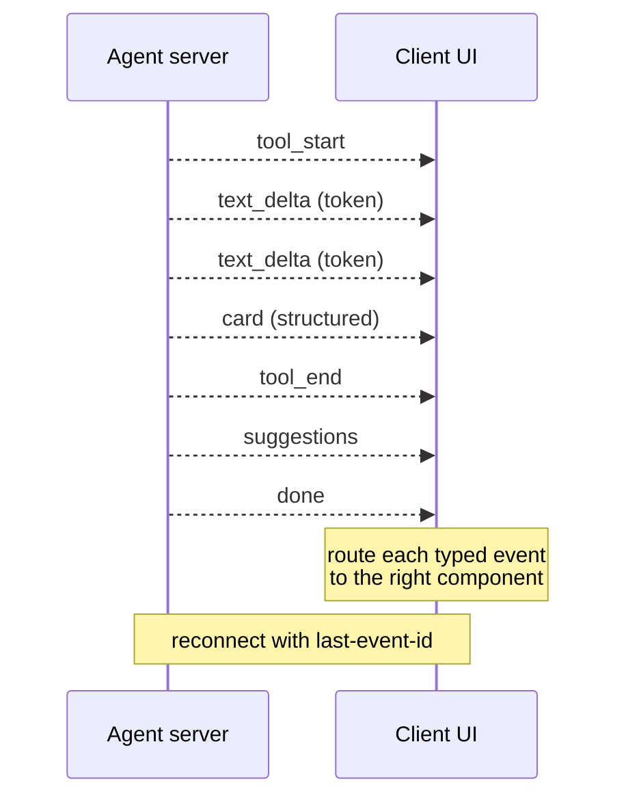

# Streaming Typed Events

**Also known as:** SSE Streaming, Typed Event Stream, Token Stream + Cards

**Category:** Streaming & UX  
**Status in practice:** mature

## Intent

Push partial results to the client as typed events as they become available, rather than waiting for the full response.

## Context

A team is building a user-facing agent where the time between the user pressing send and the first visible characters appearing is the latency the user actually perceives — what is often called time-to-first-token, or TTFT. The interface is not just plain prose: it shows cards, suggested follow-ups, tool-progress indicators, and progressively disclosed content. The team has to decide how the server should push partial results to the client as they become available.

## Problem

Waiting until the full answer is generated before rendering anything feels sluggish even when the actual generation is fast, because the user has nothing to look at during the wait. Streaming a single channel of plain text helps with perceived latency but loses the structure the interface needs: the client receives a stream of characters with no way to tell apart a token of the main answer, the start of a tool call, a structured card, or an error. Without a typed event vocabulary on the stream, the client either waits for the end or guesses, and neither produces a good interface.

## Forces

- Browser/network limits on long-lived connections.
- Event ordering and reconnection semantics.
- Backpressure when the client is slow.

## Therefore

Therefore: split the stream into a typed event vocabulary (text_delta, card, tool_start, done, error) over SSE or WebSocket, so that each event routes to the right UI component as soon as it lands.

## Solution

Use Server-Sent Events (or WebSocket) with a typed event vocabulary: text_delta (token), card (structured), suggestions, tool_start, tool_end, done, error. The client routes each event to the right UI component. Reconnect with last-event-id resumption.

## Structure

```
Agent server --SSE/WebSocket--> typed events {text_delta | card | suggestions | tool_start | tool_end | error | done} -> Client router -> matching UI component; on drop: reconnect with last-event-id -> resume stream
```

## Diagram



## Example scenario

A chat product streams a single text channel; the UI cannot tell apart token text, structured cards, suggestions, and tool progress until everything is rendered. The team switches to typed events over SSE: `text_delta`, `card`, `suggestions`, `tool_start`, `tool_end`, `done`, `error`. The client routes each event to the right widget as it arrives; perceived latency drops, structured content renders early, and the UI gains progress indicators.

## Consequences

**Benefits**

- Perceived latency drops dramatically.
- Rich UIs with structured streaming components.

**Liabilities**

- Connection management complexity.
- Partial state on the client must be reconcilable.

## Failure modes

- Unknown event type — the server adds a new event that the client does not route, and that part of the response silently disappears.
- Broken reconnect — the client resumes without the right last-event-id, and tokens or cards are duplicated or missing on screen.
- Unreconciled partial state — the stream ends in error after several deltas, and the client shows a half-built answer as if it were complete.
- Unbalanced tool events — a tool_start arrives with no matching tool_end, and the UI shows a spinner that never stops.

## What this pattern constrains

Events are typed; clients cannot consume payloads outside the declared event vocabulary.

## Applicability

**Use when**

- User-facing agents where time-to-first-token is perceived latency.
- The UI shows cards, suggestions, or progressive disclosure that need typed events.
- A transport (SSE, WebSocket) supports event streams with reconnection.

**Do not use when**

- Outputs are short enough that batching the full response is fine.
- The client cannot consume streams or has no progressive UI.
- A typed event vocabulary cannot be agreed across producer and consumer.

## Components

- Agent server stream producer — emits typed events (text_delta, card, tool_start, tool_end, suggestions, done, error) as work progresses
- Event type tagger — labels each payload with a vocabulary type before it leaves the server
- Transport — Server-Sent Events or WebSocket connection carrying ordered events with last-event-id
- Client event router — dispatches each typed event to the matching UI component
- Reconnection handler — resumes the stream from last-event-id after a transport drop

## Tools

- Server-Sent Events — long-lived one-way HTTP transport with built-in last-event-id resume
- WebSocket — bidirectional transport when the client must also push events mid-stream
- HTTP chunked transfer with length-prefixed JSON frames — fallback where SSE or WebSocket are blocked

## Evaluation metrics

- Time-to-first-token — latency from request to the first text_delta event reaching the client
- Event-vocabulary coverage — share of payloads that match the declared typed-event schema
- Reconnection success rate — fraction of dropped streams that resume cleanly via last-event-id
- Out-of-order or duplicate event rate — ordering and idempotency violations on the client
- Backpressure drop rate — events discarded or queued when the client cannot keep up

## Known uses

- **Bobbin (Stash2Go)** _available_ — SSE typed events: text_delta, card, suggestions, tool_start, done, error.
- **OpenAI Assistants streaming** _available_
- **Anthropic Messages streaming** _available_

## Related patterns

- _complements_ **Structured Output**
- _generalises_ **Citation Streaming**
- _complements_ **Bidirectional Impulse Channel**
- _complements_ **Salience-Triggered Output**
- _complements_ **Stop / Cancel**
- _used-by_ **Multilingual Voice Agent Stack**
- _alternative-to_ **Delayed Streams Modeling**
- _complements_ **Unified Voice Interface**
- _complements_ **Generative UI** — Generative UI rides this typed event stream, specialising it for declarative interface components.

## References

- [MDN: Server-Sent Events](https://developer.mozilla.org/en-US/docs/Web/API/Server-sent_events)
