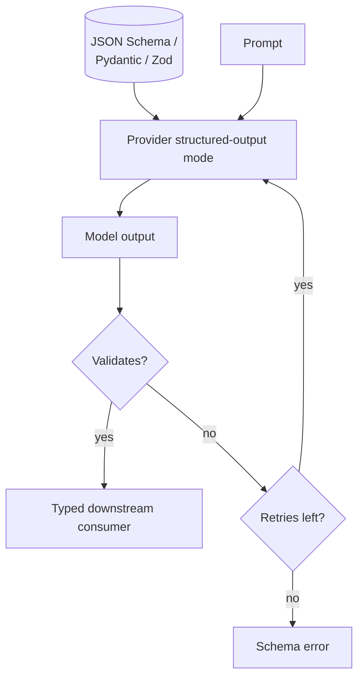

# Structured Output

**Also known as:** JSON Mode, Schema-Constrained Generation, Typed Output

**Category:** Structure & Data  
**Status in practice:** mature

## Intent

Constrain the model's output to conform to a JSON Schema (or similar typed shape).

## Context

A team has a pipeline where downstream code expects typed data — a JSON object with known fields, the input to a function call, the body of an API request. The language model is asked to produce that object, and the code that consumes it cannot work with prose. The team needs the model's output to validate against a schema, not just look like it does.

## Problem

When the model is asked to emit JSON via natural-language instructions alone, the output is close but not quite right in inventive ways: smart quotes instead of straight ones, a stray sentence of explanation before the opening brace, a trailing comma, an extra field the schema does not allow. Strict parsers reject this; permissive parsers smuggle bugs forward. Writing post-hoc fixers turns into a tar pit of regular expressions chasing each new failure mode, and the application picks up a class of "flaky model" bugs that are really shape bugs the team has no clean way to prevent at decode time.

## Forces

- Strict schemas reduce model freedom and recall.
- Schema evolution is a real concern.
- Provider implementations of structured output differ in fidelity.

## Therefore

Therefore: hand the schema to the provider's constrained-decoding mode and validate-and-retry on failure, so that the model cannot emit content that does not type-check.

## Solution

Define a JSON Schema (or Pydantic / Zod / equivalent). Pass it to the model via the provider's structured-output mode. Validate the output. Reject and retry on validation failure. Cap retries.

## Structure

```
Schema (JSON Schema / Pydantic / Zod) + Prompt -> provider structured-output mode -> model output -> validate --pass--> typed consumer; --fail--> retry (capped) --cap reached--> schema error
```

## Diagram



## Example scenario

A pipeline that consumes model output as JSON keeps breaking on smart quotes, surprise prose preambles, and trailing commas. Post-hoc parsing is a tar pit. The team defines a JSON Schema, passes it via the provider's structured-output mode, validates the result, and retries on validation failure with a low cap. The 'flaky model' bug class disappears because the model is now constrained to the typed shape at decode time.

## Consequences

**Benefits**

- Downstream code becomes simple and typed.
- Schema-level errors surface immediately.

**Liabilities**

- Provider lock-in for the strictest modes.
- Some tasks resist schema-fitting; the schema becomes the bottleneck.

## Failure modes

- Retry loop burn — a schema the model cannot satisfy for some input triggers retries up to the cap on every call, adding cost and latency before a schema error.
- Schema as bottleneck — a task that does not fit the shape is forced into it, and the model fills required fields with weak or made-up values that still validate.
- Valid but wrong — the output passes the schema while the content is incorrect, and downstream code trusts it because it parsed.
- Provider lock-in — the code depends on one provider's strict mode, and moving to another provider brings back malformed output.

## What this pattern constrains

The model cannot return content that does not validate against the schema.

## Applicability

**Use when**

- Downstream code consumes typed data and free-form text would break parsers.
- A JSON Schema or equivalent typed shape can be defined for the output.
- The provider supports structured-output mode or function calling.

**Do not use when**

- Output is for human consumption only and structure adds no value.
- The schema would be so loose it provides no real type safety.
- Strict schema enforcement triggers excessive retries that hurt UX.

## Components

- Schema definition — JSON Schema, Pydantic model, or Zod schema that declares the typed output shape
- Constrained-decoding mode — provider-side or local grammar that prevents the model from emitting non-conforming tokens
- Validator — runs after decoding and rejects outputs that do not type-check against the schema
- Retry controller — re-prompts with the validator error on failure, capped at N attempts
- Typed consumer — downstream code that can rely on the schema and skip ad-hoc parsing

## Tools

- Provider structured-output mode (OpenAI Structured Outputs, Anthropic tool-use schemas) — constrained decoding against a supplied schema
- Pydantic or Zod — defines the schema in code and produces the JSON Schema the provider consumes
- Local grammar-constrained decoder (Outlines, llama.cpp grammars, Guidance) — enforces shape on open-weights stacks
- Guardrails AI or similar validator — wraps generation with validate-and-retry when the provider lacks strict mode

## Evaluation metrics

- First-attempt schema-validation pass rate — fraction of outputs that type-check without any retry
- Mean retries per successful output — overhead the retry loop adds; high values point at schema/model mismatch
- Final failure rate at the retry cap — outputs that never validate; surfaces tasks the schema cannot fit
- Task-quality delta vs free-form baseline — does constraining the shape hurt the underlying answer quality
- Schema-evolution break rate — proportion of past outputs that stop validating when the schema changes

## Known uses

- **ConvArch** _available_ — Strict JSON schema for every architecture-edit tool call.
- **Knitting-DSL Pipeline (Stash2Go)** _available_ — Frozen 6-item rubric output schema.
- **Guardrails AI** _available_

## Related patterns

- _used-by_ **Tool Use**
- _used-by_ **Frozen Rubric Reflection**
- _used-by_ **Deterministic-LLM Sandwich**
- _alternative-to_ **Schema-Free Output**
- _complements_ **Plan-and-Execute**
- _used-by_ **DSPy Signatures**
- _used-by_ **Input/Output Guardrails**
- _complements_ **Streaming Typed Events**
- _alternative-to_ **Hallucinated Tools**
- _alternative-to_ **Tool Output Trusted Verbatim**
- _used-by_ **SOP-Encoded Multi-Agent Workflow**
- _used-by_ **Mobile UI Agent**
- _used-by_ **Dual-System GUI Agent**
- _complements_ **Code-as-Action Agent**
- _used-by_ **Multilingual Voice Agent Stack**
- _complements_ **Code-Switching-Aware Agent**
- _composes-with_ **Prompt/Response Optimiser**
- _complements_ **Citation Attribution**
- _complements_ **Deterministic Control Flow, Not Prompt**
- _complements_ **Context Minimization**
- _complements_ **LLM Map-Reduce Isolation**
- _complements_ **Missing max_tokens Cap**
- _used-by_ **Performative Message**
- _composes-with_ **Attentive Reasoning Queries** — ARQ blueprints emit each reasoning step as a structured field, making them individually checkable.
- _complements_ **Machine-Checkable Tool Contract** — Constrains what the model emits; this constrains what the tool accepts and what its failures look like.
- _used-by_ **Solver-Ready Formulation Handoff** — The formulation is emitted as a typed artefact that must validate before compilation, not as free prose describing a model.
- _used-by_ **Semantic Decision Node** — The typed answer schema is structured output taken to its limit: a closed set of options plus a probability, with no free text.

## References

- [OpenAI Structured Outputs](https://platform.openai.com/docs/guides/structured-outputs)
- [Pydantic](https://docs.pydantic.dev)
