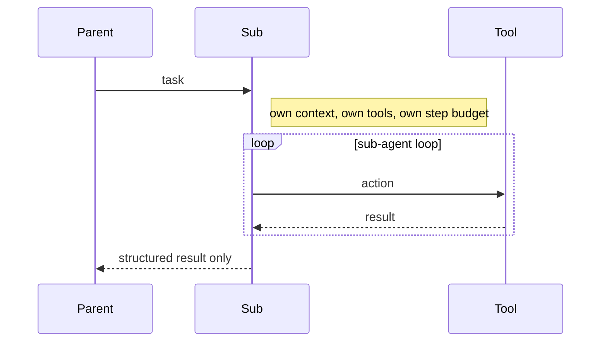

# Subagent Isolation

**Also known as:** Worktree Subagent, Parallel Subagent, Isolated Worker

**Category:** Multi-Agent  
**Status in practice:** emerging

## Intent

Run subagents in isolated workspaces so their writes do not collide and parallelism is safe.

## Context

A coding agent — or any agent that edits files, runs commands, or mutates a workspace — delegates to several sub-agents that should work in parallel. Each sub-agent has its own bounded task: one refactors a module, another updates tests, a third writes documentation. They all want to touch the same repository at the same time.

## Problem

If the sub-agents share one working directory, their edits race each other: one sub-agent's commit clobbers another's uncommitted changes, two sub-agents edit the same file with incompatible diffs, and a failure in one leaves the workspace in a state that breaks the others. Serialising them removes the parallelism that was the point of spawning sub-agents in the first place. Without isolated workspaces, the team has to choose between racing writes and giving up on parallel execution.

## Forces

- Isolation has setup cost (new worktree, branch, container).
- Reconciling work back to the main workspace is its own problem.
- Excessive isolation prevents subagents from seeing each other's progress when that would help.

## Therefore

Therefore: give each subagent its own workspace (git worktree, branch, container, sandbox) and reconcile results back through the supervisor, so that parallel work runs without write collisions and failures leave inspectable evidence.

## Solution

Each subagent runs in its own workspace (git worktree, container, branch, sandbox). The supervisor reconciles results back to the main workspace on completion (merge, cherry-pick, replay). Only one workspace can land changes at a time.

## Structure

```
Supervisor --task--> Subagent 1 (own worktree / container) | Subagent 2 (own worktree / container) --> results --> Supervisor --reconcile one at a time (merge, cherry-pick, replay)--> Main workspace
```

## Diagram



*Subagent Isolation wraps a full agent loop behind a function-shaped boundary so the parent only sees the return value.*

## Example scenario

A research agent is asked to write a market report. Instead of doing every sub-task in its main loop, it spawns three sub-agents in parallel: one to research competitors, one to pull pricing data, one to summarise news. Each sub-agent has its own tool set and step budget. The main agent only sees the three structured results that come back, not the dozens of intermediate web searches each sub-agent ran.

## Consequences

**Benefits**

- True parallelism without write collisions.
- Failed subagents leave their workspace as evidence.

**Liabilities**

- Setup latency.
- Reconciliation conflicts.

## Failure modes

- Merge conflict at landing — two subagents change the same lines in separate workspaces, and the supervisor cannot reconcile them cleanly.
- Setup latency — creating a fresh worktree or container per subagent takes longer than the subagent's actual task.
- Cross-workspace write — a subagent writes outside its own workspace, and the collisions isolation was meant to prevent come back.
- Orphaned workspace — a subagent fails, its workspace is never cleaned up or reconciled, and its partial work is silently lost.

## What this pattern constrains

Subagents may only write to their own isolated workspace; cross-workspace writes are forbidden.

## Applicability

**Use when**

- A bounded sub-task has its own tool palette, prompt, or model.
- The parent's context should not bloat with the sub-agent's intermediate turns.
- Sub-agents can run in parallel and their failures must be containable.

**Do not use when**

- The parent must observe the sub's intermediate state for debugging.
- The sub is a single-shot operation; Tool Use suffices without an agent loop.
- Recursive nesting depth is unbounded; cost will spiral.

## Components

- Parent supervisor — spawns isolated sub-agents and reconciles results back to the main workspace
- Isolated sub-agent — runs in its own git worktree, branch, container, or sandbox
- Workspace boundary — git worktree, container filesystem, or sandbox preventing cross-writes
- Reconciliation step — supervisor-side merge, cherry-pick, or replay of sub-agent results
- Structured result envelope — only sanctioned channel from sub-agent back to parent

## Tools

- git worktree — per-sub-agent branch and working directory for parallel code edits
- Container or sandbox runtime — OS-level isolation for untrusted sub-agent execution
- Claude Code or Devin subagent harness — spawns isolated workers and tracks their lifecycle
- Merge driver — automated or manual reconciliation of overlapping sub-agent changes

## Evaluation metrics

- Parallelism factor — actual wall-clock speedup versus serial execution
- Reconciliation-conflict rate — share of sub-agent results that needed manual merge resolution
- Sub-agent setup latency — wall-clock overhead per isolated workspace
- Failure-evidence completeness — share of failed sub-agents whose workspace was inspectable post-mortem
- Cross-workspace-write violations — runs where isolation was bypassed and writes collided

## Known uses

- **Claude Code subagent + git worktree** _available_
- **[Devin sessions](https://docs.devin.ai/get-started/devin-intro)** _available_
- **[Cursor parallel agents](https://cursor.com/)** _available_
- **[OpenHands](https://github.com/All-Hands-AI/OpenHands)** _available_
- **[Sparrot](https://marco-nissen.com/sparrot/)** _available_ — A subagent runtime spawns bounded child agents for delegable work (deeper passes, isolated investigations) and returns their result to the main loop without merging their context window into the parent.

## Related patterns

- _specialises_ **Orchestrator-Workers**
- _composes-with_ **Sandbox Isolation**
- _composes-with_ **LLMCompiler**
- _complements_ **Agent-as-Tool Embedding**
- _complements_ **Unbounded Subagent Spawn**
- _used-by_ **Clone Fan-Out Research**
- _alternative-to_ **Cascading Agent Failures**
- _alternative-to_ **Memory Extraction Attack**
- _generalises_ **LLM Map-Reduce Isolation**
- _complements_ **Context Folding**
- _complements_ **Shadow Workspace** — Worktree isolation separates parallel subagents; a shadow workspace isolates the agent's edits from the real tree for safe review.
- _complements_ **Forkable Agent Sandbox** — Isolation stops parallel workers from colliding; forking gives each worker an identical live starting state instead of an empty one.

## References

- [Claude Code subagents](https://docs.claude.com/en/docs/claude-code/sub-agents) — 2025
