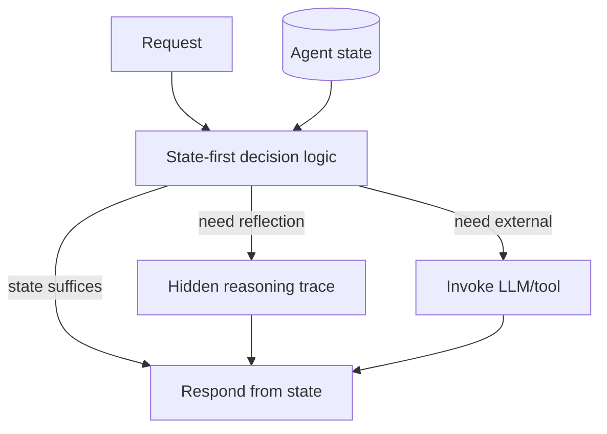

# Subject-First Agent Architecture (ENA Stateful Core)

**Also known as:** ENA Stateful Core, State-First Agent, Inverted-LLM-Control

**Category:** Cognition & Introspection  
**Status in practice:** experimental

## Intent

Invert the LLM-centric pipeline: the agent is a stateful subject whose decision logic chooses whether to invoke the LLM at all, treating the model as one tool among many.

## Context

The dominant pattern: LLM at the center, state and tools as periphery — each request flows Context+Prompt → LLM → Action. The Russian Habr 2026 source proposes inverting this: agent state at the center, LLM as a tool the agent decides whether to call.

## Problem

LLM-centric pipelines make every decision stochastic. The agent has no way to 'stay silent' on routine queries where its current state already answers the question. Every request goes through the LLM even when the agent could answer from state. Differs from existing llm-as-periphery by being more specific: the *agent state-first decision logic* is the load-bearing concept.

## Forces

- LLM-centric pipelines are the SDK default.
- State-first design requires bespoke control logic — not just framework configuration.
- Not invoking the LLM means giving up flexibility on edge cases.

## Therefore

Therefore: the agent is a stateful subject — a process/class with persistent internal state and decision logic; at each request, the decision logic chooses whether the state suffices to respond, or whether to invoke the LLM (or another tool) for assistance.

## Solution

Implement the agent as a stateful process. Internal state includes goals, history, confidence, conflict signals. Decision logic at each request: (a) does state suffice to respond? if yes, respond from state; (b) is there internal conflict warranting reflection? if yes, run hidden reasoning trace; (c) does the query need external information or generation? if yes, invoke LLM or tool. The LLM is one tool among many, not the central decision-maker. Pair with llm-as-periphery, stateless-reducer-agent, reflexive-metacognitive-agent, awareness.

## Structure

```
Request + Agent state (goals, history, confidence, conflict signals) --> state-first decision logic --> {state suffices -> respond from state | internal conflict -> hidden reasoning trace -> respond | needs external information or generation -> invoke LLM or tool -> respond}
```

## Diagram



## Example scenario

A long-running personal assistant has stateful subject design. User asks 'what's my next meeting?' — decision logic checks state, finds the schedule in memory, responds directly without LLM (free, fast). User asks 'help me draft a follow-up email' — decision logic checks state, finds insufficient context, invokes LLM to draft. The LLM is called only when state is insufficient.

## Consequences

**Benefits**

- Routine queries answered from state without LLM cost.
- Agent can 'stay silent' or 'think' when state is uncertain.
- LLM stochasticity contained to specific decisions.

**Liabilities**

- Bespoke control logic — not framework-configurable.
- State design is upfront work.
- Risk of over-trusting state on edge cases the LLM should have caught.

## Failure modes

- Overtrusted state — the agent answers from its state on an edge case the LLM would have caught, and the reply is confidently wrong.
- Never silent — the decision logic routes nearly everything to the LLM, so the system is LLM-centric again with extra code.
- Stale state answers — state is not refreshed, and responses from state repeat facts that changed since.
- Hidden reflection loop — conflict signals keep triggering the hidden reasoning trace, and the agent spends cycles without responding.

## What this pattern constrains

The LLM is invoked only when state-first decision logic decides it is needed; LLM is not the default decision-maker.

## Applicability

**Use when**

- Long-running agent where state accumulates meaningfully.
- Routine queries are common and answerable from state.
- Engineering team can build bespoke control logic.

**Do not use when**

- Short-lived or single-call agents where state never accumulates.
- Every query genuinely requires LLM judgment.
- Team capacity limits bespoke control logic.

## Components

- Stateful subject — process/class with persistent internal state
- State-first decision logic — chooses LLM/tool invocation per request
- Hidden reasoning trace — internal reflection without LLM
- LLM-as-tool wrapper — invoked only when decision logic decides

## Tools

- Stateful subject process
- State-first decision logic
- LLM-as-tool wrapper

## Evaluation metrics

- LLM-invocation rate — share of requests that needed model call
- State-only response rate — answered without LLM
- Hidden reasoning trace count

## Known uses

- **[Habr (Russian): Субъектный подход к архитектуре агентов: инверсия управления LLM](https://habr.com/ru/articles/987518/)** _available_

## Related patterns

- _specialises_ **LLM as Periphery**
- _complements_ **Stateless Reducer Agent**
- _complements_ **Reflexive Metacognitive Agent**
- _complements_ **Awareness**
- _complements_ **Meditation Mode**

## References

- [Субъектный подход к архитектуре агентов: инверсия управления LLM](https://habr.com/ru/articles/987518/) — 2026
