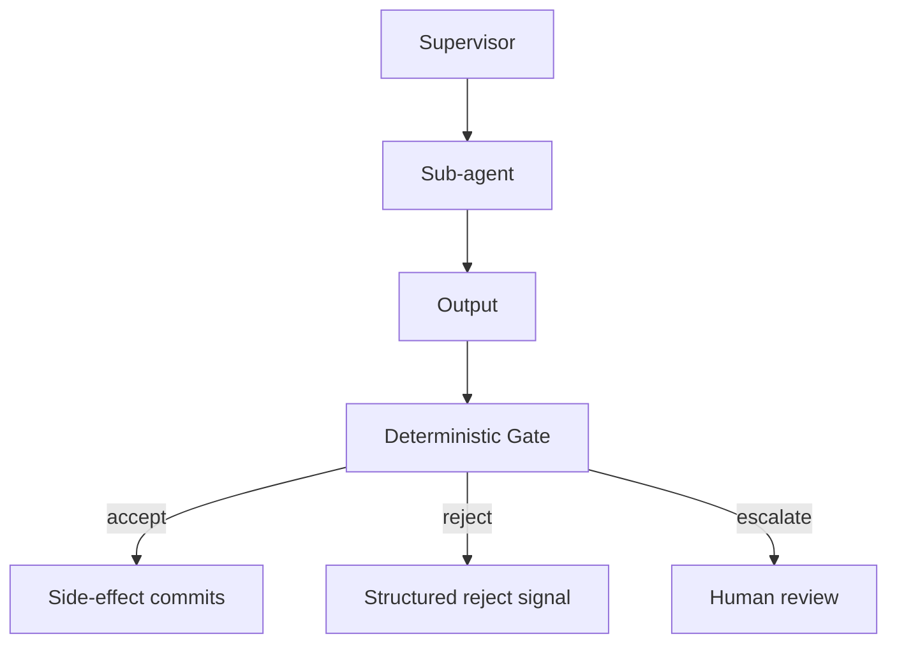

# Supervisor-Plus-Gate

**Also known as:** Validating Supervisor, Gated Supervisor

**Category:** Safety & Control  
**Status in practice:** emerging

## Intent

Supervisor controller that validates and gates LLM outputs against deterministic checks before they commit to side-effects.

## Context

A multi-agent system has a supervisor that dispatches work to sub-agents and collects their outputs. The system needs to enforce policy or quality constraints that the LLMs may violate. Treating the supervisor as just a router lets bad outputs through.

## Problem

A plain supervisor routes work without checking the legitimacy of returned outputs. Sub-agent results pass through to side-effects (commits, sends, writes) on the supervisor's authority. When a sub-agent's output violates a policy invariant, there is no checkpoint between 'output produced' and 'effect committed'. Distinct from a plain supervisor by mandating a hard reject signal on policy violation.

## Forces

- Sub-agent outputs are often unstructured and hard to validate generically.
- Adding validation latency at every supervisor hop can balloon end-to-end time.
- A 'best-effort' supervisor pattern lets soft violations through without explicit decision.

## Therefore

Therefore: every supervisor hop runs a deterministic gate (policy-as-code, schema check, allow-list) before committing the sub-agent's output to downstream effect; gate violations produce an explicit reject signal, not a fallback.

## Solution

Co-locate a Gate next to the Supervisor. The Gate receives the sub-agent output, runs deterministic checks (schema validity, policy-as-code, allow-list, threshold), and emits one of {accept, reject, escalate}. Only accepted outputs flow to side-effects. Rejections produce structured errors that surface to retries or human review. Pair with supervisor, policy-as-code-gate, and typed-refusal-codes.

## Structure

```
Supervisor --> Sub-agent --> Output --> Deterministic gate (schema, policy as code, allow-list, thresholds) --accept--> Side-effect commits | --reject--> Structured error to retry | --escalate--> Human review
```

## Diagram



## Example scenario

A payment-approval multi-agent system has a supervisor dispatching to credit-check, fraud-check, and limit-check sub-agents. Each sub-agent returns a structured verdict. The Gate runs `approved AND fraud_score<0.3 AND amount<=daily_limit` before forwarding to the commit step. A sub-agent returning `approved=true` with no fraud field is rejected by the gate's schema check, not silently passed through.

## Consequences

**Benefits**

- Side-effects can only fire on outputs that passed an explicit deterministic check.
- Rejections produce structured signals downstream systems can react to (retry, escalate, alarm).
- The gate decision is auditable independently of the LLM's reasoning trace.

**Liabilities**

- Adds latency at every supervisor hop.
- Requires investment in deterministic policy expression — the gate is only as good as the rules.
- Sub-agents may need to be redesigned to produce outputs the gate can check.

## Failure modes

- Rules too thin — the gate checks schema but not the policy invariant that matters, so a violating output is accepted.
- Uncheckable output — a sub-agent returns free text the gate cannot evaluate, and the team marks it accept by default to keep work moving.
- Escalation backlog — many outputs land in escalate, human review falls behind, and side effects wait at every supervisor hop.

## What this pattern constrains

No sub-agent output flows to a side-effect without passing the gate; the supervisor cannot bypass the gate on its own authority.

## Applicability

**Use when**

- Multi-agent system where sub-agent outputs drive side-effects.
- Domain has expressible deterministic invariants (policy, schema, thresholds).
- Audit requires per-decision deterministic evidence independent of LLM trace.

**Do not use when**

- Sub-agent outputs are too unstructured for deterministic checks (pure prose generation).
- Latency budget cannot absorb per-hop gate checks.
- Domain has no expressible policy rules — gate would be a no-op.

## Components

- Supervisor — dispatches work and collects outputs
- Sub-agent — produces structured output
- Gate — deterministic policy/schema/allow-list checker
- Side-effect committer — only fires on gate-accepted outputs
- Reject signal handler — surfaces rejections to retry or escalation

## Tools

- LLM API — for sub-agent outputs
- Policy-as-code engine — for deterministic gate checks
- Structured error channel — for reject signals

## Evaluation metrics

- Gate-reject rate — share of sub-agent outputs the gate refuses
- False-accept rate — gate-passed outputs that should have been rejected
- Per-rule fire rate — which gate rules are exercising the catch

## Known uses

- **[Production LLM Agents Runtime Patterns survey (arXiv 2605.20173)](https://arxiv.org/abs/2605.20173v1)** _available_

## Related patterns

- _specialises_ **Supervisor**
- _complements_ **Policy-as-Code Gate**
- _complements_ **Typed Refusal Codes**
- _complements_ **Stochastic-Deterministic Boundary (SDB)**
- _complements_ **Input/Output Guardrails**
- _complements_ **Pipeline Triad Pattern**
- _complements_ **Scatter-Gather Plus Saga**
- _complements_ **Policy-Gated Agent Action (KRITIS)**
- _alternative-to_ **Workflow-Success vs Business-Validity Gap** — A validating supervisor that gates output against deterministic business checks before commit is the remedy; this anti-pattern is what its absence produces.

## References

- [A Methodology for Selecting and Composing Runtime Architecture Patterns for Production LLM Agents](https://arxiv.org/abs/2605.20173v1) — 2026
