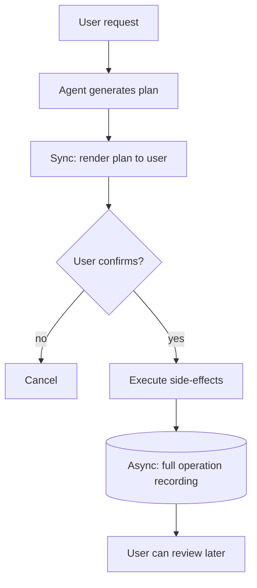

# Synchronous Execution-Plan Confirmation

**Also known as:** Pre-Execution Plan Confirm, Sync Plan + Async Audit

**Category:** Safety & Control  
**Status in practice:** emerging

## Intent

Agent synchronously emits its full execution plan for user confirmation before any side-effect step, and provides asynchronous operation recordings for post-hoc review.

## Context

A user-facing agent (especially in regulated industries like Taiwan finance 2026) takes consequential actions on the user's behalf. Users are uncomfortable with opaque agentic execution; regulators require demonstrable user intent capture.

## Problem

When the agent executes silently and only shows results after the fact, users cannot verify that the agent understood the request correctly until damage is done. Post-hoc transcripts help audit but cannot prevent. Differs from approval-queue by being agent-driven (the agent emits the plan up front) rather than human-driven (the human writes the plan).

## Forces

- Synchronous confirmation adds latency on every consequential request.
- Users may skim the plan and approve without reading.
- Async recordings are necessary for audit but insufficient for prevention.

## Therefore

Therefore: before any side-effect step, the agent emits its complete planned action sequence to the user in human-readable form and waits for explicit confirmation; full operation recordings are persisted asynchronously for review and audit.

## Solution

At the boundary between planning and execution, the agent renders the plan in plain language (or structured form the user can review). User must explicitly confirm (button press, signed message) before execution starts. During and after execution, full operation recordings are persisted to a user-visible log for asynchronous review. Pair with human-in-the-loop, dry-run-harness, decision-log, policy-gated-agent-action.

## Structure

```
User request --> Agent generates plan --sync--> Render plan to user --> User confirms? --no--> Cancel | --yes--> Execute side effects --async--> Full operation recording --> User reviews later
```

## Diagram



## Example scenario

A wealth-management agent receives 'rebalance my portfolio'. Agent emits plan: 'sell 30 shares NVDA, buy 200 shares VOO, transfer $5,000 to bond fund'. User reviews each line, confirms. Execution proceeds. Operation recording (every API call, every state change) is persisted to the user's vault for later review. Regulator audit at year 2 reconstructs the user's confirmation timestamp + the executed actions.

## Consequences

**Benefits**

- User intent captured before any side-effect — reduces 'agent did the wrong thing' incidents.
- Regulatory compliance for sectors requiring documented user authorization.
- Asynchronous recordings support audit, dispute resolution, and trust building.

**Liabilities**

- Latency added on every consequential action.
- User fatigue if confirmation prompts become routine (banner blindness).
- Confirmation step itself becomes attackable (UI spoofing, social engineering).

## Failure modes

- Banner blindness — the plan prompt appears on every action, and users confirm without reading what the agent will do.
- Spoofed confirmation — an attacker fakes the confirm UI or talks the user into approving, and the plan runs as if it were reviewed.
- Plan-execution drift — the agent confirms one plan in plain language but executes steps that differ from it, and only the recording shows the gap.

## What this pattern constrains

No side-effect step executes without explicit user confirmation of the plan; the plan shown to the user must match what executes.

## Applicability

**Use when**

- User-facing agent with consequential actions.
- Regulated industry requiring documented user authorization.
- Plan can be rendered in user-comprehensible form.

**Do not use when**

- Agent runs autonomously without per-action user authorization (e.g. background automation).
- Latency budget cannot absorb synchronous confirmation step.
- Plan cannot be meaningfully rendered for non-expert users.

## Components

- Plan generator — produces human-readable action sequence
- Sync confirmation UI — user reviews and approves before execution
- Executor — only proceeds on confirmation, executes the confirmed plan
- Async recording store — full operation transcript for later review
- Audit reconstruction tool — replays user confirmation + executed actions

## Tools

- Plan renderer — human-readable plan output
- Sync confirmation UI
- Async recording store — operation transcripts

## Evaluation metrics

- Confirmation rate — share of plans users confirm
- Cancel-after-show rate — users who cancel after seeing the plan
- Audit-reconstruction latency — time to surface user confirmation in audit

## Known uses

- **[Vocus (Taiwan): 2026 企業如何導入 AI - finance sector requirement](https://vocus.cc/article/69c4b90efd89780001849d6d)** _available_

## Related patterns

- _specialises_ **Human-in-the-Loop**
- _complements_ **Approval Queue**
- _complements_ **Dry-Run Harness**
- _complements_ **Decision Log**
- _complements_ **Policy-Gated Agent Action (KRITIS)**
- _complements_ **Two Human Touchpoints**

## References

- [2026 企業如何導入 AI？解析 2026 必知的 5 大 模型趨勢](https://vocus.cc/article/69c4b90efd89780001849d6d) — 2026
