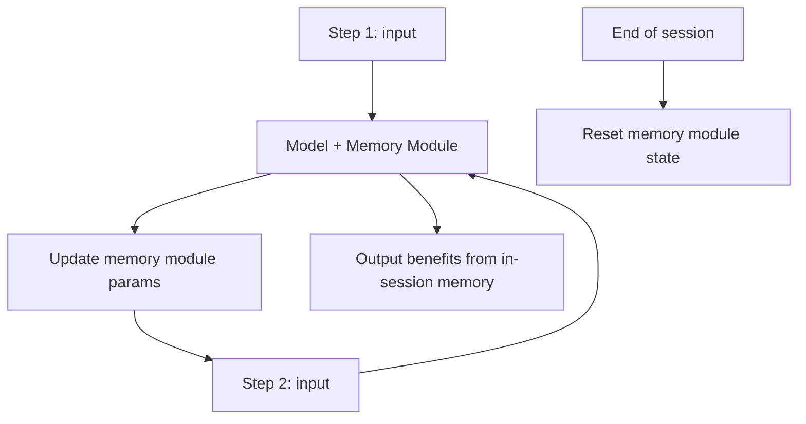

# Test-Time Memorization (Titans)

**Also known as:** Inference-Time Memory, Titans Memory Module

**Category:** Memory  
**Status in practice:** experimental

## Intent

Memory module that learns at inference time by incorporating recent inputs into its parameters during the session rather than relying solely on pre-trained weights.

## Context

A long-running agent task generates new information that should influence later decisions in the same task — but happens after training. Standard models either lose this information at session end (no learning) or require expensive retraining cycles to incorporate it.

## Problem

Pre-trained-only models can't learn within a session. Retraining is too slow and expensive to do per-session. RAG retrieves but doesn't internalize. The agent needs a way to memorize within a session that's faster than retraining but more integrated than retrieval.

## Forces

- Test-time training adds inference-time compute cost.
- Memory module design affects what's memorizable and at what fidelity.
- Concurrency issues — multiple sessions writing to the same module would interfere.

## Therefore

Therefore: add a parametric memory module that updates during inference based on the session's inputs; the agent reads from the module on subsequent steps as if it were part of the model.

## Solution

Behrouz et al. 2024 — Titans architecture. A neural memory module sits alongside the main model; during a session, inputs trigger updates to the module's parameters (gradient steps at inference time). Later steps in the same session benefit from this in-session learning. Module state is per-session and ephemeral. Pair with episodic-memory, agentic-memory, landmark-attention, agent-resumption.

## Structure

```
Session input --> Model + memory module --gradient update at inference--> Module params --> next input benefits; End of session --> reset module (or explicit promotion to LTM)
```

## Diagram



## Example scenario

A research-agent session processes 200 papers over 6 hours. With standard model: early papers' content fades by paper 150. With Titans test-time memorization: each processed paper updates the memory module; by paper 150 the model effectively recalls patterns from paper 5 without RAG retrieval. End-of-session synthesis is dramatically better.

## Consequences

**Benefits**

- Within-session learning without retraining.
- Fidelity higher than retrieval-only approaches.
- Particularly powerful for long tasks where early inputs should shape late decisions.

**Liabilities**

- Test-time training has compute cost per session.
- Module design and update rules are research-level work.
- Per-session ephemeral state must be managed and reset.

## Failure modes

- Cross-session bleed — module state is not reset, and one session's learned inputs shape another user's answers.
- Bad update — an early wrong input changes the module's parameters, and later steps in the session build on it.
- Compute blow-up — gradient steps at every input make long sessions too slow or costly to serve.
- Unpromoted learning — useful in-session knowledge vanishes at session end because no promotion to long-term memory is defined.

## What this pattern constrains

Memory module parameter updates may not persist beyond session end without explicit promotion to LTM; no cross-session bleed of in-session learned state is allowed by default.

## Applicability

**Use when**

- Long single-session tasks where early inputs should shape late decisions.
- Compute budget allows test-time parameter updates.
- Research / experimental setting with model-side flexibility.

**Do not use when**

- Production stability requirements (memory module is experimental).
- Short-session tasks where retrieval suffices.
- No model-side support for test-time training.

## Components

- Neural memory module — parametric, updateable at inference
- Test-time update rule — gradient step per input
- Per-session ephemeral state
- Optional promotion-to-LTM rule

## Tools

- Neural memory module (parametric, updateable at inference)
- Test-time update rule
- Per-session ephemeral state

## Evaluation metrics

- In-session learning lift vs static-model baseline
- Per-session memory-module cost
- Cross-session bleed incidents

## Known uses

- **[Behrouz et al. 2024 — 'Titans: Learning to Memorize at Test Time'](https://arxiv.org/abs/2501.00663)** _available_
- **[Cited in Bornet et al. Agentic Artificial Intelligence references](https://www.worldscientific.com/worldscibooks/10.1142/14380)** _available_

## Related patterns

- _complements_ **Episodic Memory**
- _complements_ **Agentic Memory**
- _complements_ **Landmark Attention**
- _complements_ **Agent Resumption**
- _complements_ **Large Reasoning Model (LRM) Paradigm**

## References

- [Titans: Learning to Memorize at Test Time](https://arxiv.org/abs/2501.00663) — Behrouz et al., 2024
