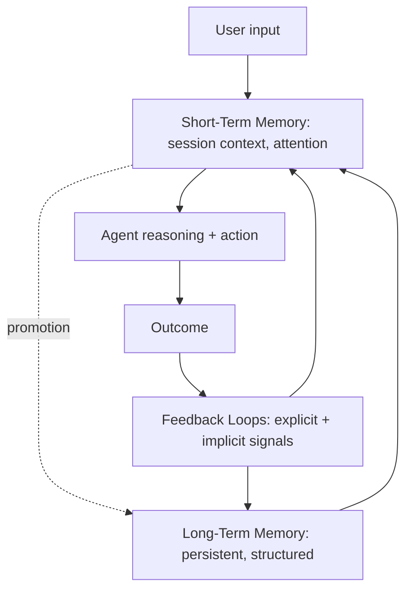

# Three Layers of Agentic AI Memory

**Also known as:** STM+LTM+Feedback Onion, Concentric Memory Architecture

**Category:** Memory  
**Status in practice:** emerging

## Intent

Architect agent memory as three integrated concentric layers — Short-Term Memory (outer), Long-Term Memory (middle), Feedback Loops (core) — operating together as a unit rather than as separable optional components.

## Context

A team building or operating an agent that needs to remember across sessions. The default is to treat short-term context window, long-term retrieval store, and feedback-improvement as three independent concerns. They interact in ways that surface only at scale.

## Problem

Treating the three memory concerns as independent leads to silos: the STM forgets what LTM stored; the LTM never gets refined by feedback; feedback loops don't update either memory cleanly. Bornet's onion model insists they're one architecture, not three add-ons.

## Forces

- Three layers means three components to maintain.
- Each layer uses different storage technology (in-memory cache, vector DB, workflow store).
- Boundary semantics between layers (when does STM promote to LTM?) require explicit design.

## Therefore

Therefore: instantiate all three layers from day one — STM holds immediate session context, LTM persists structured information across sessions, Feedback Loops continuously refine both — and define explicit promotion / refinement boundaries between them.

## Solution

Three coordinated layers. STM: bounded session context, attention mechanisms, token management. LTM: persistent, structured, indexed (typically vector or graph). Feedback Loops: ingest explicit (corrections, ratings) and implicit (engagement, errors) signals to refine both STM and LTM over time. Define promotion rules (when STM content gets written to LTM) and refinement triggers. Pair with short-term-memory, episodic-memory, semantic-memory, procedural-memory, memory-type-storage-specialization, agentic-memory.

## Structure

```
User input --> Short-term memory (session context) --> Agent reasoning + action --> Outcome --> Feedback loops (explicit + implicit signals) --refine--> {Short-term memory, Long-term memory}; Short-term --promotion--> Long-term --load--> Short-term
```

## Diagram



## Example scenario

A customer-service agent at a logistics firm. STM holds the current conversation. LTM persists customer history, past tickets, learned-workflows across sessions. Feedback Loops ingest CSAT scores, agent corrections, ticket-reopen rates and refine both layers — STM gets better at attention to high-priority customers, LTM gets better at classifying past resolutions. Six months in, error rates have dropped 50% per Bornet's case data.

## Consequences

**Benefits**

- Continuity across sessions without losing immediate-context responsiveness.
- Feedback continuously improves both immediate behavior and persistent knowledge.
- Architecturally explicit memory makes failure modes diagnosable per-layer.

**Liabilities**

- Three layers to design, build, and maintain.
- Promotion / refinement rules are non-trivial design work.
- Feedback-loop discipline requires actually wiring user signal back to memory writes.

## Failure modes

- Disconnected feedback — ratings and corrections are collected but never written back, so neither memory layer improves.
- Over-promotion — a loose rule copies most session content into long-term memory, and it fills with noise.
- One-way flow — long-term memory is written but never loaded back into the session, so the agent stores knowledge it does not use.
- Blurred layer blame — a failure is reported as a memory problem without saying which layer caused it.

## What this pattern constrains

All three layers must be present and connected; an agent missing any layer is not considered fully memory-enabled.

## Applicability

**Use when**

- Agent persists across sessions and benefits from learning.
- Engineering team can build and maintain all three layers.
- Feedback signal is collectible.

**Do not use when**

- Stateless single-shot agents.
- No mechanism to collect feedback.
- Team can only build one layer; better to design that one well than build a half-functional three-layer.

## Components

- STM — session-scoped working memory
- LTM — persistent structured memory (episodic + semantic + procedural)
- Feedback Loops — continuous refinement layer
- Promotion rules — STM → LTM
- Refinement triggers — feedback → both layers

## Tools

- STM implementation
- LTM implementation
- Feedback-loop ingestion pipeline

## Evaluation metrics

- Per-layer coverage
- Promotion rate STM to LTM
- Feedback-driven refinement rate

## Known uses

- **[Bornet et al. — Agentic Artificial Intelligence, Chapter 7 (Figure 7.1: Three Layers onion diagram)](https://www.worldscientific.com/worldscibooks/10.1142/14380)** _available_

## Related patterns

- _complements_ **Short-Term Thread Memory**
- _complements_ **Episodic Memory**
- _complements_ **Semantic Memory**
- _complements_ **Procedural Memory**
- _complements_ **Memory-Type Storage Specialization**

## References

- [Agentic Artificial Intelligence — Chapter 7: Memory](https://www.worldscientific.com/worldscibooks/10.1142/14380) — 2025
