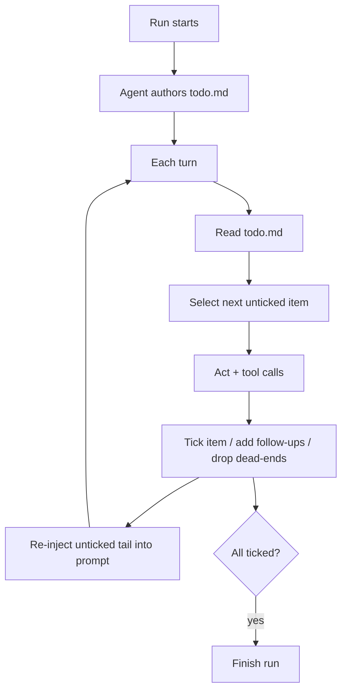

# Todo-List-Driven Autonomous Agent

**Also known as:** todo.md Agent, Persistent Markdown Plan, Externalised Plan File

**Category:** Planning & Control Flow  
**Status in practice:** emerging

## Intent

Have the agent author a plan file (e.g. todo.md) early in the run, tick items as it completes them, and re-inject the remaining plan into context; the file is durable plan and working memory.

## Context

A team runs an agent on a long-horizon autonomous job — a multi-hour coding task, a deep research investigation, a complex data migration — inside a sandboxed virtual machine that gives it persistent file-system access and basic tools (shell, browser, file editor). The run may span hundreds of tool calls, more than any one model context window can comfortably hold. The team needs the agent's plan to survive context truncation and process restarts.

## Problem

If the plan lives only in the model's context window, it drifts toward the middle of the window where attention is weakest and the model loses track of which items it has finished. When the context is truncated to fit, the plan is the first thing to disappear because the model has moved past it. If the run is paused, crashed, or resumed in a fresh context, the agent has no durable record of which sub-tasks are done and starts over or skips items at random. Keeping the plan only in the model's head is incompatible with runs longer than a single window.

## Forces

- Models attend most strongly to the end (and start) of the context window.
- File-system memory is durable; in-context memory is volatile.
- Re-injecting the full plan every turn is repetitive but combats attention drift.
- Markdown is human- and model-readable, supports easy ticking.

## Therefore

Therefore: have the agent author its plan as a checklist file on disk and re-inject the unticked tail into context each turn, so that the plan survives context truncation and pause-resume instead of drifting to the middle of the window.

## Solution

Early in the run, the agent writes its plan as a checklist file (todo.md) in its sandbox. Each turn: read the file, work the next unticked item, update the file (tick the item, add follow-ups, drop dead-ends). Re-inject the unticked tail of the file into the prompt before the model's next turn. The file outlives any single context window. Paired with a sandboxed VM that gives the agent persistent storage and basic tools (browser, shell, file editor).

## Structure

```
Sandbox VM (browser, shell, files) + agent loop: read(todo.md) -> select next item -> act -> update(todo.md) -> repeat.
```

## Diagram



## Example scenario

A long autonomous coding run gets context-truncated halfway through and the agent forgets which sub-tasks are done. The team gives it a `todo.md` it must author early in the run as a checklist; each turn it reads the file, works the next unticked item, updates the file, and re-injects the remaining plan into context. Now a context truncation or a process restart can resume cleanly because durable plan and working memory live on disk, not in the window.

## Consequences

**Benefits**

- Plan survives context truncation and pause/resume.
- Re-injecting unticked items keeps the model focused on what's left.
- Human-readable trail for debugging and review.

**Liabilities**

- Re-injection costs tokens every turn.
- The agent may rewrite the file capriciously; needs guardrails on plan mutations.
- Sandboxed VM cost (one VM per task) is non-trivial.

## Failure modes

- Capricious rewrite — the agent rewrites todo.md mid-run and drops items it found hard, so they are never done.
- Tick without work — an item is marked done before the action is recorded, and a resumed run skips it.
- Re-injection cost — the unticked tail grows long, and re-injecting it every turn eats a large share of the token budget.
- Stale follow-ups — dead-end items are never removed, and the agent keeps returning to work that no longer matters.

## What this pattern constrains

The agent may not advance past an unticked item without recording the action in the plan file; arbitrary in-context-only plans are forbidden.

## Applicability

**Use when**

- A long-horizon autonomous task may span hundreds of tool calls and exceed in-context plans.
- The sandbox provides filesystem access for a durable plan artefact.
- Runs may be paused, truncated, or resumed and need a reload-friendly plan.

**Do not use when**

- Tasks are short and an in-context plan suffices.
- There is no filesystem to write a durable plan file.
- The plan would never be re-injected and the file would just be write-only noise.

## Components

- Sandbox VM — provides persistent file system and basic tools
- Agent-authored todo.md — checklist plan written early in the run
- Read-pick-act-update loop — turn-by-turn cycle over the file
- Re-injector — packs the unticked tail of the plan into each next prompt
- Resume handler — restores state from todo.md after pause, truncation, or restart

## Tools

- Sandboxed VM — durable file system plus shell, browser, and editor
- LLM API — runs the agent each turn over the re-injected unticked tail
- File-editor tool — agent uses it to tick items and add follow-ups
- Browser and shell — execution surface for the actual work

## Evaluation metrics

- Plan survival across truncation — whether todo.md correctly drove resumption
- Re-injection token overhead — tokens spent re-loading the unticked tail per turn
- Plan-mutation discipline — incidents of capricious rewrites unrelated to progress
- Tick-action correspondence — fraction of ticks that match an actual completed action
- End-to-end completion on long-horizon tasks — success rate versus an in-context-only baseline

## Known uses

- **[Manus (Monica.im)](https://manus.im)** _available_ — Plan persisted as todo.md inside a per-task sandbox VM; remaining items re-injected each turn.
- **[OpenManus](https://github.com/FoundationAgents/OpenManus)** _available_ — Open-source replica of Manus's loop.

## Related patterns

- _specialises_ **Scratchpad** — Scratchpad for the plan specifically.
- _alternative-to_ **Spec-First Agent** — Spec-first uses a human-authored spec; this is agent-authored.
- _complements_ **Agent Resumption**
- _uses_ **Context Window Packing**
- _uses_ **Sandbox Isolation**
- _complements_ **Append-Only Thought Stream**
- _complements_ **Affect-Coupled Plan Lifecycle**
- _alternative-to_ **Commitment Tracking**
- _complements_ **Pre-Flight Spec Authoring**
- _alternative-to_ **Standing State Injection** — The todo-list agent re-injects a durable plan file the agent reads and writes; standing-state-injection re-derives the snapshot per turn with no plan file to maintain.

## References

- [From Mind to Machine: The Rise of Manus AI as a Fully Autonomous Digital Agent](https://arxiv.org/abs/2505.02024) — 2025
- [How Manus Uses E2B to Provide Agents With Virtual Computers](https://e2b.dev/blog/how-manus-uses-e2b-to-provide-agents-with-virtual-computers)
